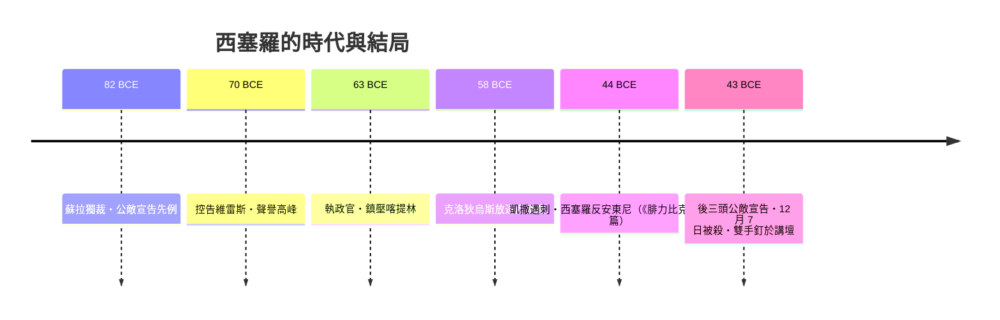

# 第二篇 第二章 第一節：西塞羅與自然法——共和國最強辯士的理論與悲劇結局

> 公元前 43 年 12 月，羅馬東南郊。被proscription（公敵宣告）列入黑名單的馬庫斯·圖利烏斯·西塞羅（Marcus Tullius Cicero, 前 106–前 43）試圖逃亡出海，被安東尼的士兵追上斬首。他最後的反抗是把自己的脖子伸向劍下——而依屋大維與安東尼的命令，他的**雙手被砍下釘在羅馬廣場的講壇上**，因為那雙手寫過太多攻擊獨裁者的演講。

## 一、法律設計者的第一個身分：演說家兼「司法實務者」

西塞羅不是胎在法律系統之外的哲學家。他是羅馬史上最成功的訴訟律師：

- **前 80 年《為羅斯基烏斯辯護》**：年僅 26 歲，敢於對抗權傾一時的前執政官蘇拉的釋奴，一戰成名。
- **前 70 年《控告維雷斯》**：以貪污、敲詐西西里行省的罪名起訴前總督維雷斯（Verres）。維雷斯看到證據鏈後自知必敗，當庭自我流放。此案讓西塞羅成為行省居民心中的「正義代表」，也把「總督行為可被刑事追究」寫入羅馬人的常識。
- **前 63 年任執政官**，粉碎喀提林陰謀（Catiline Conspiracy）——但處決叛亂分子未經審判，成為他一生被人反覆清算的案子（「關於公民的爭議，到底能不能不經審判處死？」——這正是後世憲法學「非常狀態」難題的羅馬原型）。

## 二、理論貢獻：《論共和國》與《論法律》——自然法的經典表述

西塞羅把希臘斯多亞哲學（Stoicism）的宇宙理性論，轉譯成法律人讀得懂的政治神學。他在《論共和國》第三卷寫下自然法（lex naturalis）最著名的定義：

> 「真正的法律是與自然相合的正當理性；它是普遍適用、恆常不變的……在羅馬和在雅典沒有不同，今天與明天沒有不同。」（*true law is right reason in agreement with nature...*）

這個命題的殺傷力在於：**它設立了一個高於任何成文法——包括高於獨裁者命令——的裁判基準**。人定的惡法「不配稱為法律」。這是兩千年後納粹時期拉德布魯赫公式（"惡法非法"）的羅馬祖先（參見第 7 章紐倫堡審判）。

《論法律》則更進一步：把自然法落成一部「理想國憲法草案」，包括宗教的公民化、混合政體、官職輪替——孟德斯鳩與美國建國者都會在兩千年後拾起這些零件。

## 三、前因後果：西塞羅之死與法律話語的轉折

安東尼與屋大維殺他，不只是報復謾罵——西塞羅的演說證明：**一個沒有軍隊的人，可以靠法律話語、程序正當性與公眾輿論跟握有軍團的人對抗**。這對軍事獨裁是制度性威脅。砍下他的雙手示眾，等於承認「語言也是武器」。

## 四、遺產

1. **自然法成為歐洲法學的長期底層協議**：經教父哲學（安波羅修、奧古斯丁）、托馬斯·阿奎那，直達格勞秀斯（第 6 章）與美國《獨立宣言》的「不言自明」。
2. **西塞羅的書信與演說**，成為文藝復興人文主義教育（三藝：文法、修辭、邏輯）的核心教材——**教育系統塑造法律精英**的制度第一次成型。伊拉斯謨、美國建國者（如約翰·亞當斯）都自稱「西塞羅的信徒」。
3. 他示範了法律設計者的一種悲劇原型：**用言語與制度對抗暴力者，最終多死於暴力；但他寫下的文本比劍活得久。**

---

*下一節：羅馬法學家如何在法庭與教室之間，建立起「法學」這門專業——參見 [2.2 烏爾比安與羅馬法學家](02.2-烏爾比安與羅馬法學家.md)*