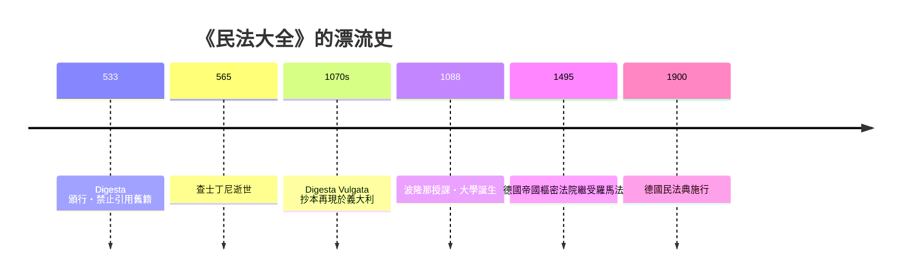

# 第二篇 第二章 第三節：查士丁尼與《民法大全》——十四年的文本搶救工程

> 公元 528–534 年，君士坦丁堡。拜占庭皇帝查士丁尼一世（Justinian I, 約 482–565）任命法學大臣特里波尼安（Tribonian）主持一項瘋狂工程：**把近千年累積的羅馬帝國法令、法學家著作全部整理、刪削、校訂、改寫成一個終版權威文本**。成果即《民法大全》（Corpus Iuris Civilis）：《法典》(Codex)、《學說匯纂》(Digesta)、《法學階梯》(Institutiones)、《新律》(Novellae)。

## 一、前因：一個正在「硬碟碎片化」的法律系統

到 6 世紀，羅馬法已經面臨「資料災難」：

- **三千多條法令**散見於私有《格列哥里安法典》《海爾莫蓋尼安法典》《狄奧多西法典》等私人彙編，版本互有出入。
- **法學家著作數千卷**，抄本錯漏、偽作摻雜。
- 帝國東西部法律習慣不一，行政成本高漲。

查士丁尼的動機是典型的帝國治理：**統一規則＝降低統治成本＋宣示普世皇權**。他甫登基（527 年）即與波斯開戰、鎮壓尼卡暴動（532 年血洗君士坦丁堡競技場），政策上則追求一體化「羅馬和平」2.0。

## 二、工程本身：史無前例的文本手術

| 冊 | 完成年 | 內容與做法 |
|---|---|---|
| 《法典》Codex | 529（修訂 534） | 歷代皇帝敕令的官方選集，重複矛盾者刪除 |
| 《學說匯纂》Digesta | 533 | 摘編自 39 位法學家約兩千卷著作，**壓縮約 95%**；烏爾比安、保羅斯佔最大篇幅 |
| 《法學階梯》Institutiones | 533 | 教科書兼有法律效力，供學生入門 |
| 《新律》Novellae | 歿後彙集 | 查士丁尼晚期希臘語敕令 |

特里波尼安團隊的手術刀非常狠：他們**改寫古典文本**以去除過時內容、統一術語——後世稱插改 Interpolation。這在 19 世紀德國歷史法學派眼中是「對文本的竄改」，但換個角度：這正是**史上第一次大規模的法律系統重構（refactoring）**——把無數個別條目重構成一個會產生出一致輸出的體系。《學說匯纂》共 50 卷、約 15 萬行，某些章節連續引用數十位法學家，堪稱古代最密集的文本工程。

新秩序同時下達**禁止引用令**：以後法庭只准引《大全》，未收入者一律作廢。用今天的話說：主版本發布後，舊分支全部關閉。

## 三、後果一：帝國本身照不住火

諷刺的是，查士丁尼死後拜占庭自身疲於戰事，希臘語世界實用的是《新律》與後來的環保式重編（如 9 世紀《巴希利卡法典》）。**真正讓《大全》起死回生的，是它在意大利于 1070 年代被重新發現**——一份完整的《學說匯纂》抄本（佛羅倫斯抄本）重見天日。

## 四、後果二：大學、法學職業與繼受運動

- **1088 年左右，伊爾內里烏斯（Irnerius）在波隆那以註釋《大全》授徒**——歐洲第一所大學核心即法學院。中世紀歐洲的法律教育自始圍繞這套文本。
- 註釋法學派（Glossators）→ 評註法學派（Commentators / Bartolus 一系）→ 「理性的羅馬法」滲入各國法庭。
- 德意志神聖羅馬帝國 1495 年設帝國樞密法院，正式繼受羅馬法；法國南方成文法地區直接以羅馬法為慣例。
- 19 世紀德國潘德克頓學派以《學說匯纂》（Pandekten 即 Digesta 希臘名）為基建構體系，其成果直接成為德國民法典（第 5 章）藍本，並經日本繼受傳入清末變法與中華民國民法——**今天兩岸、日本、韓國的民法結構，追根溯源就是查士丁尼的工程**（參見 5.3）。

一位 6 世紀皇帝的「文獻清倉」，養活了之後一千四百年的法律教育、法學職業與數億人的民事規則——**制度的「版控」（版本控制）本身就是最持久的統治科技**。

---

*第三篇移師英格蘭：一位國王與他的巡迴法官們如何創造普通法——參見 [3.1 亨利二世的司法改革](03.1-亨利二世的司法改革.md)*