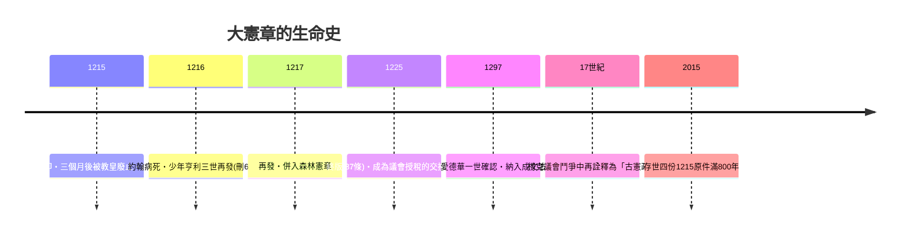

# 第三篇 第三章 第二節：大憲章——1215 年蘭尼米德草坪上的「強制合約」

> 1215 年 6 月 15 日，泰晤士河畔蘭尼米德（Runnymede）。約翰王（King John）在叛逆男爵集團的軍事壓迫下，蓋印認可一份 63 條的《大憲章》（Magna Carta）。三個月後教皇依諾增爵三世便宣布其無效，英格蘭旋即內戰——但這份「失敗的和平條約」卻成為此後八百年憲政話語的母本。

## 一、前因：一場由「戰爭會計」引爆的憲政危機

約翰的失敗是財政與軍事問題，不是哲學問題：

1. **諾曼底失守（1204）**：金字招牌的安茹帝國縮水，男爵失去跨海領地。
2. **猛徵暴斂**：為奪回諾曼底，他徵收「scutage」（代役金）、任意提高封臣繼承金、濫用王室特權（ wardship 監護權變現）、任意扣押寡婦財產。
3. **與教皇翻臉（1206–1214）**：坎特伯雷主教人事糾紛使英格蘭被處以「禁聖令」（Interdict），約翰被迫向教皇稱臣納貢，財政周轉更緊。
4. **布汶戰役慘敗（1214）**：聯軍潰敗，最後一點威信破產。男爵們 1214 年集兵，1215 年佔領倫敦——約翰沒有籌碼了。

## 二、條款解剖：為什麼第 39 條成為人类正當法律程序的祖先

《大憲章》多是具體的封建補償（遺孀的權利、倫敦港自由、蘇格蘭商人免關稅……），但其中數條日後成為世界憲法的基因：

- **第 39 條**：「任何自由人非經其同等身份者依法裁判或依國家法律，不得被逮捕、監禁、剝奪財產、放逐或以任何方式毀損……」——這是**正當法律程序 (due process)** 與人身保護觀念的直系祖先。
- **第 40 條**：「我們不將出售、拒絕或延宕權利與正義。」——司法近用權 (access to justice) 的鼻祖。
- **第 61 條**：男爵選 25 人組成委員會，若國王違約可「攻擊」（distraint）王室——史上最早的**違憲審查救助機制**雛形，雖然只活了幾個月。

## 三、發布之後：四次重發與神話鑄造

關鍵的「二次發明」：1215 原件當天幾乎無人照抄——真正讓大憲章不死的，是**它在 13 世紀被反覆重發、朗讀、並進入教區年曆**，成為「國王也守約」這個理念的載體。當 17 世紀議會派需要「祖傳武器」對抗斯圖亞特王權時，柯克等人把它重新闡釋為英格蘭的「古代憲法」（ancient constitution）——一趟典型的**理念再包裝（reframing）**。

## 四、制度學啟示

1. **權力就是談判籌碼**：大憲章本質是軍事僵局下的「和解書」，證明法律文獻常是政治力平衡的產物，而非理想設計。
2. **先例會自我繁殖**：一旦「徵稅與重大措施須經同意」被寫進 1225 版並綁定議會授稅，議會主權的種子已埋下——通往 1689《權利法案》與美國憲法的路線圖在此定案。
3. **文本的規模效應**：一條短短的拉丁文，被引用八百年，成為難民、囚犯、殖民地上訴狀裡的通用語——制度的韌性來自文本的可複製性。

---

*下一節：1613 年的御前會議室裡，柯克如何當著詹姆士一世的回答「國王本人也要接受裁判」——參見 [3.3 柯克](03.3-柯克.md)*