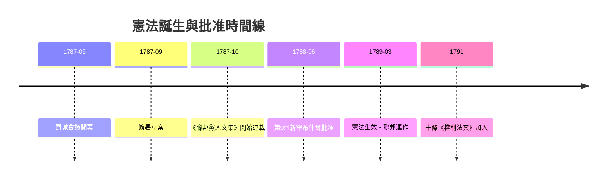

# 第四篇 第四章 第二節：漢密爾頓、麥迪遜與《聯邦黨人文集》——用媒體行銷完成一次憲法攻防

> 1787 年 9 月 17 日，費城。39 名代表在獨立廳簽署新憲法草案。但文本要生效，得經過 13 州中至少 9 個州的批准大會——一場真正的民意攻防戰。兩個紐約人決定用筆參戰：亞歷山大·漢密爾頓（Hamilton, 1755/57–1804）與詹姆斯·麥迪遜（Madison, 1751–1836），加上外交官約翰·傑伊（Jay）三人，以「普布利烏斯（Publius）」之名在報上連載長文。1787 年 10 月至 1788 年 5 月，共 85 篇，即《聯邦黨人文集》（The Federalist Papers）。

## 一、前因：邦聯的破產日記

獨立後的美國不是一個國，是十三個吵架的邦聯成員：

- 大陸會議無徵稅權、無常備軍、無統一商務權——能否償還獨立戰爭債務取決於各州良心（而各州基本不還）。
- 州際貿易壁壘林立，紐約州對新澤西州貨物收關稅。
- 1786–87 年謝斯起義（Shays' Rebellion）：馬薩諸塞負債農民武裝抗稅，邦聯無力平亂，靠州民兵——華盛頓讀信後震驚：「政府像沙造的繩。」

漢密爾頓本人的直起身世（加勒比海尼維斯島私生子、孤兒）、在 King's College（今哥倫比亞大學）受教育、獨立戰爭中成為華盛頓副官，使他堅信：**沒有強有力的中央財政與司法，共和國必亡於內耗或外債**。

## 二、費城會議：祕密憲法實驗室（1787 年 5–9 月）

55 位代表在關閉門窗、禁筆記的會議室吵了 116 天。麥迪遜提前抵達，做足功課（讀遍古今邦聯成敗資料），成為會議的大腦：

| 爭點 | 大州方案（維吉尼亞案） | 小州方案（新澤西案） | 康乃狄格折衷案 |
|---|---|---|---|
| 國會 | 兩院按人口 | 一院每州一票 | 眾院按人口＋參院每州二席 |
| 行政 | 強勢總統 | 委員會 | 單一總統＋選舉人團 |
| 司法 | 國家法院 | 不設 | 聯邦最高法院 |

自 6 月起，麥迪遜已記下他日後要防守的核心：**兩院制、否決權、聯邦權力列舉**。會議結束時他承認「贏得很少、輸掉很多」——但拿到的文本已足以支撐他的打造。

## 三、85 篇論戰：制度設計的自我解說書

《聯邦黨人文集》不是宣傳冊，它逐篇回答反對者（Anti-Federalists，如紐約州長喬治·柯林頓陣營）的炸彈：

- **第 10 篇（麥迪遜）**：解決黨派（faction）之害——切舉大共和：人多派多，任何一派更難一黨獨大；**代議制＋大領土＝派系稀釋器**。
- **第 51 篇（麥迪遜）**：「人性若是天使，就不需要政府」，「**野心必須以野心抵抗**」——分權制衡的心理學地基。
- **第 70 篇（漢密爾頓）**：為「強總統」辯護——行政需能量（energy）與統一（unity）。
- **第 78 篇（漢密爾頓）**：預言並限定「司法審查」——法院是「最不具危險的部門」，且須受制於憲法文本。

## 四、批准戰：紐約的險勝與後遺症

實際戰局：賓州、麻州、維州先後過關（維州 1788 年 6 月 53:52 險勝，麥迪遜險勝反聯邦派 Patrick Henry 主導的大會）；新罕布什爾 1788 年 6 月成為第 9 州，憲法正式生效。紐約州拖到 7 月才以 30:27 表決加入，漢密爾頓一人幾乎憑演說與報章攻勢翻盤——這場多階段的論戰確實是「銷售憲法」的標竿案例。

---

*下一節：那位拒絕簽字的維吉尼亞老紳士如何逼出十條修正案——參見 [4.3 梅森與權利法案](04.3-梅森與權利法案.md)*