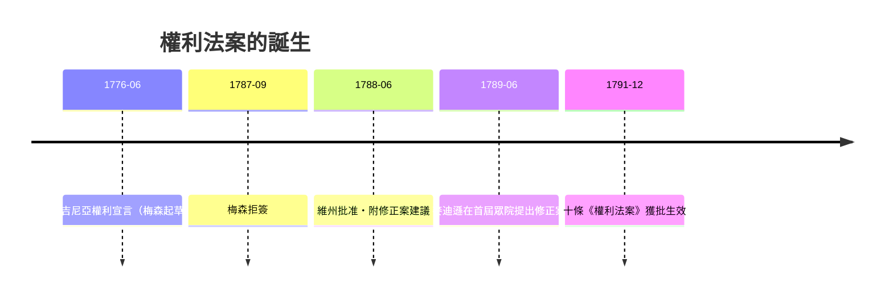

# 第四篇 第四章 第三節：喬治·梅森——拒簽者以「不加權利法案」否決國家憲法

> 1787 年 9 月，費城會議尾聲。維吉尼亞代表喬治·梅森（George Mason, 1725–1792）拒絕在憲法上簽字。他在返回家園的路上告訴朋友：「這個政府沒有權利法案，我絕不生活在它之下。」兩年後，他的頑固成真——十條修正案成為美國憲法的一部分。

## 一、梅森是誰：另一位「設計先行者」

梅森並非外界看來的邊緣怪老頭，他是元老級的設計者：

1. **1776 年起草《維吉尼亞權利宣言》（Virginia Declaration of Rights）**：16 條，開頭即「所有人天生同等自由與獨立，並擁有若干固有權利」。這份文件**早於《獨立宣言》三週**，被傑斐遜大幅化用（生命、自由、追求幸福 ↔ 生命、自由、財產；多數學者認為傑斐遜過度取材而少數為之辯護）。
2. 也因此，他的簽名出現在獨立宣言的字跡被後人讀錯卻被認出——他不缺席革命，只缺席 1787。

## 二、拒簽的三個核心理由

梅森當場提出三點：

| 異議 | 具體不滿 | 後續發展 |
|---|---|---|
| 缺權利法案 | 無言論、宗教、陪審、搜查保護 | → 第一至第八修正案 |
| 參院權力過大 | 兼有條約、人事批准與彈劾法庭之權 | 部分由分權細則緩解 |
| 國會內外商業條款存疑 | 導入稅許可存疑 | 為奴隸州的長期焦慮埋種 |

費城會議曾表決（9:3 以及其他）**不**入權利法案——他們的邏輯很工程師：州憲法已有保障，聯邦層次列舉權利反而給政府「未列舉即干涉」的口實（日後 Ninth Amendment 才補上這個漏洞）。

## 三、批准戰場：梅森與亨利如何操作

回維吉尼亞後，梅森印發《Objections to the Constitution》（本州名為《異議書》），與 Patrick Henry 在批准大會上聯手：**聯邦政府若無明文禁止，未來可能泛權化的「必要與適當條款」會吃掉州權**。這套論證成為全國 Anti-Federalists 通用的框架。

## 四、最諷刺的橋段：梅森打敗了麥迪遜

麥迪遜原本反對修正案（他認為無實質效力、恐拖延批准）。**是梅森的堅持（加上反聯邦派的威脅）逼他轉向**：麥迪遜在國會選區競選（對手正是反聯邦派 James Monroe）時承諾推動修正案，1789 年以議員身分起草 12 條，1791 年 10 條獲准。麥迪遜因推動修正案而在史學上被尊為「**權利法案之父**」——而那頂桂冠，其實是他被梅森「打敗」後才戴上的。

## 五、制度學啟示

1. **權利從「列舉」中被具體化**：大憲章第 39 條 → 維州宣言 → 聯邦修正案，是一條不斷被複用與改寫的代碼。
2. **反對者，是憲法的烘焙裝置**：沒有拒簽者，就沒有修正案。「不簽」本身是一種立法行為。
3. **教育與手腕缺一不可**：梅森和麥迪遜都是 Montpelier／Gunston Hall 私人圖書館餵出來的博學紳士——18 世紀維吉尼亞種植園階層的閱讀網絡，正是憲政設計的孵化器。

---

*第五篇：一位義大利青年如何用一本小冊子廢掉全歐洲的刑訊——參見 [5.1 貝卡里亞](05.1-貝卡里亞.md)*