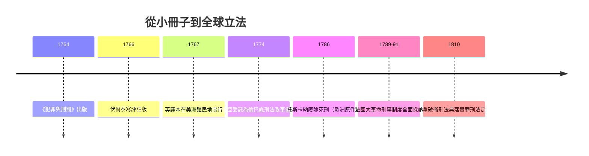

# 第五篇 第五章 第一節：貝卡里亞——26 歲青年用一本小冊子廢掉全歐洲的刑訊

> 1764 年夏，匿名印於里窩那。年僅 26 歲的米蘭青年切薩雷·貝卡里亞（Cesare Beccaria, 1738–1794）——前一年才自帕維亞大學取得學位的修辭學講師——出版一本不到一百頁的小冊子：《犯罪與刑罰》（Dei delitti e delle pene）。家人起初為他擔憂乃至勸他就醫（母親以為他發瘋的軼事廣泛流傳），宗教界也有人指控其「傷風敗俗」。但三年內，書被譯成法文、英文、德文——伏爾泰專門撰寫評註版——全歐洲君主如葉卡捷琳娜二世、腓特烈二世將其納入立法參考。

## 一、前因：18 世紀刑罰制度的恐怖現場

貝卡里亞寫書時的歐洲刑事司法，今天看來是恐怖片：

- **刑訊**是法定程序：嫌犯「拒不招供」可被刑求以取得供述（羅馬-教會法傳統）。
- **死刑**用在篡幣、私鹽運輸、偷盜——1707 年英格蘭法典有 200 多種死刑罪名（Bloody Code）。
- **刑罰無標準**：法官依「身份」裁量，秘密程序、指控文件不公開。
- 財產罪與生命刑等值——普通民眾一次失足就丟命。

托斯卡尼大公 利奧波德（後來的利奧波德二世）在1764閱讀這本書後，率先於 1786 年在托斯卡納廢除 torture 與 死刑——歐洲第一個廢死刑地區——他自稱「貝卡里亞的學生」。

## 二、書的六發子彈

| 論點 | 內容 | 今日旗手 |
|---|---|---|
| 罪刑法定 | 法官不得解釋法律、刑度須明文預告 | 法治國原則・罪刑法定主義 |
| 刑訊不當 | 刑訊得到的是「喊痛的能力」而非真相 | 現代禁止刑求的總綱 |
| 死刑不合理 | 國家無處死個人的原始契約；終身勞役的嚇阻強於短痛 | 廢死運動 |
| 嚇阻不等於嚴苛 | 效果＝嚴重性×確定性，**確定性**重於嚴厲 | 費爾巴哈心理威嚇論 |
| 比例原則 | 刑罰應與犯罪對社會的危害成正比 | 比例原則・罪刑相當 |
| 預防為上 | 改善法律與教育、明白立法，比更重的刑罰更便宜 | 保安處分・犯罪預防 |

他的靈感來源不只有一本書：米蘭「拳擊社」（Società dei Pugni）學人社圈——數學家韋里（Verri）兄弟對書稿給予強力編輯；孟德斯鳩在《論法的精神》第六、十二卷已批判酷刑與宗教迫害（貝卡里亞多處引其論）；盧梭的「社會契約」觀念則被他反過來證成死刑的荒謬——既然沒有人會在締約時同意把處死自己的權力交給國家。

## 三、數學進入法學：啟蒙運動的「理性人」模型

貝卡里亞把犯罪者模型化為**計算快樂與痛苦效用的大腦**——刑罰的定位不是報應，而是「調整犯罪預期報酬的價格」。半世紀後由邊沁的《道德與立法原理導論》(1789) 擴充為功利主義系統；到了 20 世紀，芝加哥學派的貝克（Gary Becker, 1968《犯罪與懲罰的經濟分析》）把這條線量化為犯罪經濟學——2017 年的「預測式執法」甚至就是這個模型的 21 世紀延伸。

## 四、貝卡里亞的現實生活：一個膽小的勝利者

史實令人莞爾：貝卡里亞本人極端膽小、怕演講、怕巴黎的喧囂（1766 年訪法時躲在旅館）。他後半生在米蘭奧地利政府任公職，主要成績是**度量衡與經濟改革**——跟死刑與刑訊幾乎無關。他晚年（1789 在）還因擋下他人廢死刑議案的交辦，立場曖昧。

---

*下一節：一位戰爭機器的總統，為何要把民法典當作他最珍愛的財產——參見 [5.2 拿破崙法典](05.2-拿破崙法典.md)*