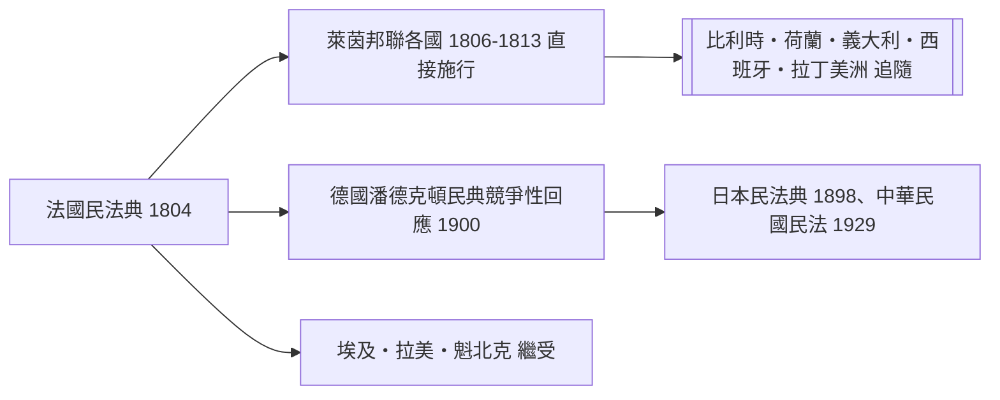

# 第五篇 第五章 第二節：拿破崙與《法國民法典》——「我的真正光榮不是四十場勝仗」

> 1800 年 8 月，第一執政拿破崙·波拿巴（Napoleon Bonaparte, 1769–1821）任命四位起草人——Tronchet、Bigot de Préameneu、Malleville、Portalis——組成法典起草委員會。此後四年，他親自主持 **約 102 場（一说 57 場核心由參政院 Conseil d'État 辯論）**、其中超過一半由他本人名列主席的法案聽證。1804 年 3 月 21 日，《法國民法典》（Code civil des Français）頒布。

## 一、前因：法國法律的碎片化與大革命的清理

1804 年之前的法國，是「一國兩制」極端版：

| 地區 | 法律體系 |
|---|---|
| 南部（成文法 pays de droit écrit） | 羅馬法為基 |
| 北部（習慣法 pays de droit coutumier） | 300 多種地方習慣 |
| 自治城鎮、行會 | 數百種商法特典 |

而封建法、家庭從屬與大革命的衝突在統一市場邊緣卡住——財產登記、契約執行、遺產分配，跨省交易時無規則可循。拿破崙的本能：**打仗需要動員的算法、跨行省的供應鏈需要登記與契約的可預測性**。軍事物流是他最懂的商品。

## 二、法典的三大理論基因與現實質地

1. **所有權絕對（第 544 條）**：「所有權是絕對地以最絕對的方式享用與處分之權」——大革命沒收土地後，新買家要的是肌肉式的物權保障。
2. **契約自由與意思自治（第 1101、1134 條）**：「於當事人間，契約具有法律之效力。」這是商業資本主義的引擎，也是後來「契約即支配」批評的靶標。
3. **法典的抽象自治 & 第 4 條禁止法官「以默然拒訴」**：每位法官必須裁判任何訟案，**不得以法律無規定為由拒絕裁判**——「法無明文」不再是拒審藉口，把法律漏洞轉為法學義務。

但法典同樣封存了時代的保守面：妻子依附丈夫（未婚為從屬於父之未成年人、已婚為從屬於夫之成年姊妹——第 213 條，妻子「應服從其夫」）、私生子與奴隸（海地革命已讓帝國被迫在 1794/1802 反復，1802 年拿破崙一度恢復奴隸制）。劃時代與時代的烙印同時在此。

## 三、拿破崙的真實參與：主編不是掛名

拿破崙並不自己起草條文，但以軍事會議的方式**親自主持許多關鍵辯論**（家庭法、離婚、繼承），自述「我離場時只剩兩件事記得住：家庭與財產」。他也把 1801 年的《政教協定》（天主教為法國主要宗教、教士薪俸由國家支付）納入民法典的宗教專章，使 1804 年法典成為**世俗政權統一家庭與社會秩序的工具**。他晚年著名的自我總結：

> 「我的真正光榮不是四十場勝仗——滑鐵盧會抹去這一切。我的民法典、我的、永遠不會被忘記。」（聖赫倫那島回憶錄）

## 四、傳播：法典成為歐洲與全球的「模板」

法典已經翻成數十種語言，在 50 多個司法管轄区仍是活法——比帝國版圖持久好幾倍。它失敗的地方也是經典教材：**把 19 世紀初的資產階級男性做成的抽象人，強行統治一切邊緣身份**，直到 20 世紀修正案辛苦拆解（法國 1938–1965 年才有妻子獨立行為能力，1970 年代始行使家庭平等）。

---

*下一節：德國法學家如何把民法典寫成抽象大樓、並經日本傳到東亞——參見 [5.3 德國民法典與潘德克頓](05.3-德國民法典.md)*