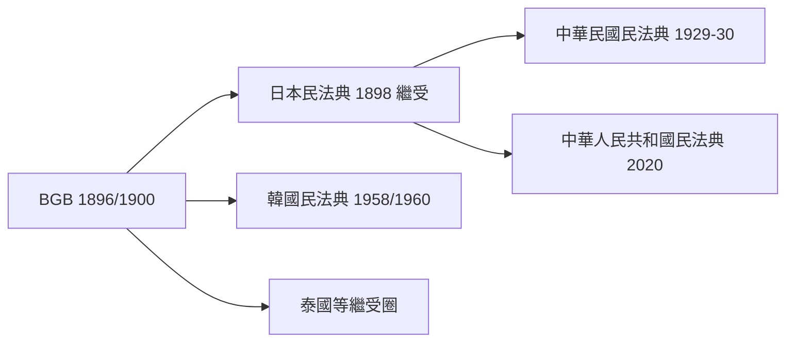

# 第五篇 第五章 第三節：薩維尼與德國民法典——一種抽象到極致的「概念法學」，如何決定東亞民法樣貌

> 1900 年 1 月 1 日，德意志帝國《民法典》（Bürgerliches Gesetzbuch, BGB）施行。這部法律從 1871 年帝國立定資格算起、從馮·薩維尼（Friedrich Carl von Savigny, 1779–1861）的理論算起更早——共花了**一百多年**。它被法國人批評冷峻抽象，被英國普通法律師嘲弄「像工程師的圖紙」，卻成為日本、中華民國、韓國民法典的直系祖先。

## 一、前因：薩維尼的「歷史法學派」革命

1814 年，薩維尼與普魯士改革派法學家 Thibaut 爆發世紀論戰：Thibaut 主張德意志應立即制定一部像法國那樣的統一民法典；薩維尼在《論立法與法學在當代的使命》中回敬：

> 法律不是立法者的創造物，而是民族精神（Volksgeist）的有機成長——**過早法典化會傷害這株植物**。

薩維尼的方法論成為 19 世紀德國法學的主流：**先科學化，後法典化**。他和普赫塔（Puchta）一系把《學說匯纂》（Pandekten）中羅馬法素材重新分解為一組**過邏輯抽象的概念系統**（法律關係 → 權利 → 要件 → 效果），史稱**潘德克頓法學**。耶林（Jhering）在《羅馬法的精神》與《法學的狡辯術與目的》中補上「目的是船長」的目的論轉向；溫徹德（Windscheid）起草草案。

## 二、BGB 本體：抽象體系的工程勝利

BGB 的抽象不是為了難倒讀者，而是**體系工程**的極致：

| 編 | 內容 | 工程意義 |
|---|---|---|
| 總則 Allgemeiner Teil | 權利主體・法律行為・代理・期間 | **抽出共同結構，定義一次、五編共用**（章節重用） |
| 債之關係編 | 契約、侵權、不當得利 | 交易引擎 |
| 物權編 | 所有權、他物權、登記 | 財產操作系統 |
| 家庭／親屬編 | 婚姻、親子、監護 | 社會秩序層 |
| 繼承編 | 遺產、遺囑 | 財富跨代傳輸 |

抽象核心是「**法律行為**（Rechtsgeschäft）」這個發明：把「有意的意思表示＋法律效果」抽成通用接口，不管契約是物權移轉、婚姻締結還是公司成立，皆套用同一組規則。這是「定義減重、代碼重用」在規則系統中的巔峰——模組化到連德國學生都要多讀兩年才能讀懂。

也要誠實地記錄它的偏見：1896 年立法過程中，婦女運動爭取到的結婚與財產自主、繼承公平相當有限（面對大多數男性議員＋保守皇帝）；帝國議會才是 1919 年後修訂的引擎。

## 三、傳播：經日本，落到東亞棋盤

日本明治政府在起草民法典時，一度聘法國學者 Boissonade 起草「舊民法典」（1890），因家族法部分太過法國化而遭「民法典論爭」延宕；轉向德國潘德克頓體系後定稿（1898 施行）——因為維新政府要的是「能讓列強廢除治外法權的文明法典」，而 BGB 的家庭權威結構也與天皇制家庭觀相容。清末修律（沈家本聘日籍顧問）、民國 1929 民法典、乃至 2020 年中國民法典，這條翻譯線幾乎一脈相承。

## 四、產業鏈啟示

- **理論研發 → 立法工程 → 外銷（繼受）——形同今天的標準化（IP）邏輯**：薩維尼奠定「學術硬核」，BGB 是產品，「繼受」即技術轉移。
- 抽象使 BGB 更具**延展性**：20 世紀的格式契約、消費者保護、債法現代化（2001/02 年 Schuldrechtsmodernisierung）都在其框架內迭代；概念分層的設計比法國法典更易修補。
- 它同時證明一件事：**最抽象的規則系統，可能是最長命的規則系統。**

---

*第六篇：越獄的書箱、一場小委任狀案如何創造出違憲審查權——參見 [6.1 格勞秀斯](06.1-格勞秀斯.md)*