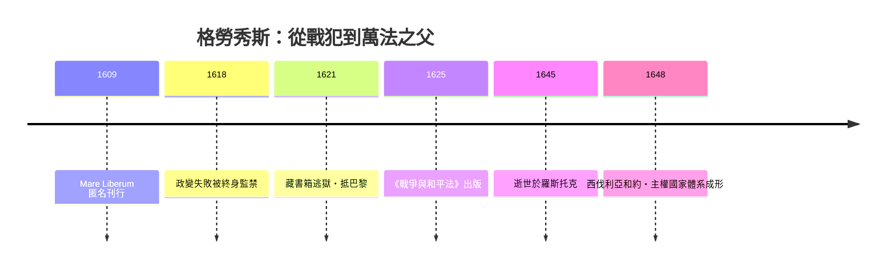

# 第六篇 第六章 第一節：格勞秀斯——藏進書箱逃獄、並發明公海自由的學霸

> 1621 年 3 月，荷蘭洛維斯坦（Loevestein）城堡。因宗教與政治鬥爭被終身監禁的烏戈·格勞秀斯（Hugo Grotius, 1583–1645）在妻子瑪麗亞的協助下，**把自己裝進一個裝滿書籍（一說裝滿亞麻床單與書箱）的大木箱**，由守衛抬出城堡「還書」。船至安特衛普，他先脫離再赴巴黎。這場越獄的細節被妻子寫信描述給孩子（1621 年 3 月 22 日信）而傳世。

## 一、前因：荷蘭內戰與「捕獲法」的商業動機

格勞秀斯的兩大行動都源自**為荷蘭東印度公司（VOC）辯護**：

- 1603 年葡萄牙船「聖凱瑟琳號」在新加坡海峽被荷蘭人奪取，VOC 需要法律論證奪船正當。格勞秀斯受託寫出《論捕獲法》（De Jure Praedae，未刊行；**其中第 12 章「論海洋自由」於 1609 年匿名刊行**，即 Mare Liberum）。
- 當時西班牙與葡萄牙主張整個海域與新大陸的排他權（教皇亞歷山大六世 1493 的分界線、瓦斯科努們的「無主之地」理論）。格勞秀斯引羅馬法、早期教會作家與自然法：**海洋是不能被占有的東西，正如空氣**。這是「公海自由」的憲章——至今仍寫進《海洋法公約》。
- 葡萄牙方的辯護者（如英國 John Selden）則以《Mare Clausum》（封海論，《海洋關閉論》）回應——英荷海權之争的法律面。

## 二、從內政犧牲者到國際法之父

1618 年，荷蘭共和國的宗教政治衝突（正統加爾文派 vs 宣和派）引爆：奧登巴恩維爾特（Oldenbarnevelt）派被織黨鬥倒，格拉夫秀斯與其司法政治盟友入獄、盟友被斬首。逃獄後他在巴黎居留十年，1623 年起由法國路易十三供給年金。

1625 年，巴黎出版 **《戰爭與和平法》（De Jure Belli ac Pacis）**——三卷、近千頁。核心命題：

> 「即使上帝不存在（一說：即使我們不談上帝），自然法依然有效。」（*etsi daremus non esse Deum*）

法律不依賴神啟而立於人性與理性本身——這句話把西塞羅的自然法世俗化，完成了現代國際法的地基。書中系統化：

1. **正義戰爭（ius ad bellum）與戰時法（ius in bello）**分立：何時可開戰、開戰後哪些行為仍被禁止（如對非戰鬥員）。
2. **條約必須遵守（pacta sunt servanda）**成為國際秩序的第一公理。
3. 主權國家彼此點狀平等：沒有超國家裁判者，但法律義務仍存在——「法的烏托邦」。

## 三、駭人指向的「戰爭化為法律」

三十年戰爭打到第 7 年（玻西米亞戰事、丹麥參戰、德意志末日式屠殺），《戰爭與和平法》的意義在於：**在無世界政府的前提下，用一個共同文法定義「可辯論的訴求」**。日後：

| 後續影響 | 案例 |
|---|---|
| 和約談判引用其術語 | 1648 西伐利亞和約的學界辯論 |
| 國際仲裁法庭引用 | 19 世紀阿拉巴馬號仲裁 |
| 現代機構遙拜 | 海牙國際法庭正廳懸掛其像；紐倫堡檢察官引用其戰爭罪論（見 7.3） |

## 四、晚年：外交官與漂流者

1634 年他出任瑞典女王克里斯蒂娜駐巴黎大使（他青年時期也是出色的拉丁詩人與希臘文學者）。1645 年病逝於返程途中的羅斯托克，葬於代爾夫特新教堂。生前因捲入瑞典-荷蘭政治被本國部分人士視為可疑人物，死後卻被代代追認為「國際法與自然法之父」——不可辯駁的學術遺產始終存在：他關於《聖經》與教義的註釋在其宗教時代也已成為一定基準。

---

*下一節：一位密西西比大法官如何用一紙駁回創造違憲審查——參見 [6.2 馬伯利訴麥迪遜](06.2-馬伯利訴麥迪遜.md)*