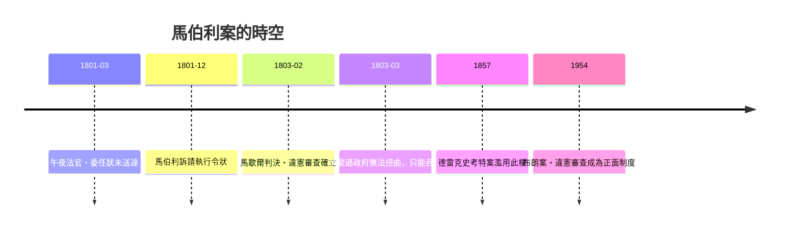

# 第六篇 第六章 第二節：馬歇爾與「馬伯利訴麥迪遜」——一場看似妥協的駁回，偷渡出違憲審查權

> 1803 年 2 月 24 日，美國最高法院首席大法官約翰·馬歇爾（John Marshall, 1755–1835）宣讀「馬伯利訴麥迪遜（Marbury v. Madison, 5 U.S. 137）」判決。表面上他駁回了原告：你要求的命令狀，本法院無權核發。但他在駁回過程中，**同時宣告了一條從未被明文寫進憲法的權力：聯邦法院可以審查國會立法是否違憲，並宣告其無效**。

## 一、前因：1800 年總統大選的「政權交接黑客案件」

1800 年大選，聯邦黨的亞當斯輸給民主共和黨的傑斐遜。1801 年 3 月 3 日離任前夜，亞當斯政府趕工任命了一批法官與治安法官（史稱「**午夜法官** Midnight Judges / Midnight appointments」）：3 月 2 日深夜任命名單、3 月 3 日由亞當斯簽名，3 月 4 日交接前的國務卿——**就是馬歇爾本人**（他同時兼任國務卿與首席大法官）——來不及送達所有委任狀。

威廉·馬伯利等幾位哥倫比亞特區治安法官的委任狀留在了辦公室桌上。新國務卿麥迪遜（傑斐遜指使）扣住不發。馬伯利直接向最高法院申請「執行令狀（writ of mandamus）」，依 1789 年《司法條例》第 13 條，最高法院對此類申請享有「原審管轄權」。

## 二、馬歇爾的三段論：一個政治上的完美拆解

| 步驟 | 內容 | 對誰有利 |
|---|---|---|
| 1. 馬伯利有權取得委任狀 | 委任一經簽署蓋印即生效，扣件是「違反既得權利」 | 反傑斐遜政府 |
| 2. 有權利就有救濟 | 政府不是「行為免訴」的 | 聽起來更激進 |
| 3. **但本法院不能核發** | 《司法條例》第 13 條擴張最高法院原審管轄，**超出憲法第 3 條所列範圍**，故違憲無效 | 面上認輸 |

當傑斐遜政府期待法院退讓時，馬歇爾以第三步**同時**：
1. 躲開了「判政府敗訴卻無法執行」的權威災難；
2. 沒有給總統寫一張無法兌現的命令狀；
3. 卻**在判決書中為法院爭得史上最大的一筆制度資產：宣告法律違憲的權力**。

這是「程序設計遇上政治博弈」的最佳教材：讓步的形式，換來實質的權力擴張。

## 三、判決書的三個關鍵論證

- 憲法是「最高法」：**明文以書面建立三權分立者，不可能意在讓立法者任意突破的疆界**。「法律與憲法牴觸者無效；確定何者為準，屬於司法部門之本分。」（*It is emphatically the province and duty of the judicial department to say what the law is.*）
- 法官就職時需宣誓「忠於憲法」——不審查違憲法規，等於背棄宣誓。
- 法院無「憲法軍隊」可執行判決，但**其他權力來源同樣有限**——制度弱點反而成為正當性的來源。

## 四、權力要「低調使用」：馬伯利案在 19 世紀只被動用過兩次違憲宣告

其策略性甚至表現在：本世紀其餘時間，最高法院對聯邦立法的違憲宣告幾乎只用於 Dred Scott (1857)（污點判決）。真正發力是在 1930s 之後（新政時期）。違憲審查是**長期持有但不可濫用的核子武器**——馬歇爾本人一生再沒有把該武器於聯邦層級正式開火第二次。

---

*下一節：馬歇爾的三十五年任期如何把聯邦打造成「憲政最高仲裁者」——參見 [6.3 馬歇爾的聯邦帝國](06.3-馬歇爾的聯邦帝國.md)*