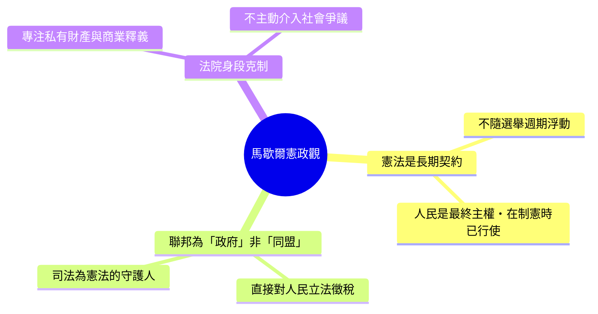

# 第六篇 第六章 第三節：馬歇爾的聯邦帝國——三個世紀判例把最高法院放上憲法仲裁台

> 約翰·馬歇爾在 1801–1835 年間擔任美國最高法院首席大法官 34 年，主持超過 1,100 件判決、約一半由他親筆起草。他也刻意維持「法院統一聲音」——任期內異議意見罕見（早期只有 8 件），塑造出一個彷彿「憲法就在馬歇爾嘴裡」的聽覺印象。

## 一、前因：一個還在打架的年輕共和國

1801 年的聯邦，其實是三個懷疑論者的集合體：

- **州權派**認定憲法只是邦聯 2.0 的契約，各州有權「平等宣告」聯邦法無效（1798 年 Kentucky & Virginia Resolutions 的理論）。
- **聯邦黨人**主張強中央，敗選後退守司法陣地。
- **民粹民主**的傑斐遜在任內仍不敢公開挑戰高院。

馬歇爾的任務，是在信實鬆散的 13 州聯邦中，為中央司法權打造制度肌肉。

## 二、三大判例協奏曲

### McCulloch v. Maryland（1819）

國會依照「必要與適當條款」成立第二合眾國銀行是否逾權？馬里蘭州對其分行課州稅是否合法？馬歇爾雙殺：

> 「讓目的合法、手段合宜、不與憲法字面禁止牴觸者……即是合憲的。」（*implied powers* 畫龍點睛）

州不得對聯邦機構課稅——「**摧毀之權涵蓋創設之權；反過來說並不成立**（the power to tax involves the power to destroy）」。這是**聯邦至上主義的制度性包廂**，從此州政府無法用稅務工具「合法絞殺」聯邦機構。

### Gibbons v. Ogden（1824）

紐約州授予的汽船壟斷 vs 聯邦航行執照。馬歇爾把憲法「州際通商條款」（commerce clause）的「通商」擴為**一切往來交換，不限買賣**，並確認聯邦立法在明文領域「最高」（preemption）。之後近百年，聯邦動用此條管理鐵路、電報、反壟斷（1890 Sherman Act、1930s 新政）都有此判例為骨架。

### Cohens v. Virginia（1821）

馬歇爾親自出庭辯護（原為被告律師），法院確認**自身可審理州法院之上訴（含州刑事案）**，完成司法國家所有權的閉環。

## 三、權力設計的底層邏輯：不要跟人民走得太快

馬歇爾的政治哲學在判決中一以貫之：

## 四、批評與終局

傑斐遜視其判決為「以法律為名的政變」。1833 年 Cherokee Nation、Worcester v. Georgia 等案中法院支持切羅基民族權利，安德魯·傑克遜總統（傳言）答「馬歇爾已作裁決，讓他自己去執行吧」——暴露司法權的執行赤字。1835 年馬歇爾逝世——他任內留下的整套判例群，其憲政骨架至今仍未被本質修改。

換一套演算法語言：**馬歇爾把「法院」從被動裁判引擎，升級為憲法意義的常駐直譯器**。每個判決都在為後世累積語義緩存——普通法傳統第一次以大陸規模被「制度化」。

---

*第七篇：全體同僚贊成種族隔離的一場判決中，一位孤狼大法官寫下改變 20 世紀的異議——參見 [7.1 哈倫的異議書](07.1-哈倫的異議書.md)*