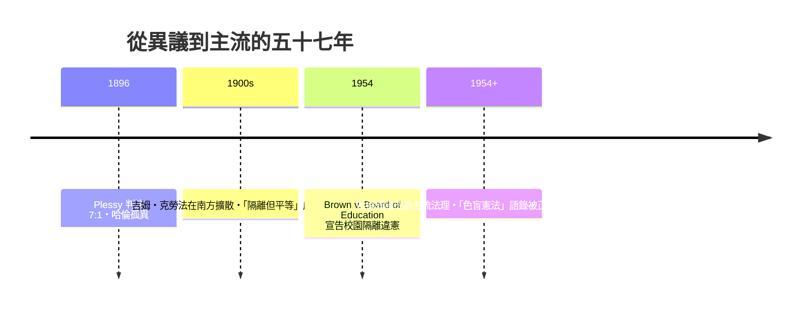

# 第七篇 第七章 第一節：哈倫——在種族隔離判決中寫下「憲法對膚色盲目」的孤狼

> 1896 年 5 月 18 日，美國最高法院以 7:1 裁決「普萊西訴弗格森案（Plessy v. Ferguson, 163 U.S. 537）」：路易斯安那州「黑人與白人必須乘坐不同車廂」的法律**合憲**，前提是設施「隔離但平等」（separate but equal）。正義的唯一異議者，是肯塔基州前奴隸主家庭出身、以聯邦黨人式保守主義自居的大法官約翰·馬歇爾·哈倫（John Marshall Harlan, 1833–1911）。

## 一、前因：普萊西本人其實是「被設計的原告」

這個案件本身就是 19 世紀末的「策略性訴訟」工程：

- 1892 年，紐奧良「平等保護公民委員會」（Comité des Citoyens，克里奧爾商人與知識份子組織）**僱請**淺膚色的荷馬·普萊西（Octoroon，八分之一黑人血統）故意闖入白人車廂被捕，全程有人拍照。
- 該組織串連律師 Albion Tourgée（北方廢奴派作家），把案件一路打到最高法院。訴訟策略：用「猜不出血統」的客觀荒謬性來質疑種族分類。
- Tourgée 在法律簡報中已提出「白人標籤是種財產利益」的私密論證，並預演「法律面前的色盲」理論。

但 1880 年代的高法院正處在「重建退潮」期：1877 年的「1877 年妥協」結束聯邦對南方的干預、吉姆·克勞法遍地開花，大法官多為政治交易的產物。判決走向被結構決定。

## 二、多數意見 vs 哈倫異議

| | 多數意見（布朗主筆，Justice Henry Billings Brown） | 哈倫異議 |
|---|---|---|
| 種族區分 | 屬州內政，由立法者裁量 | 法律分類必須有**實質公共目的**，不能以種族為據 |
| 「隔離但平等」 | 是合理治安考量，非污辱 | 隔離即是烙印，本質是有色人種標籤 |
| 未來 | 各州自決 | 「**我們的憲法對膚色是盲目的（Our Constitution is color-blind），既不承認也不容忍公民階級之分**」 |

哈倫的滑坡預言清晰可辨：「今日可以要求黑人乘坐隔離車廂，明日即可對波蘭裔、猶太裔或天主教徒設置隔離。」——這份異議當時被輿論忽視，但**58 年後成為布朗案的正式法理**（Brown v. Board of Education, 1954 宣告「隔離但平等」違憲）。

## 三、為什麼「異議意見」是法律設計者的隱藏武器

判決書系統有一個不顯眼但致命的發明：法官可以**公開寫下不同意見**並存檔。哈倫異議的功能：

1. **異議是給未來判決的代碼提交**——它當下沒有被合併（merge），未來的法官卻可以檢出（checkout）分支重新組裝。
2. **異議提供輿論武器**：1954 年 Brown 案直接吸收其法理；2007 年 Parents Involved 案中，首席大法官羅伯茲的判決開頭便引用哈倫名句（儘管對其含義有截然相反的詮釋，這正是異議文本的開放性）。
3. **它保護司法的內在多元性**——大法官的一票雖然輸了，其論點在任何未來政治窗口都有被復活（reproduction）的機會。

這也是為什麼法律史常說：「**多數判決不留神就會被異議埋葬**。」

## 四、哈倫自己是誰：一個矛盾體成的典範

哈倫的人生本身就是19世紀的矛盾融合體：

- 生於肯塔基奴隸主之家，其名下的奴隸到 1863 年才依政治時局獲得解放。
- 南北戰爭期間是聯邦陸軍上校——他本人起初並不熱衷廢奴。
- 戰後作律師代表鐵路與大企業，被對手譏為「企業法官」；但在 1880-90 年代的諸多涉及反壟斷與個人權利的案件中，立場相當接近改革派（見 7.2 布蘭戴斯議題的時代脈絡）。
- 他主張黑人公民的權利屬於「**憲法的意旨與人民的既定確認**」——以美國古典憲政語言為社會平等做論證。

這個姿態蘊含一個耐人尋味的定理：**社會平權的法律首先由「制度內的少數派」保存——制度先讓少數人把論證寫成文本，再等待政治窗口發芽。**

---

*下一節：一位律師如何在自家書房發明「隱私權」，並教會美國把壟斷公司拆碎——參見 [7.2 布蘭戴斯](07.2-布蘭戴斯與隱私權.md)*