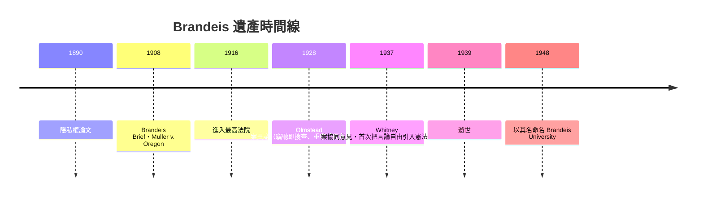

# 第七篇 第七章 第二節：布蘭戴斯——「隱私權」的發明者與拆解資本怪獸的法官

> 1890 年 12 月，《哈佛法律評論》第 4 卷第 5 期刊出一篇論文：〈隱私權（The Right to Privacy）〉，署名 Samuel D. Warren 與 Louis D. Brandeis。它宣稱法律應保護一種全新的權利——「**獨處之權（the right to be let alone）**」。此後一個多世紀的法學界公認：**這篇文章是現代隱私法的源頭**。

## 一、前因：波士頓上流社會的快門與電報

合著者 Warren 名下的家族社交生活遭到波士頓小報的持續追蹤騷擾（連其家族聚會也被渲染報導），兩位哈佛法學院同窗研判的直覺是：**新科技（帶快門的即時攝影、大發行量報紙、電話、電報）使「私人空間」出現了前所未有的被侵犯形態**。這是 19 世紀媒體資本的第一次衝擊，其本質是：**科技改變社會需求，法律必須配套**——同一邏輯在 2018 年的 GDPR 再次上演。

Brandeis 的論證結構極精巧：

1. **提煉的「權利核心」**：指出英美法中人身安全、著作權、住宅不受侵入等規則背後，共同隱藏著一種未命名的保護對象。
2. **類比推演**：從誹謗、著作權、家宅侵入中提煉「法律保護的重心逐漸從財產移至**人格（personality）**」。
3. **預留規則**：公開性可被本人授權、公共人士適用例外・即今日「公共利益例外」之祖。
4. **警告科技演化中的困局**：「無形的機器（instantaneous photographs）」正是他舉的例子——與今天的人聲紋、演算法完全相同。

## 二、「Brandeis Brief」：把社會科學帶入法庭

1908 年 Muller v. Oregon（限制女性工時案）中，Brandeis 以律師身分提交史上第一份**由 100 多頁社會調查報告組成**的法庭資料：多數內容是工業衛生研究、教會統計、縣社會個體報告，**僅兩頁法律論證**。這一招被命名為 **Brandeis Brief**，至今已成為美國憲法訴訟的標準配，也是「社會科學證據（social facts）」進入法院的第一范式。

它迅速改變了法官的角色——從羽毛筆道德講道者，變成**閱讀資料、權衡社會效益的工程師**。

## 三、拆解「大到不能倒」的資本怪獸：發明「事實調查的反壟斷」

1912–16 年 Brandeis 以民間顧問身分活躍於華府：

- 1912 年大選中，他支持威爾遜的「新自由（New Freedom）」綱領，明確主張**拆分壟斷**而非「管理壟斷」。
- 他為 1914 年《克萊頓反托拉斯法》（Clayton Act）與《聯邦貿易委員會法》（FTC Act）提供實質智識支持，並協助把「不公平競爭」寫成可執行的法定概念。
- 他留下著名診斷：問題的根源不在資本規模大，而在 **「別人的錢」（Other People's Money, 1914 演講與文集標題）**——用他人儲蓄冒險的金融結構必然傾向投機。2008 年金融危機後的監管討論至今仍在引用這個框架。

## 四、1916 進入最高法院：美國史上最激烈的提名戰

威爾遜提名 Brandeis 入最高法院（1916 年 1 月），遭多位企業律師、大律所前合夥人與部分媒體公開反對長達四個月，參院聽證歷史上前所未見；反對者攻擊他是「激進改革者、平民律師、猶太人」。1916 年 6 月參院以 47:22 批准——**美國最高法院第一位猶太裔大法官**就此就任，並以．邏輯嚴密、行事極簡（他不收禮、不住華府的酒店、夏天露營）聞名。

Olmstead 異議（1928）——竊聽電話是否構成憲法第四修正案的「搜查」——在他筆下被定義為「 Government 不能逾越人民的合理期待」。1967 年 Katz v. United States，多數意見宣告「第四修正案保護的是**人，不是場所**（people, not places）」，布蘭戴斯的立場被正名為主法。手機定位、雲端儲存、AI 臉部識別的個資規則，今天全部立於這根柱子上；GDPR 的「資料主體尊嚴」邏輯（見 9.3）與它同源。

---

*下一節：從美國最高法院請假一年，把檢察台搬進紐倫堡法庭——參見 [7.3 傑克遜與紐倫堡](07.3-傑克遜與紐倫堡.md)*