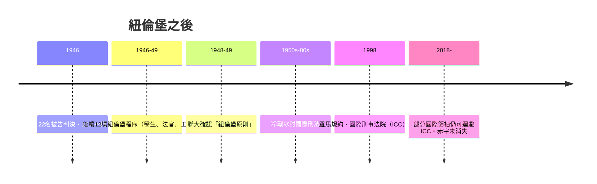

# 第七篇 第七章 第三節：傑克遜在紐倫堡——「我們永遠不會成功消滅戰爭，除非使戰爭成為非法」

> 1945 年 8 月，倫敦。美國最高法院大法官羅伯特·H·傑克遜（Robert H. Jackson, 1892–1954）向我自己的法院**請假一年**，出任美國國際軍事法庭首席檢察官，並促成四國（美蘇英法）簽訂《倫敦憲章（London Charter）》——為納粹戰犯建立起史上第一座「國際刑事法庭」的規則手冊。

## 一、前因：為什麼不是「就槍斃」

1945 年初，同盟國領袖的起初直覺分歧：

| 陣營 | 立場 |
|---|---|
| 英國邱吉爾（早期）、蘇聯史達林 | 直接槍決納粹領導人 |
| 美國戰爭部長 Henry Stimson | **公正程序審判**——用審判本身證明法治 |
| 美國財政部長 Morgenthau | 「摩根索計畫」：剝除德國工業＝集體懲罰 |

傑克遜憑其曾任司法部長（Attorney General, 1940–41）與最高法院大法官（1941 年起）的資歷聲望，**把「審判」變成戰後秩序的核心設計**。1945 年 4–6 月他主持倫敦四國談判；他拒絕蘇聯式「形式審判、事先定罪」的提議，也抗拒復仇式直接處決，最終確立：**被告有辯護律師、經過交叉詰問、全程公開記錄**——在廢墟上從零建立一套可運作的刑事程序。

## 二、開庭陳詞名段

1945 年 11 月 21 日首日陳詞中，傑克遜說出日後被記錄於全球國際刑法教科書的段落：

> 「那是歷史上第一次，四個大國容許自己的敵人到法庭上，公開而且公正，提出任何有利於自己的辯護——以事實、法律與證據決定其命運。」
>
> 「**被審的是受傷的文明**——法庭審判犯人，但真正受審的是暴政本身。」
>
> （他在與羅斯福的往來亦說過核心目標：「**使戰爭本身也可能被定罪**；不懲罰倡議戰爭者，就無法阻止下一次戰爭。」

《倫敦憲章》確立的三大新罪名：

1. **反和平罪（crimes against peace）**：策動侵略戰爭（最富爭議——正面挑戰「主權開戰自由」）
2. **戰爭罪（war crimes）**：違反戰爭法規之暴行
3. **反人類罪（crimes against humanity）**：對平民人口的大規模迫害——不論有無戰爭狀態

並首次確立兩條貫穿至今的原則：**個人**須為以國家名義所犯之罪負責（國家身分不是 shield）、**服從上級命令不是免責理由**（「我只是執行命令」被正式駁回，但可作為減刑事由）。

## 三、法庭工程的挑戰

傑克遜的設計與執行本身就是一堂制度工程的課：

- **多國程序的兼容性**：英美「對抗式」審理對上蘇法「檢察主導」傳統——折衷為「證據進用相對寬鬆＋辯護權強制保障」。
- **證據規模史無前例**：指控主要依賴德國自己的官方文件（納粹自己記錄了罪行），上千萬頁文書成為「被告陣營自我舉證」的證據庫。
- **辯護制度**：22 名被告每人均由法庭指定德國律師辯護，辯方可以充分盤問證人——程序公平性起初被許多盟國軍方質疑為「太仁慈」，事後卻被公認為整個審判正當性的支柱。
- **執行權赤字**：法庭本身是戰勝國手造產物（批評至今稱「勝利者之正義 victor's justice」），但其程序性公正是史無前例的第一步。

## 四、遺產：紐倫堡原則至今仍在

傑克遜回美國最高法院後又服務十年，並在 1952 年 Youngstown 案的協同意見中留下美國憲法史上最常被引用的段落之一：

> 「《權利法案》的目的，正是要把某些議題**從政治變動的偶然性中抽離**，交由法院作為法律原則長期適用。」

——從紐倫堡回到法院，他證明同一組法律設計工具，既可用來審戰犯，也可用來限制總統。

---

*第八篇：從憲法法院的發明人到無知之幕的思想實驗——參見 [8.1 凱爾森](08.1-凱爾森.md)*