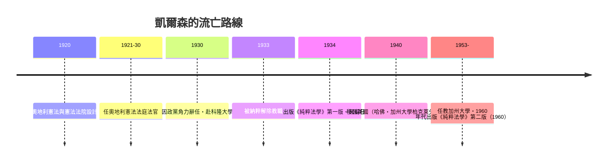

# 第八篇 第八章 第一節：漢斯·凱爾森——「純粹法學」與憲法法院的發明人

> 1920 年，維也納。年僅 39 歲的漢斯·凱爾森（Hans Kelsen, 1881–1973）以憲法學者身分參與起草 1920 年《奧地利聯邦憲法》（Bundes-Verfassungsgesetz, 1920）——其中創設了**世界第一部專門審查立法違憲、由法官集中把關的憲法法院**。此後一百年，這種「憲法法庭」模式成為戰後德國、義大利、西班牙、土耳其、韓國、台灣等共通的制度原型。

## 一、前因：哈布斯堡的多元國家與法律階層化的需要

奧匈帝國由十幾個民族、多種議會與方言法律共存，行政-立法衝突每天上演：法庭如何裁斷兩層規範衝突？帝國末期的奧地利議會政治癱瘓，法律人痛感需要一個**獨立於日常政治的裁斷機制**。凱爾森的答案是雙重的：

1. **理論**：把法律描述為一個**由上而下的階層體系（hierarchy of norms）**——下位規範源自上位規範的授權，層層而上追溯到「基本規範」（Grundnorm，不證自明的應然假定）。
2. **制度**：既然規範有階層，就必須設一個**守門員**檢查下位規範是否準確執行上位規範——由一位「消極立法者」（negativer Gesetzgeber）撤銷違憲法律，但不代立法者立法。

這是「先建數據模型，再建校驗服務」的經典軟體思維：**我們判的是規範與規範之間的位置關係，不是道德善惡**。

## 二、「純粹法學」（Reine Rechtslehre）的清單

凱爾森 1934 年出版《純粹法學》，其方法論主張相當激進：

- **去自然化**：把自然法、神學、心理學、社會學的方法全部逐出法學——法學只研究「規範之間的授權關係」。
- **去心理化**：「效力的問題」與「心理中的服從」是兩回事——只要立法者照程序立了法，它就有效（即使被服從度極低）。
- **法官相對消極**：「**法官是在法律的邊框裡進行部份立法**」——他把司法定位為規範體系的「局部動態補白機」。
- **結局的冷靜**：法律的效力框架並不能決定正義方向——能產生一個公正制度也能產生一個不公正制度，法學不幫你回答善惡。

## 三、職業路線的戲劇轉折

他親手設計的制度，要到**二戰的人權震盪**之後才全面開花：既然要讓「權利可起訴」，就要有專業法庭接案。1951 年德國聯邦憲法法院正式運作，其組織結構明顯沿襲凱爾森模型；義大利（1955）、西班牙（1978）接續跟進。

## 四、建設性經典：為什麼「集中審查」勝過「普通法院分散審查」

奧地利-德國式（凱爾森模型）與美國式（馬歇爾模型 6.2）的分權審查路線死留百年：

| 面向 | 凱爾森模型（集中審查） | 美國模型（分散審查） |
|---|---|---|
| 誰可挑戰法律 | 通常限制在特定管道、抽象審查 | 任何具體案件中的法官 |
| 判決效力 | 撤銷立法、對全國具有約束力 | 個案裁判累積成先例 |
| 法官角色 | 「消極立法者」 | 「個案對法條的解釋者」 |
| 政治風險 | 專業集中、易政治化 | 分散而平緩 |

---

*下一節：一位在哈佛思考「如果你不知道自己會投胎成誰，你會怎麼設計社會」的哲學教授——參見 [8.2 羅爾斯](08.2-羅爾斯.md)*