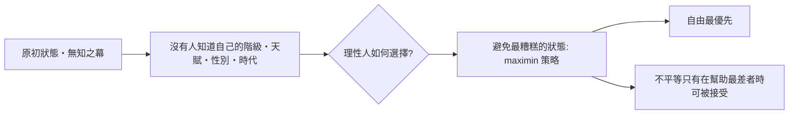

# 第八篇 第八章 第二節：約翰·羅爾斯與「無知之幕」——正義作為一次「投票前的未知投胎」

> 1971 年，哈佛哲學教授約翰·羅爾斯（John Rawls, 1921–2002）出版《正義論》（A Theory of Justice）。書中提出一個思想實驗：**在尚未知道「自己是誰」之前，共同為社會設計規則**。這個「無知之幕」（Veil of Ignorance）成為 20 世紀政治哲學被引用、被批判最多的一張圖。

## 一、前因：一位目睹戰爭尾聲的步兵

1943 年羅爾斯從普林斯頓畢業後投身太平洋戰場。1945 年 8 月投下原子彈的消息與隨後廣島的實況報導，徹底動搖他對戰爭的信念——他晚年自述：「對我來說，**戰爭本身及其可能性，從此成為政治的核心問題**。」戰後他取得博士學位（1950），先後任教於康乃爾、麻省理工學院與哈佛，自 1950 年代末起以二十年時間打磨一組政治哲學論文，最終於 1971 年集成《正義論》。

## 二、理論主樑：具體的設計規則

羅爾斯在書中做了嚴格的推演：

### 1. 起點：「原初狀態（original position）」的思想實驗

- 假想有群人要簽署一份基本社會契約，但彼此都被藏進**無知之幕**後：不知自己的階級、財富與能力，也不知所處的時代地點與善惡偏好。
- 已知：社會分配像「一個以各種方法續來」的人集合，生存所需大致齊全，但無法確認自己抽中的位置。

### 2. 兩條正義原則（因幕下人人自我防衛而出現）

1. **平等基本自由原則**：每個人對最廣泛的基本自由（言論、宗教、人身、財產、程序公平、政治參與）都有平等資格；自由只能為自由讓路。**第一原則而且絕對不能被後者覆蓋。**
2. **差異原則（difference principle）**：**只有當不平等能有利於最不利者（least advantaged）時，才容許財富與地位不平等**；機會公平平等必須先行。這一條是全書最「大膽」的推論。

他的「最終算法」：一群理性人不會挑純功利主義的「總和最大化」——因為你可能被以「所有人的最大總利益」為名要求獻出器官；也不會選封建特權制——因為你可能抽中最底層。**合理的選擇是 minimax：把最壞情況的損失壓到最小。**

## 三、差異原則 vs 功利主義：一次哲學大戰

羅爾斯選擇與 20 世紀的「功利」基準正面對立，目標正是邊沁（Bentham）、密爾（J.S. Mill）傳承下來的「社會效用加總」傳統：

| 維度 | 功利主義 | 羅爾斯主義 |
|---|---|---|
| 善的度量 | 全體快樂總和 | **個別人**正當性（尊嚴不可被加總） |
| 分配 | 允許犧牲少數 | 以最不利者為基準點計算 |
| 權利 | 可為總效用被排擠 | 自由絕對優先 |

今日許多公共制度的糾葛——最低薪資、全民健保、累進稅制、教育政策的「弱勢補償」框架——都在不同程度上引用了這條理念血統。

## 四、批評與定向

- **諾齊克（Robert Nozick）《無政府・國家與烏托邦》1974**：財富的取得即有正當性，政府無權「再分配」——自由意志主義的正面出擊。
- **德沃金（Ronald Dworkin）**：無知之幕不夠激進——天賦本身就是社會抽籤，分配應直接以「資源均等」（equality of resources）為基準。→ 見 8.3。
- **桑德爾（Michael Sandel）**：無知之幕中的「人」喪失了社會性認同——**羅爾斯的主體是空的**，沒有社群、沒有歸屬感、沒有實質的人生目標。
- **阿瑪蒂亞·森（Amartya Sen）**：與其設計唯一理想制度，不如做**實際制度的比較**（他提出的「能力途徑 capability approach」影響了聯合國人類發展指標）。

羅爾斯終生正面迎接批評；晚年在《政治自由主義》（1993）重新限定：這套正義只是為「**民主立憲的社會**」服務，而非宣稱對全人類有效。

---

*下一節：德沃金——為了證明法律有「標準答案」，人為設計一個超級法官——參見 [8.3 德沃金](08.3-德沃金.md)*