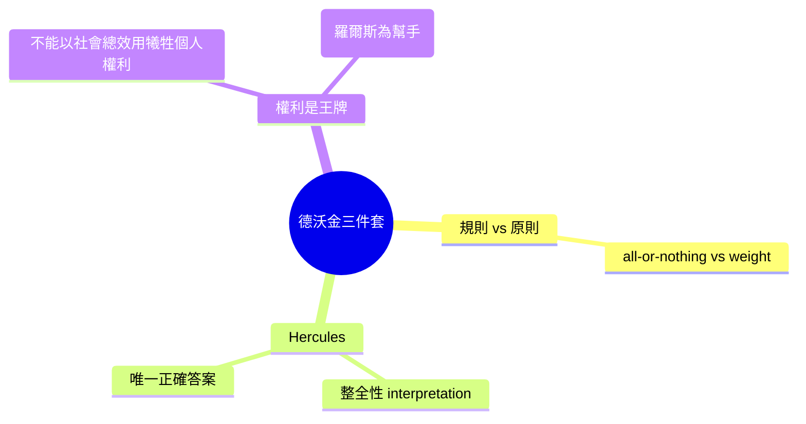

# 第八篇 第八章 第三節：羅納德·德沃金——赫拉克勒斯法官與「法律的原則」

> 1977 年，牛津。美籍英倫的法哲學教授羅納德·德沃金（Ronald Dworkin, 1931–2013）出版《認真對待權利》（Taking Rights Seriously）。書中向整個英美法理學丟出兩枚炸彈：**法官裁判不只依賴規則，還依賴「原則」；以及：一切疑難案件其實都存在「唯一正確答案」（one right answer）**——只要法官夠強。

## 一、前因：兩個長年隱藏的戰場

- 20 世紀英美法理學的統治者是 **H.L.A. Hart（哈特）** 的《法的概念》（1961）：法律是一個由「承認規則」（rule of recognition）駕駛的規則系統——用後設規則分辨「什麼算是有效的法」。疑難案件時，法官是**在做裁量**（discretion），法律在此「用完」了。
- **校外戰場**：60 年代的美國民權運動、越戰期間的抗命訴訟、「布郎案以降」的法院積極主義——「法院到底憑什麼保護少數人？」——若照哈特的框架，**法官似乎是在用「非法律」的個人心證**替弱者翻案，法律與道德的界線便顯得模糊。

德沃金先在耶魯、普林斯頓受訓，1962–1969 任教於耶魯，1969 年起任教牛津大學「法理學講座」（該講席長期由哈特佔據）後轉任紐約大學、倫敦大學學院——他的整體論戰陣地「**規則控制 vs 原則推論**」就此成形：法官在疑難案中介入的不只是裁量，更是對隱藏原則的科學解讀。

## 二、規則 vs 原則

德沃金的核心結構（1977 書第一章起）：

|  | 規則（Rules） | 原則（Principles） |
|---|---|---|
| 運用 | 全有全無（all-or-nothing） | **權衡，相對分量**（weight） |
| 衝突 | 衝突的一條無效 | 多條原則可並存（如公平・合理期待・不自食其言） |
| 例 | 「超速即違法」 | 「不得從他人過錯中得利」「平等尊重」 |
| 用途 | 找代碼 | **在規則真空與衝突時回答法理爭端** |

他舉例：Riggs v. Palmer（1889 年紐約州，依遺囑法兇手本可繼承，法院卻拒絕）——規則與「**不得從自己的罪行中得利**」的原則衝突，法官依原則勝出。若照哈特，這只是司法裁量；德沃金說：**那也是法律，只是沒寫在條文裡**。

## 三、赫拉克勒斯（Hercules）：法官的理想機型

為了引導這種「唯一正確答案」的論證，德沃金設想一位虛構法官 **Judge Hercules**：

> 作為法官，他有超凡智力、學生素養、人生的耐心、與法律學說的完整知識；面對任何可疑案件，他都會**補充整個法律學說（law as integrity）**，找出最能讓「過往判例+成文法+道德原則」構成統一作品的**唯一最佳詮釋**。

要點：

1. **整全性（law as integrity）**：法律像一部連續共同撰寫的長篇小說，Hercules 是持續參與的作者，不是事外仲裁者。
2. **權利是王牌（rights as trumps）**：**個人的基本權利，不能因「社會總體利益」而被犧牲**——政府主張「公共利益更好」之前，必須先通過「平等尊重個人」這道關卡；多數決不能直接碾過少數權利。
3. **道德論證公開化**：裁判必須以可辯駁的道德理據支撑，而非以「個人偏好」定案。

## 四、現實與缺陷

- 批評者指出：**沒有法官是 Hercules**。「唯一正確答案」要求同時完成過往判例整理、道德權衡與內在一致，實務上難以達成；多數法院改用「**足夠限定的答案**」：程序門控、比例原則與類案的推理即可收斂。
- 激進主義者如桑斯坦（見 9.2）回應：法院實際上在「**不完整理論化的協議（incompletely theorized agreements)**」上運作——不必說明大原理，就能同意處理具體個案——這反駁了 Hercules 的必要性。
- 但德沃金的骨架支持了**戰後憲政主義的哲學正當性**：南非憲法法院、德國聯邦憲法法院、台灣司法院的多數判決文風，都有「**proportionality + rights as trumps + principle weighing**」的德沃金味。
- 生前遺作 2013《Religion without God》仍堅持：法哲學的伏筆，是「**人的尊嚴有兩種基本價值：生命的內在價值，及人生主體性的價值**」。

---

*第九篇：矽谷兩位。「Code is law」的先知與行為經濟學的推手——參見 [9.1 萊斯格](09.1-萊斯格.md)*