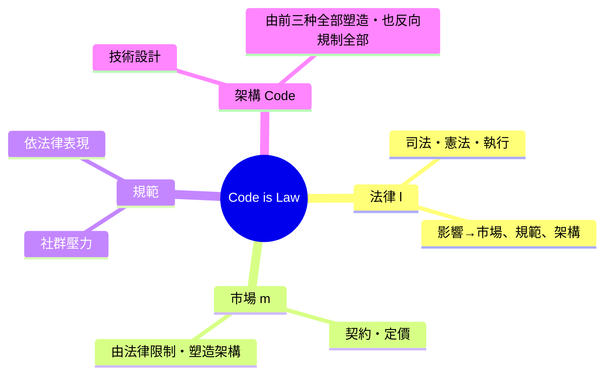

# 第九篇 第九章 第一節：萊斯格與「程式碼即法律」——向微軟宣戰的法律教授

> 1999 年，哈佛法學院教授勞倫斯·萊斯格（Lawrence Lessig, 1961–）出版《Code and Other Laws of Cyberspace》，宣告一個新命題：**在網路空間中，真正規範行為的常常不是國會立法，而是程式碼、硬體與協議**。他隨後於 2002 年共同創立 Creative Commons——他是「賽博法律行動主義」的第一代宗師。

## 一、前因：1990s 的互聯網「無政府主義樂園」假象

1990 年代的主流論調非常樂觀：

- 約翰·佩里·巴洛（John Perry Barlow）發表《網路空間獨立宣言》（1996）：「工業世界的政府……你們在我們的世界不受到歡迎」— 「**Cyberspace 不予任何治理**」。
- 加密學者自信：加密技術（PGP、SSL）足以抵擋一切審查。
- 商業巨頭如 Netscape 起飛，微軟 Windows + IE 開始吞併瀏覽器市場。

萊斯格的實證分析立即戳破這場樂觀主義幻象：

## 二、他的核心洞察：規制（regulation）有四種形式

| 規制源 | 機制 | 例子 |
|---|---|---|
| 法律（law） | 司法命令・權利救濟 | 判決、禁令 |
| 規範（norms） | 社群壓力 | 恥辱・口碑 |
| **市場（market）** | 價格與契約 | 平台抽成 |
| **架構（architecture / code）** | 事物的技術可能性 | DRM、實名制、演算法審核 |

萊斯格的論證威力在於：「**Code is law**」不是修辭——**當架構決定可能與不可能，架構的規制強度遠高於傳統法律：它能 100% 執行，無需逮捕、無需審判、且幾乎不可被上訴。**你被演算法封鎖（shadow-ban、限流）時，沒有法律文書、沒有程序、沒有法官。

他提出設計公路的品牌警語：

> 「當我們讓私有者（平台／微軟）去寫架構，我們就是在用**看不見的憲法**去規制公共空間。」

## 三、他的政治行動：Microsoft 案與 Creative Commons

- 1997–98 年，萊斯格在美國司法部訴微軟反壟斷案（United States v. Microsoft Corp.）中出庭作證（政府方的技術證人），解釋瀏覽器與作業系統捆綁如何阻斷競爭。微軟律師透過多年的申覆調查程序對他施壓，並試圖指控其研究受到競爭對手資助；他為此公開披露所有贊助來源，堅持到辯論結束。
- 2002 年，他與 Eric Eldred 等人共同創立 **Creative Commons**，把「著作權的『全有或全無』」重新設計為層級化的授權選項表（BY、NC、SA、ND 四個開關，可組合成多種許可證）——這是「**用工程手段設計法律選項**」的標本。
- 1998–2003 年，他主理 Eldred v. Ashcroft（挑戰美國版權期限延長法 Sonny Bono Copyright Term Extension Act），2003 年最高法院 7:2 駁回——雖敗訴，卻把「公共領域是憲政問題」變成主流法學論題。

## 四、他的公式化：「四個槓桿」

-萊斯格的洞見在於：**這四個槓桿彼此塑形與反塑**——法律可以命令架構（如《圖形登陸協調法》比要求平台加入編譯逼的管理），架構也可反過來主導法律（如區塊鏈執行自動清償——見 10.1），市場影響規範，規範又會影響立法。

## 五、遺產

1. **隱私/演算法政策的日常話語**：今天演算法審核、推薦系統與中美平台監管討論，全都在使用他的「Code is Law」片語。
2. **「架構治理」變成學科**：網路治理（Internet Governance）馬拉松之後，ITU、ICANN、歐盟《數位服務法》（DSA）都已把「透明度・非歧視・可上訴」設計進架構層。
3. **CC 授權** 改變了整個開源生態與全球知識共享的關係（從維基百科、OpenAI 訓練語料到唱片通路與創作者經濟）。
4. **他創立了「用架構修憲」的思想武庫**——這也是桑斯坦的 9.2 推理研究與 9.3 布魯塞爾效應的共同基座。

---

*下一節：行為經濟學家與法律政策——卡桑与塞勒「推手政策」的花钱与守門——參見 [9.2 推手理論](09.2-推手理論.md)*