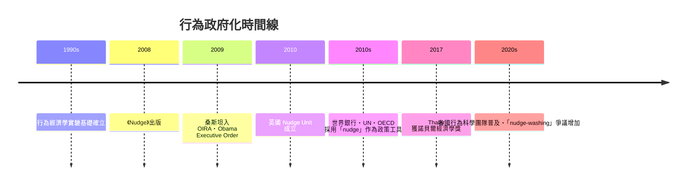

# 第九篇 第九章 第二節：桑斯坦與塞勒——「推手（Nudge）」：不強迫，但把選項設計成人想要的

> 2008 年，芝加哥大學行為經濟學家理查·塞勒（Richard Thaler, 1945–）與哈佛法學院教授卡斯·桑斯坦（Cass Sunstein, 1954–）合著《推力》（Nudge: Improving Decisions about Health, Wealth, and Happiness）。宣言極簡：

> 「**推力（nudge）**是任何改變行為的選項架構設計——它**不禁止任何選項、也不顯著改變經濟誘因**。」

## 一、前因：行為經濟學的三十年積累

「理性人」（homo economicus）模型從貝卡里亞（5.1）到芝加哥學派一直統治規則設計——「人會理性計算刑罰與收益」。但1970 年代起，心理學家 **丹尼爾·卡尼曼（Daniel Kahneman）與阿莫斯·特沃斯基（Amos Tversky）** 用實驗證明：

- **損失規避**（loss aversion）：失去 100 元的痛 > 得到 100 元的快
- **框架效應**：同樣的統計資料，換個「95% 存活 vs 5% 死亡」的說法，選擇就變
- **預設效應**：人類很少主動改變「已登記的選項」（默認提撥率、器官捐贈登記）
- **現時偏好**（present bias）：人類永遠低估未來

卡尼曼因此 2002 年獲得諾貝爾經濟學獎；塞勒 2017 年也獲獎；行為經濟學正式成為「規則設計」的硬核科學。

## 二、「預設選項」是最大的槓桿

塞勒與桑斯坦的核心理論工具十分樸素：

> **在多數情況下，人們順從「最省力的道路」。那條路的形狀，由設計者決定。**

最著名的真實應用是**英國的自動加入職業退休金制度（Automatic Enrolment）**：2012 年起雇主依法把員工「自動加入」退休金計畫，員工可選退出（opt-out），但多數人從不自選——結果參與率大幅攀升至九成上下。美國 401(k) 退休金的預設提撥率實驗（Thaler 與 Benartzi 的 “Save More Tomorrow” 計畫）也觀察到同樣效應。

2010 年，英國內閣辦公室成立全球第一個政府級的「**Nudge Unit（行為洞察團隊，Behavioural Insights Team）**」，用預設選項、簡化表單、社會規範提示（「大多數人都準時繳稅」）等方式改造行政流程：報稅信表加入社會證明後催繳效果提升、器官捐贈登記改為簡單流程、公共服務的選項預設化——「**推手正式進入政府操作系統**」。

## 三、桑斯坦進入白宮：OIRA 的「推手化改造」

2009 年奧巴馬邀桑斯坦出任**白宮資訊與法規事務辦公室（OIRA）主任**——該辦公室負責審查幾乎所有聯邦重大法規。桑斯坦在任（任命因政治爭議延宕至 2009 年 9 月生效）推動行政命令 13563「Improving Regulation and Regulatory Review」：

- **成本效益分析導入行為科學修正**：假定決策者非理性後，重新校準政策收益估算。
- **簡化披露**：貸款、信用卡與資費文件改用「簡明語言與標準格式」呈現，降低理解成本。
- **資訊性規制**：燃油經濟性標籤、食品營養警示等「以資訊促選擇」的工具全面標準化。

## 四、批評的火力線

1. **操縱 vs 民主問責**：批評者稱這是「**家父主義的隱匿版**」——設計者以「為你好」為名在民眾看不見的介面層改變行為；好處是不用立法、成本最低，壞處是**民主審查被繞過**（誰來監督推手者？）。
2. **效果質疑**：2020 年代多項 meta 分析（如 Mertens 等人 2022 對 nudge 實驗的系統回顧）顯示，nudge 效果平均偏小、且精度與穩定性受質疑；也有「nudge-washing」（把普通政策包裝成行為科學）的現象。
3. **德沃金式挑戰（8.3）**：若個人尊嚴與權利是王牌，靠介面設計改變選擇是否構成對自主性的剝削？桑斯坦的回應是保持透明（ disclose nudge）、限定於「明顯對本人有利且可輕易退出的場合」。

但「推力」的一個後果無法否認：**政策界開始把「行為科學」視為傳統立法之外的第五枚規制槓桿**——與萊斯格的四槓桿（9.1）合流，規則設計的語言就此全面更新。

---

*下一節：布魯塞爾效應——GDPR 是如何讓全球公司跪下的？參見 [9.3 布魯塞爾效應](09.3-布魯塞爾效應.md)*