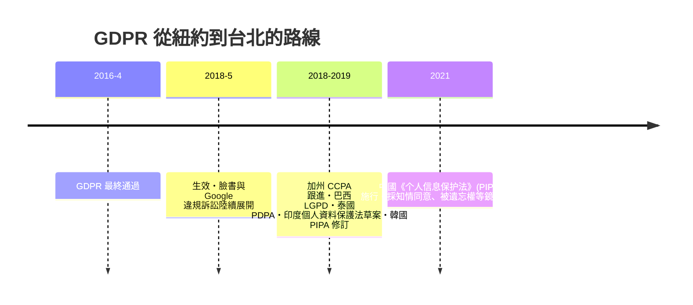

# 第九篇 第九章 第三節：布魯塞爾效應——GDPR 如何讓矽谷巨頭全球跪下

> 2018 年 5 月 25 日，歐盟《通用資料保護規則》（GDPR）正式施行。生效前夜，各大網站同夜如雪崩般彈出「我們更新了隱私政策」、「接受 Cookies」的彈窗——從東京到紐約，全球使用者都被歐洲的法律覆蓋。一位不在歐盟生活的人也享有歐洲的資料規則，**只因為他恰好使用跨國平台**。這就是「布魯塞爾效應」（Brussels Effect）——由哥倫比亞大學法學者 Anu Bradford 在 2012 年命名、2020 年成書。

## 一、前因：單一市場 + 監管工程

歐盟的監管霸權不是喊出來的，是「市場規模＋統一規格」疊出來的：

1. **5 億消費者的單一市場**：任何要接觸歐盟客戶的跨國企業，沒有「分區降級」的選擇——除非放棄歐洲收入。
2. **「規格殺手」傳統**：早在資料之前，壓力鍋、玩具、化妝品、飛機噪音、化學品（REACH）、食品添加物、隱私 cookie——歐盟規格一次次成為全球標準。
3. **「布魯塞爾效應」的邏輯**：跨國企業調整一次「最低共同分辨率」，比按各國調整便宜許多。結果是：**歐盟法律在無需執行程序的情況下，自動「滲透」進全球供應鏈**。

GDPR 的先例譜系是 1995 年的資料保護指令（Data Protection Directive, 95/46/EC）——但因為跨國平台資料流動使其效力有限，才需要修訂。立法過程歷經 2012 年提案、四年的歐洲議會與各國博弈，2016 年 4 月正式通過。

## 二、GDPR 的核心設計模板

| 組件 | 典型條款 | 全球迴聲 |
|---|---|---|
| **同意與明確合法性**（Lawfulness） | 第 6 條：處理個人資料需符合六大合法基準之一 | 各國「知情同意」的強化版 |
| **被遺忘權**（Right to erasure） | 第 17 條 | Google 訴訟、各國「被遺忘」立法 |
| **資料移植權**（Portability） | 第 20 條 | 開放銀行、平台間轉移 |
| **隱私預設**（Privacy by Design & by Default） | 第 25 條 | 產品設計階段就要求隱私 |
| **資料外移管制**（Data localization / transfer） | 第 44–49 條：向外轉移需適當保護——衍生出 Standard Contractual Clauses 廣泛被全球公司法務直接引用 | 大型跨國企業在全球供應鏈中直接採用 |
| **高額罰鍰** | 最高可罰全球年營業額 4% | 以違規成本重塑跨國企業的驗證心態 |
| **資料保護官**（DPO） | 第 37 條 | 設立大型公司新職位——隱私以「治理」長年化 |

## 三、歐盟競爭政策主戰場：Vestager 陣營

歐盟競爭事務專員 **瑪格麗特·維斯塔格（Margrethe Vestager, 2014–2024 在任）** 在這場賽局中扮演了另一側的主設計者：

- 2017 年對 **Google Shopping** 裁罰 24.2 億歐元；2018 年對 Android 裁罰 43.4 億；2019 年對 AdSense 裁罰 15 億。
- 2016 年認定蘋果應補繳愛爾蘭 130 億歐元稅款，一路打到歐洲法院。
- 推動《數位服務法》（DSA）與《數位市場法》（DMA）：DSA 把平台責任與內容治理寫成規則；DMA 則針對「守門人（gatekeeper）」級的大平台，列出不得濫用的行為清單——以規則語法直接約束演算法與商業設計。

GDPR（由司法、消費者與平等事務部門主導）是「**個人權利保障**」的一側；Vestager 主導的競爭政策與後續的 DSA/DMA 是「**市場結構約束**」的另一側——兩側合流形成歐盟數位法律的完整劇本。

## 四、跨國落地：矽谷的行為改變與全球跟進

## 五、制度學總結

布魯塞爾效應的深層，是**「沒有超國家法庭也能有效落實跨境規則」的第三條路線**——不是格勞秀斯式條約（6.1），不是拿破崙式帝國武力（5.2），而是「大市場規模 × 統一規格 × 企業的比較成本」。法律設計者最終學會了：**當沒有全球政府時，讓「規格」自己去當全球的政府。**

---

*第十章：當法律不再由人類執行——智慧合約與 AI 代理——參見 [10.1 薩博與智慧合約](10.1-薩博與智慧合約.md)*