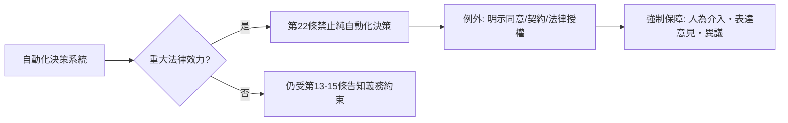

# 第十篇 第十章 第二節：演算法黑盒與「不受純自動化決策約束之權利」——當法律要求機器說明理由

> 2016 年，美國威斯康辛州最高法院審理 State v. Loomis：被告 Eric Loomis 對量刑時使用的風險評估軟體 COMPAS 提出挑戰——這個商業系統**不公開其演算法**（商業秘密），卻影響刑度。法院最終維持使用，但要求法官「不得單獨依賴」該分數。這是**演算法進入刑事司法的黑盒難題**第一次成為憲法級爭點。

## 一、前因：自動化決策滲透公共權力

21 世紀頭二十年，政府與企業把裁判大量外包給模型：

- **刑事風險評分**：COMPAS、PSA（Public Safety Assessment）——法官參考其「再犯率」預測
- **信用與保險**：FICO 分數、車險「駕駛行為定價」
- **求職篩選**：履歷自動排名（亞馬遜 2014–2018 年內部招聘模型因「壓低女性簡歷評分」而廢棄，2018 年 Reuters 披露）
- **福利與移民**：澳洲「Robodebt」自動追債系統（2016–2020 錯誤追債 47 萬人，釀成澳洲史上最大政府醜聞之一，2023 年聯邦法院集體訴訟和解）
- **社會評分與預測警政**（predictive policing）

## 二、結構性問題：偏見、黑盒、不可申辯

| 問題 | 機制 | 法律對應難點 |
|---|---|---|
| **訓練資料偏見** | 歷史歧視被模型學去（COMPAS 對黑人被告高估再犯風險——ProPublica 2016 調查） | 「歧視」要件是主觀故意，模型是「無意」 |
| **黑盒** | 深度學習不可解釋＋商業秘密 | 正當程序要求「說明理由」，機器給不出 |
| **不可申辯** | 使用者不知被分類、無資料更正管道 | 傳統「聽審權」失去對象 |
| **規避審查** | 政府向民間採購模型，繞過公法拘束 | 「行政行為」定義追不上 |

## 三、GDPR 第 22 條：人類保留最後否決權

GDPR 第 22 條寫下一條世界首創的權利：**資料主體有權不受「僅基於自動化處理、對其產生法律效力或類似重大影響」之決策的約束**——除非經本人明示同意、契約必要、或法律授權，且必須提供：人為介入、表達意見、對決策提出異議之保障（第 22 條第 3 款）。

配套還有第 13–15 條：**自動化決策必須提供「有意義的資訊與所涉邏輯」**——「解釋權」的近似物（法條未直接使用 "right to explanation" 一詞，但學理上被如此詮釋）。

## 四、落地與擴散

- **歐盟 AI 法案（AI Act, 2024 年通過）**：把風險分級——「不可接受風險」（社會評分、即時遠端生物辨識等）直接禁止；「高風險」（求職、信用、司法協助）要求人為監督、資料治理與可追溯。
- **美國路線**：不修憲法而靠既有法律＋判例（Loomis 案的正當程序分析）；地方立法（如伊利諾 AI Video Interview Act）與執法（EEOC 對招聘演算法的調查）。
- **台灣與亞洲**：個資法修法、司法院「AI 應用原則」、行政院「AI 治理原則」，方向均朝「輔助而非取代」。

## 五、制度學定位

這一節的母題，其實是**整本書的一再重演**：每一代「更強的裁斷工具」（神判→法官→陪審→演算法）進場時，法律設計者的工作都一樣——**設計「人工檢查點」**。漢摩拉比把神判變成條文、亨利二世把神判變成陪審、布蘭戴斯把「獨處」變成權利、GDPR 把演算法決策逼出「人為介入」介面。**正當程序的核心從來不是「誰來裁決」，而是「永遠留一個可以對人說話的出口」。**

---

*最後一節：當 AI 開始替人類寫法律——設計正義還是被正義設計？參見 [10.3 AI 法律的未來](10.3-AI 法律設計的未來.md)*