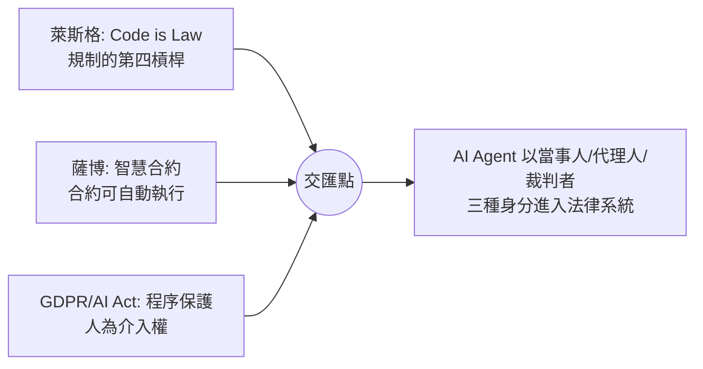

# 第十篇 第十章 第三節：AI 代理人進入契約與法庭——法律設計者的終極考題

> 2023–2025 年：生成式 AI 在律師資格模擬考達到及格水準（GPT-4 於 2023 年的模擬統一法律資格考試評測中成績接近人類考生前段——Chicago-Kent 與史丹佛學者 2023 年測試）；史丹佛等團隊讓 AI 對真實案例預測判決，與人類判決方向高度一致；智慧合約開始由 AI 代管。**第一次，法律系統同時面對「AI 作為工具」與「AI 作為行為主體」的雙重湧入。**

## 一、前因：三條曲線在此交匯

- **技術線**：大語言模型（2022 ChatGPT 公開後）具備起草、比對、檢索法律文本的能力。
- **制度線**：電子簽章法（美國 E-SIGN 1999、台灣 2001）、UNCITRAL《電子商務示範法》早已替「非紙面意思表示」鋪路。
- **主體線**：愛沙尼亞 2017 年曾公開討論「機器人法官」（robot judge）處理小額糾紛的構想；歐盟 AI Act 2024 首次把 AI 系統本身納入「產品責任」式監管。

## 二、三大真實戰場

### 1. AI 簽約：意思表示是誰的？

AI Agent 自動下單、議價、簽署智慧合約已屬現實（高頻交易即最早案例）。法律上以「**代理法**」接住：AI 是「工具」，行為效果歸屬使用者——但「授權範圍」如何界定？錯誤下單（flash crash 級事故）可否依錯誤、意思表示不實撤銷？傳統要件「人」的辨認能力被架空，各國多靠**既有制度擴張**而非新主體。

### 2. AI 起草與「得在法庭上引用」的邊界

- **Mata v. Avianca（2023，紐約南區）**：律師用 ChatGPT 起草訴狀，引用了**六個不存在的判例**（模型幻覺），遭法院制裁——**「AI 幻覺」成為法律文獻的風險源**，各法院隨後紛紛要求披露 AI 使用。
- 法務市場的重構：初階審閱、標準契約起草高度自動化（legal tech），律師向「策略、談判、倫理判斷」上移——**職業結構變化，而非簡單失業**。

### 3. 責任歸屬（Accountability）：出事找誰？

| 情境 | 責任鏈 |
|---|---|
| AI 錯誤陳述導致契約締結 | 使用者（表見代理）→ 開發商（產品責任/瑕疵擔保） |
| 自動駕駛事故 | 駕駛監督義務 → 製造商 → 保險（德國 2021《自動駕駛法》已立法分層） |
| AI 裁決偏誤 | 使用機關（正當程序責任）——GDPR 第 22 條＋AI Act 人為監督義務 |

歐盟 2024 年《產品責任指令》修訂已把**軟體與 AI 明文列入「產品」**——責任版圖正式擴張。

## 三、如果 AI 開始寫法律：三種未來

1. **輔助模式（現行主流）**：AI 起草、人類立法者與法官拍板——回頭看，這就是 Brandeis Brief（7.2）的極端化：把社會科學證據換成模型輸出，**關鍵仍是「人為把關」的制度設計**。
2. **規格模式**：AI 為海量個案產出「個別化規則」（如所得稅逐年自動調適）——羅爾斯式普遍規範與個案正義的張力（8.2–8.3）被機器放到最大。
3. **主體模式（科幻但被嚴肅討論）**：授予 AI 有限法律人格（如「電子人格」，2017 年歐洲議會決議曾建議研究）——這將直接挑戰查士丁尼以來「法律主體＝能負責之意志」的公理（2.2）。

## 四、給法律設計者的結案陳詞

三千年來，這個職業反覆做同一件事：

> **當權力找到新的執行介面（石碑→印刷→演算法），就用新的介面重新分配「誰可以向誰說理」。**

- 漢摩拉比把神明的裁決寫成可查閱的條文（1.1）
- 梭倫讓規則在立法者離開後仍能運轉（1.2）
- 柯克堅持規則高於國王（3.3）、馬歇爾讓法院成為憲法直譯器（6.2）
- 布蘭戴斯為「看不見的生活」發明權利（7.2）、哈倫在敗訴判決裡為未來留檔（7.1）
- 萊斯格提醒我們最強的法律可能是看不見的架構（9.1）、GDPR 要求黑盒必須留一扇人門（10.2）

AI 沒有改變這個母題，只是把它的難度調到最高：**當規則的撰寫者、執行者與受規範者都可能是機器時，「留一個可以對人說理的出口」仍是最後的底線。**這是法律設計者三千年不變的職業守則——也是這本書想留給讀者的一句話。

---

*全書完。回到 [README 目錄](README.md)*