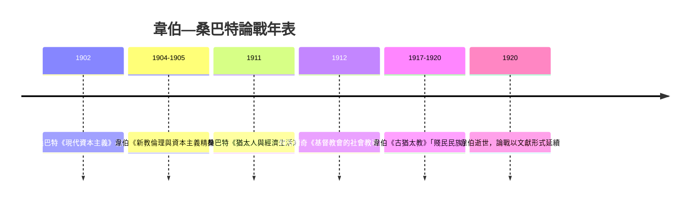

# 第一章第二節　桑巴特反命題：猶太人與現代資本主義的誕生

## 一、1911 年的挑戰：「清教徒是猶太人」

韋伯《新教倫理》問世六年後，其好友與海德堡同僚維爾納・桑巴特（Werner Sombart, 1863–1941）於 1911 年出版《猶太人與經濟生活》（*Die Juden und das Wirtschaftsleben*），作為其巨著《現代資本主義》（1902）的補論。這本書拋出了一個挑釁性的翻轉命題：**「清教徒是猶太人」（Die Puritaner sind Juden）**——不是猶太倫理近似清教徒，而是清教倫理本身深受猶太思想浸染；現代資本主義的鑄造者，與其說是日內瓦的加爾文，不如說是流散歐洲的猶太商人。

桑巴特列舉的證據包括：清教徒自認「新以色列」、大量援引《舊約》（命名子女多用舊約人名）、安息日紀律與猶太安息日倫理的相似，以及十七世紀英格蘭清教徒與阿姆斯特丹塞法迪猶太人社群的密切商業往來。英國於 1656 年由克倫威爾（Oliver Cromwell）默許猶太人重新入境，正值清教共和國時期，桑巴特認為這絕非巧合。

## 二、六大貢獻：桑巴特的制度清單

桑巴特的核心論證不在心理層面，而在**制度與技術**層面。他系統列出猶太人帶入現代經濟生活的六項貢獻：

1. **跨國網路**：流散社群經由家族與宗教紐帶形成橫跨波蘭—阿姆斯特丹—倫敦—漢堡的商業網絡，使「國際」貿易在民族國家尚未成熟時即已運轉。典型如漢堡的葡萄牙商人社群（16 世紀末至 17 世紀）。
2. **信用票據**：匯票（Wechsel）、背書、無記名票據等信用工具的推廣，猶太人因被排斥於行會與土地所有權之外，反而成為票據流通的專家。
3. **殖民地商品**：糖、菸草、咖啡、香料等「新商品」的經銷體系，多由阿姆斯特丹與倫敦的塞法迪猶太商行建立，餵養了後來的消費社會。
4. **證券交易所**：桑巴特主張猶太人是交易所制度的「精神塑造者」；阿姆斯特丹交易所（1602 年隨荷蘭東印度公司成立）周邊活躍著大量猶太經紀人，他們將投機與流動性常規化。
5. **報紙與廣告**：現代經濟新聞始於阿姆斯特丹，早期刊載商品行情的報紙與猶太商業社群關係密切；廣告使價格資訊公開化，衝擊行會的封閉定價。
6. **自由競爭觀念**：桑巴特做出一個深刻的觀察——中世紀行會經濟的靈魂是「適足」（Angemessenheit，合理價格、限制競爭），而猶太人自外於行會，其生存法則就是無限制的競爭與套利。**自由競爭作為觀念，是從制度縫隙中滲出、再席捲全社會的。**

## 三、猶太心智：理性主義、流動性、抽象化

在制度清單之外，桑巴特提出一套「民族心理」解釋：猶太教經過塔木德時代（約公元前 200 年至公元 500 年）的千錘百鍊，養成了三種心智特徵——

- **理性主義**：塔木德論辯要求對律法文本做無止境的邏輯分析，訓練出將一切事務化約為規則與例外的心智；
- **流動性**：兩千年無國無土，財產必須易於攜帶與隱匿——金銀、票據、債權成為優先形式，這在客觀上就是金融資本的形式；
- **抽象化**：與具體土地、行會、身分的斷裂，使猶太人習於操作抽象價值（價格、利率、匯率），而這正是現代經濟的思維方式。

桑巴特甚至援引當時（帶有種族論色彩的）人類學文獻，主張猶太人「異質基因」造就其經濟稟賦——這是全書最站不住腳的部分，日後成為該書被批判的焦點。

## 四、韋伯—桑巴特論戰的學術史

兩人的分歧早於 1911 年即已形成。宗教社會學家特洛爾奇（Ernst Troeltsch, 1865–1923）在《基督教會的社會教導》（1912）中居間調停：他承認清教倫理與猶太傳統有連續性，但堅持加爾文派的**內在心理動力**（預選焦慮）是猶太教所無，故韋伯仍站得住腳。海德堡學派內部，這場論戰夾雜了友誼、競爭與日趨緊張的猶太人問題氛圍：桑巴特書中某些修辭（如「滲入」德國經濟體）在 1930 年代竟被納粹宣傳挪用，成為韋伯陣營批評他不夠謹慎的罪狀之一；諷刺的是，桑巴特本人晚年又遭納粹排擠。

## 五、後世評價：何者存活、何者證偽

二十世紀的學術檢驗結果大致如下：

**被接受的部分**——猶太人在匯票、交易所經紀、殖民地商品貿易、新聞行情傳播上的實質參與，已由經濟史實證（如 Jonathan Israel《歐洲猶太人 1550–1750》，1985；Yosef Kaplan 對阿姆斯特丹社群的研究）確認。「邊緣群體因制度排斥而擅長金融中介」的結構性論點，更成為制度經濟學與網路分析的標準命題。

**被證偽或揚棄的部分**——(1) 「清教徒是猶太人」的強命題：清教倫理的神學核心（預選說、恩寵確據）確有獨立源頭，桑巴特高估了《舊約》影響；(2) 種族心理學解釋：無任何遺傳證據，純屬時代偏見；(3) 「猶太人發明交易所」：義大利城市（佛羅倫斯、威尼斯、熱那亞）的證券交易早於阿姆斯特丹，猶太人是重要的**推廣者與放大器**，而非發明者。

公允的結論是：韋伯掌握了**動機的心理機制**，桑巴特掌握了**結構的制度機制**，兩者並非互斥而是互補。桑巴特最大的洞見——現代資本主義的若干關鍵制度，是在基督教社會的縫隙中由「外來者」鍛造——正是本書第三節將要正式化的理論起點。

$$
\text{現代資本主義} = \underbrace{\text{新教倫理（動機）}}_{\text{韋伯}} + \underbrace{\text{猶太制度遺產（結構）}}_{\text{桑巴特}} + \ldots
$$
