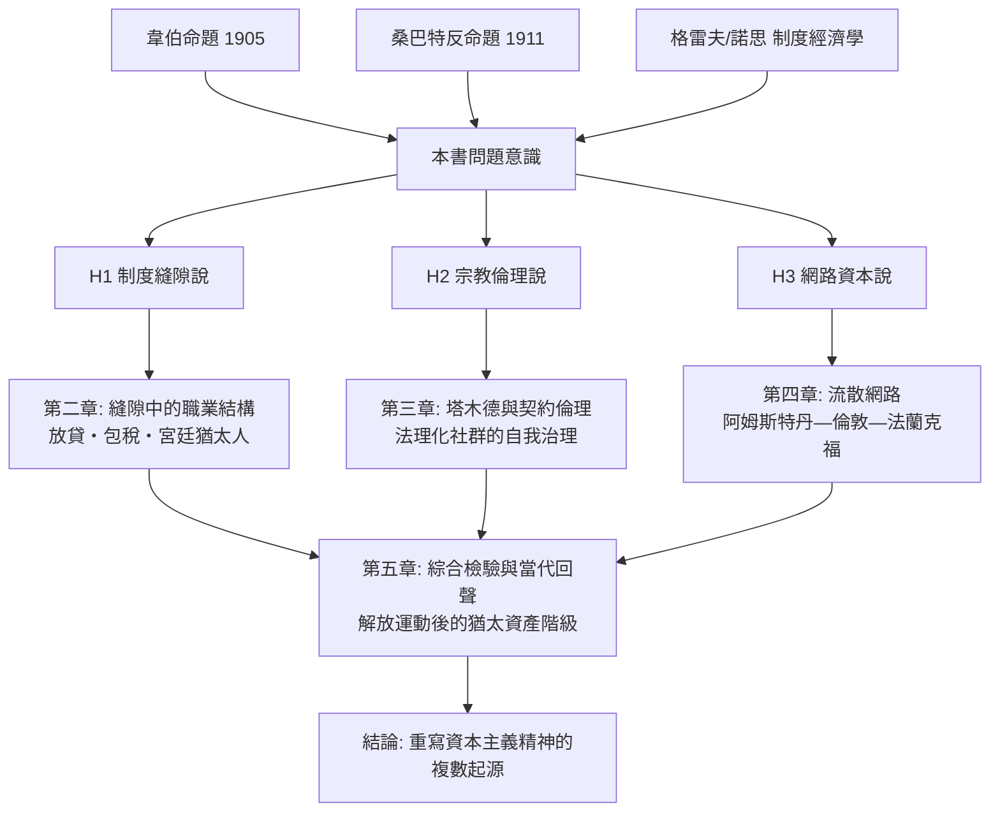

# 第一章第三節　本書的問題意識：方法、材料與三個假說

## 一、站在韋伯與桑巴特之間

前兩節呈現了百年論戰的基本地形：韋伯（1864–1920）以「入世禁慾」解釋資本主義精神的**動機**結構，卻將猶太教貶為「賤民資本主義」；桑巴特（1863–1941）以六大制度貢獻反證猶太人的**結構**角色，卻誤入種族心理學的死巷。本書的問題意識由此成形：**不預設「精神」的單一起源，而是追問——在 1492 年大流散到 19 世紀解放運動這四百年間，猶太經驗以何種機制持續輸入現代資本主義的形成過程？**

我們提出三個可檢驗的假說：

### H1　制度縫隙說（Institutional Niche Hypothesis）

基督教世界自中世紀起以高利貸禁令（usury bans，如第三次拉特朗大公會議 1179 年、教皇英諾森三世時期的教令）、行會排斥、土地限制，將猶太人**強制擠入**金融、中介、遠程貿易等縫隙行業。這些行業在當時被鄙視，卻正是現代資本主義的核心職能。因果箭頭是：**制度排斥 → 職業集中 → 能力積累 → 制度輸出**。例如 15 世紀德意志諸侯的「宮廷猶太人」（Hofjuden，如維也納的薩穆埃爾・奧本海默 Samuel Oppenheimer, 1630–1703），壟斷戰爭融資與匯兌，實為主權債務體系的先驅。

### H2　宗教倫理說（Religious Ethic Hypothesis）

繼承韋伯與桑巴特之爭，但修正操作化：不問「猶太教是否等於加爾文主義」，而問塔木德傳統是否提供了**契約倫理與理性論辯**的訓練。塔木德（約 200–500 年編纂，巴比倫蘇拉與龐貝迪塔學院）以成文律法對口傳辯論的雙層結構，要求對每一商業情境進行個案推理——從《舒爾漢・阿魯赫》（Joseph Caro 編纂，1565 年刊行）中大量商業律法章節，到波蘭的「四省議會」（Va'ad Arba Aratzot, 1580–1764）的自我治理，猶太社群內部發展出高度法理化、可執行的契約秩序。這種「內部法治」降低了商業違約風險，是倫理層次的制度資本。

### H3　網路資本說（Network Capital Hypothesis）

流散網路是**低成本的信任與資訊基礎設施**。家族、姻親、共同體法庭（bet din）與共同的希伯來文書信網，使跨國商人在缺乏國家護照與國際法的年代，能以低成本傳遞行情、驗證信用、執行懲罰（如社群性的商業聯合抵制）。本書以具體案例檢驗：阿姆斯特丹塞法迪社群（16 世紀末起）對巴西糖貿易的融資；羅斯柴爾德家族（Mayer Amschel Rothschild, 1744–1812，法蘭克福）五子分駐五都的資訊套利；乃至 19 世紀猶太報業與電報網的耦合。用資訊經濟學的語言：網路將**資訊不對稱**轉化為比較優勢。

$$
\text{資本主義精神} = f(\underbrace{H1\ \text{縫隙}}_{\text{制度推力}},\ \underbrace{H2\ \text{倫理}}_{\text{文化資本}},\ \underbrace{H3\ \text{網路}}_{\text{社會資本}})
$$

三個假說並非互斥，而是三種機制的疊加；本書將分別檢驗其相對權重。

## 二、方法：比較、長時段、制度

本書採取三重方法論：

1. **比較歷史分析**：對照猶太人與其他「中間人少數群體」（middleman minorities）——如亞美尼亞商人、中國東南亞僑商、印度祆教徒（Tata 家族前身）——辨識哪些結果為猶太經驗所特有，哪些是邊緣位置的通則。
2. **長時段**（la longue durée，布勞岱爾 Fernand Braudel 之語）：不以單一十年為窗，而追蹤 1492 年西班牙驅逐令、1579 年荷蘭聯省的宗教寬容、1656 年英國重開門戶、1782 年奧地利《寬容敕令》、1807 年拿破崙召開猶太名人會議等節點之間的長程因果。
3. **制度經濟學視角**：以道格拉斯・諾思（Douglass North）的交易成本、阿夫納・格雷夫（Avner Greif）的「社群責任制度」（multilateral reputation mechanism，其馬格里布商人研究為範式）為分析工具，將信任、契約執行、資訊流轉操作化。

## 三、資料來源說明

本書的材料分四層：(1) **法律與教令檔案**——教會法大全、帝國特許狀（Schutzbrief）、各地驅逐令與寬容令；(2) **商業文獻**——票據存根、商行書信（如羅斯柴爾德檔案，現藏倫敦與法蘭克福）、交易所行情表；(3) **社群內部文獻**——塔木德與律法問答（responsa，She'elot u-Teshuvot），後者尤其珍貴，因它是實際商業糾紛的一手紀錄；(4) **同時代人觀察**——從 17 世紀阿姆斯特丹遊記到 19 世紀的統計年鑑。對每個關鍵論斷，本書將標明其證據強度，並明確區分「實證確立的史實」與「合理推斷的詮釋」。

## 四、各章預告

- **第二章　縫隙中的職業結構**：檢驗 H1。從中世紀放貸猶太人到哈布斯堡宮廷猶太人，呈現排斥如何鑄造專長。
- **第三章　塔木德與契約的秩序**：檢驗 H2。分析律法問答中的商業判例，論證猶太社群的「內部法治」。
- **第四章　流散網路作為基礎設施**：檢驗 H3。以塞法迪大西洋貿易與阿什肯納茲銀行家族為案例，量化網路的信任功能。
- **第五章　解放、綜合與回聲**：三假說的合流檢驗，並延伸至 19 世紀猶太人與證券市場、報業、大學學科的共生，回應反猶主義如何倒置這段歷史。

本書的立場可以一言蔽之：**資本主義精神沒有單一父親——它是新教的良心、猶太的網路、以及基督教歐洲親手挖出的制度縫隙，三者共同的產物。** 韋伯命題因此不是被推翻，而是被擴充：當我們把被排除者寫回故事，資本主義誕生的因果圖才真正完整。

$$
\boxed{\text{核心命題：邊緣性（H1）× 倫理資本（H2）× 網路資本（H3）= 制度輸出的乘積效應}}
$$
