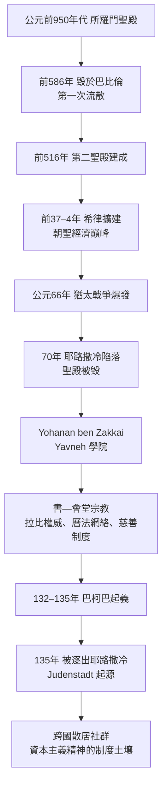

# 第二章之一 流散的起點：從聖殿到帳幕的經濟轉型——公元70年的斷裂

## 一、聖殿經濟：一個以建築物為軸心的民族

要理解資本主義精神與猶太文化的關聯，必須先理解一個常被忽略的歷史事實：直到公元70年為止，猶太人並不是一個「商人民族」，而是一個以農業、朝聖與聖殿獻祭為經濟軸心的民族。我們熟悉的「猶太人等於金融與商業」的刻板印象，是公元70年大斷裂之後，在約五百年間被宗教制度、教育制度與地緣政治逐層塑造出來的結果。本章的目的，就是拆解這個斷裂的前因後果。

### 從所羅門聖殿到第二聖殿

所羅門聖殿約建於公元前950年代（《列王紀上》第六章記載，動工於所羅門在位第四年，約公元前966年），公元前586年被新巴比倫王尼布甲尼撒二世（Nebuchadnezzar II，在位前605–562）摧毀，猶地上層階級被擄至巴比倫——這是第一次流散，也是猶太教第一次在「無聖殿、無國土」狀態下存活的實驗。公元前538年波斯居魯士大帝（Cyrus the Great）頒布敕令（《以斯拉記》第一章），允許被擄者返歸，第二聖殿於公元前516年建成。其後經哈斯蒙尼王朝（公元前140–37年）與希律大帝（Herod the Great，任猶地亞王，公元前37–4年）的大規模擴建，第二聖殿在公元1世紀初達到巔峰：希律擴建後的聖殿平台約14公頃，是當時羅馬世界最宏偉的宗教建築群之一。

### 什一奉獻與半舍客勒聖殿稅

聖殿經濟的財政基礎有三：農產什一奉獻（tithe）、初熟果物（bikkurim）的朝聖獻納，以及面向全體成年男性的半舍客勒聖殿稅。什一奉獻源自《民數記》18:21–24——利未人得農產十分之一；《申命記》14:22–29 則規定第二個什一須攜往耶路撒冷消費或折現。這意味著每一年，猶地亞農村有相當比例的收成以實物或貨幣形式流入聖城。經濟史學家估算過這筆現金流：以半舍客勒計——

$$
\text{聖殿稅年收入} = 0.5\ \text{shekel} \times N_{\text{成年男性}}
$$

若以公元1世紀猶太人口約二百萬至二百五十萬、成年男性約佔四分之一計：

$$
N \approx 500{,}000\text{ 至 }600{,}000 \text{ 人} \;\Rightarrow\; 250{,}000\text{ 至 }300{,}000\ \text{shekel/年}
$$

而每位朝聖者另需自費旅途、住宿、祭品與兌換貨幣的損耗。若再計入什一奉獻折現與國際猶太社群（埃及亞歷山大、小亞細亞、巴比倫）匯回的聖殿稅，學者估計每年流入耶路撒冷的資金以百萬計的塞斯特斯（sestertii）——這在古代地中海世界是僅次於羅馬城本身的現金匯聚點。半舍客勒稅制本身即是一個跨疆域的「自願稅收同盟」：它不需要國家機器，只靠宗教義務與《出埃及記》30:13的經文授權，就讓分散在羅馬、帕提亞兩大帝國間的社群維持財政一體。這是猶太史上第一個「無國家的跨國經濟制度」，也是後來一切猶太自治制度（Exilarch、Resh Galuta、kehilla）的技術原型。

此外，聖殿外院設有貨幣兌換桌（希臘文 kollybistēs，見《馬可福音》11:15 耶穌逐出兌換銀錢者的記載），因為來自各地的朝聖者攜帶的是帶有異教神像或帝王頭像的貨幣，須兌換為純銀的推羅舍客勒（Tyrian shekel）方能繳稅。這個兌換業務由聖殿當局壟斷經營，是古代世界少見的「宗教授權的貨幣兌換市場」。公元70年聖殿被毀後，這整套現金流瞬間歸零——其衝擊相當於一座現代城市同時失去金融中心、最大產業與稅收來源。

## 二、公元70年：斷裂如何發生

### 前因：一世紀的危機鏈

第一世紀猶地亞的政治經濟危機是一條完整的因果鏈。其一，希律死後（公元前4年）王國分裂，羅馬改行直接統治（公元6年設猶地亞行省），人口普查與直接稅引發加利利的猶大（Judas of Galilee）起義，催生了激進的「奮銳黨」（Zealots）傳統。其二，希律家族與祭司貴族（撒都該派）壟斷聖殿經濟利益，與農村小農、城市平民的貧富差距擴大——死海附近的庫姆蘭社群與《死海古卷》正是這種宗教—社會分裂的見證。其三，公元66年，凱撒利亞的希臘居民在羅馬駐軍默許下襲擊猶太會堂，隨後弗洛魯斯（Gessius Florus）挪用聖殿庫銀，引爆全面起義。起義軍一度於66年在Ben Horion等人主導下擊退敘利亞總督Cestius Gallus，並在耶路撒冷自行鑄幣——這是猶太人自哈斯蒙尼王朝後首次重獲鑄幣權，可見起義同時是宗教戰爭與經濟主權戰爭。

公元67年韋斯巴薩（Vespasian）率軍壓境，66–73年間的第一次猶太戰爭在加利利由歷史學家約瑟夫斯（Flavius Josephus，37–約100）指揮抵抗，約瑟夫斯在約他帕塔（Jotapata）陷落後投降。70年提多（Titus）圍攻耶路撒冷，逾越節期間城內湧入大量朝聖者，圍城戰造成約瑟夫斯記載的慘重死亡（其數字雖有誇大，但饑荒與屠殺確屬實況）；該年陽曆八月末，聖殿在圍城戰中焚毀，翌年（71年）羅馬舉行凱旋式，提多凱旋門（Arch of Titus，81年落成）上至今仍刻著被擄走聖殿器物——七枝燭台（menorah）——的浮雕。73年，死海邊馬薩達（Masada）要塞陷落，第一階段戰爭結束。

### Yohanan ben Zakkai 與 Yavneh：帳篷裡的學院

斷裂中最關鍵的一個人物，是法利賽學者約哈難·便·撒該（Yohanan ben Zakkai，約公元前30–公元90）。塔木德傳統（《Gittin》56a–b）記載：圍城期間，他命門徒將自己裝入棺木運出城外，向韋斯巴薩求情，請求准許他在雅夫內（Yavneh，希臘語 Jamnia）開辦一所學院。韋斯巴薩應允——這個「小得可笑」的請求，成為猶太史最大的轉折點之一。

Yavneh 學院做的事情，本質上是把一個以空間（聖殿、國土）為載體的宗教，改寫為以文本與人為載體的宗教：

1. **禮儀替代**：獻祭被祈禱（tefillah）與悔改（teshuvah）取代，會堂（synagogue/beit knesset）與學堂（beit midrash）取代聖殿成為公共生活的核心建築。
2. **權威重構**：祭司階級失業，拉比（rabbi，經過按手禮 semikhah 的律法教師）成為新權威；Yavneh 重建的 semikhah 譜系使律法裁決權得以無國土傳承。
3. **曆法與散布網絡**：學院掌握月朔宣告與閏月裁定權，透過信使網絡通知地中海與中東各社群——這是一個以宗教曆法為協議標準的跨國通訊系統。
4. **慈善制度**：聖殿稅轉型為對貧者與學者的 communal charity（tzedakah），每個社群設立募款機構，維持社群內部的資源再分配。

這是一次宗教發明：一個沒有國土、沒有聖殿、沒有主權的民族，用「書」取代「地」，用「會堂」取代「廟」，用「教師」取代「祭司」。人類史上多數民族失去國家後即同化消失，猶太人是長期存活的少數例外——而這個例外的技術核心，是識字、文本與自治。

## 三、巴柯巴起義與 Judenstadt：斷裂的完成

Yavneh 之後，猶地亞仍有數十年喘息。公元115–117年，散居在昔蘭尼加、埃及、塞浦路斯的猶太社群在圖拉真治下爆發大規模起義（Kitos War），被鎮壓後散居社群元氣大傷。真正的終局在哈德良治下到來：132年，第二聖殿廢墟上羅馬動工興建供奉朱庇特的 Aelia Capitolina 城，並禁止割禮的傳聞激起巴柯巴起義（Bar Kokhba revolt，132–135年）。領袖西門·巴·柯西巴（Simon bar Kosiba）被拉比阿基巴（Akiva ben Joseph，約50–135，Yavneh 學院最偉大的傳人）認定為彌賽亞，起義一度重建猶太政權並再度鑄幣（鑄有「以色列的自由」字樣）。135年貝特爾（Betar）陷落，起義被朱利亞斯·塞維魯（Julius Severus）殘酷鎮壓。據卡西烏斯·狄奧（Cassius Dio）記載，約五十八萬人死亡、九百餘村鎮被毀；阿基巴本人殉道。哈德良隨後下令：猶太人不得進入耶路撒冷（每年僅 Tisha B'Av 哀悼日許在城牆外哀哭——「西牆」作為哀哭之所的傳統即源於此），猶地亞改名「敘利亞—巴勒斯提納」（Syria Palaestina），企圖抹除其猶太記憶。

政治史上的地名，即是經濟史上的驅離令：被逐出耶路撒冷的猶太人聚居於城南，後來歐洲各城市中「法律指定的猶太人居住區」——從中世紀德意志的 Judengasse 到威尼斯1516年正式設立的 Ghetto——其觀念原型就是此時形成的「被隔離的猶太城區」（Judenstadt）。換言之，隔離不是資本主義的發明，而是帝國行政的發明；但被隔離者在隔離之內發展出的內聚互助、資金池與職業專精，卻成為他們日後在商業與金融上具備組織優勢的意外溫床。

## 四、結語：斷裂的三個長期後果

公元70年與135年的雙重斷裂，為本書其後所有章節設定了初始條件。第一，**人力資本化**：失去土地後，猶太人的資產從農地轉移為識字能力與律法知識——知識成為唯一帶得走的財產，這是第二章將詳論的塔木德與識字革命。第二，**職業軌道偏移**：土地禁止持有（部分地區）、農業通路被切斷，加上後世基督教會的放貸禁令，使猶太人被系統性地推向商業、兌換與金融這條「不被允許的允許」。第三，**自治傳統**：Yavneh 學到的方法——用文書、委員會、曆法與慈善網絡治理一個無國家的民族——成為後世 kahal（社群自治會）、Sura 與 Pumbedita 學院、乃至歐洲猶太社區自我治理的模板。

朝聖經濟死了，帳幕經濟誕生了。猶太人從此把「聖殿」背在背上——那是一座用字母搭成的、隨時可以卸下的移動聖殿。

---
*（本章人物與年份均依傳世文獻與主流學界定年；人口與稅收估算為數量級推估，詳見本書附錄「數據與史料說明」。）*
