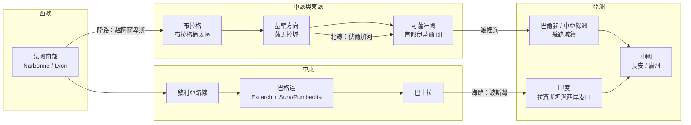

# 第二章之三 巴比倫與絲路上的猶太商網：Radhanites 與中間人時代

## 一、薩珊與伊斯蘭治下的巴比倫：自治的黃金時代

當西歐還在羅馬崩解後的碎片化中掙扎時，美索不達米亞的猶太社群正在建造他們最具組織性的政治結構。自公元前586年第一次流散起，巴比倫猶太人已在底格里斯河與幼發拉底河之間生活了千年；至薩珊波斯（224–651）晚期，社群結構已定型為雙軌自治：

- **Exilarch（流散之主，Aramaic: Resh Galuta）**：自稱大衛王血裔的世俗領袖，由波斯朝廷任命，擁有徵稅、司法與任命法官之權。薩珊宮廷承認其為境內猶太人的總代理人——這是帝國「間接統治」的典型安排。
- **學院（yeshivot）**：Sura 與 Pumbedita 兩所學院，分別以 Rav（Abba Arika，約175–247，創 Sura）與 Judah bar Ezekiel（創 Pumbedita，約259年於開塞附近）為奠基者。學院院長稱 Gaon（「卓越者」），掌宗教裁決權；學院每半年（Adar 與 Elul 月）舉行 kallah 大會，各地學者齊聚兩個月研討並提交裁決申請。

自治的巔峰出現在伊斯蘭治下。651年薩珊滅亡後，阿拉伯人接管美索不達米亞；762年阿拔斯王朝哈里发曼蘇爾（al-Mansur，754–775 在位）營建新都巴格達，恰好落在猶太社群最稠密的地帶。伊斯蘭法將猶太人（連同基督徒、祆教徒）歸為「有經者」，納入 **dhimmi** 制度：繳納人頭稅（jizya）與土地稅（kharaj）後，得享生命、財產與宗教自治之保障，但須穿著識別衣物、不得新建或過高修建禮拜堂、作證效力受限、不得擔任統治穆斯林之官職。這是一套系統性的次等公民制度——但對本書的論題而言，它產生了一個決定性的經濟副作用：dhimmi 身分在宗教上有明確界定、在法律上有跨國可攜性。一個巴格達的猶太人，在開羅、科爾多瓦、亞歷山大港享有同樣的 dhimmi 地位；而當他越境進入基督教世界，雖然失去法律保護，卻帶著完整的社群書信網絡與母語優勢。伊斯蘭擴張（632–750年間，從葡萄牙到中亞到信德）創造了人類史上第一個橫跨三大洲的統一法律與貨幣空間——統一的第納爾金幣與迪爾漢銀幣、統一的商法（依教法發展的合夥與匯票雛形）、統一的書信用語——而猶太人是唯一同時通行於這個空間與其拉丁、希臘、突厥邊界之外的大規模散居民族。中間人時代，就此開啟。

## 二、Exilarch 與 Gaonate：跨國行政與質詢信函

巴比倫學院不只是宗教機構，而是一個事實上的「無國家民族的外交部兼最高法院」。10世紀的 Sura 院長 Saadia Gaon（882–942）與 Exilarch 共同治理的體系，向從安達魯斯到呼羅珊的每一個猶太社群輸出三種公共財：

1. **法律裁決**（teshuvot，質詢信）：各地社群就商業糾紛、婚姻、繼承致函學院，Gaon 以《巴比倫塔木德》為據回覆。這是現存最早的跨國商法諮詢體系之一。
2. **曆法與節期**：自 Hillel 二世（359年）固定曆法後，學院仍掌握天文校準的權威，確保橫跨數十個緯度的社群節期同步——商業合約的交割日、債務到期日常以節期為準。
3. **人才認證**：學院頒發 semikhah 式的學位與推薦信，使流動商人與教師在各社群獲得信任背書。開羅基尼扎（Cairo Geniza，Ben Ezra 會堂廢紙窖藏，1890年代被發現，經 Solomon Schechter 於1896年起整理，含約35萬件文書）所見的11–13世紀商業信函，大量引用巴比倫法典作為合約依據——這些文書正是 S. D. Goitein 在《地中海社會》（A Mediterranean Society, 1967–1993）中重建中世紀商業史的原始材料。

## 三、Radhanites：四條絲路的猶太馬車

關於這個中間人網絡最直接的史料，是巴格達的波斯裔地理學家伊本·胡爾達茲比赫（Ibn Khordadbeh，約820–911，阿拔斯王朝驿站總監/郵政情報長官）約於870年寫定的《道里邦國志》（Kitab al-Masalik wa-l-Mamalik）。書中記載了一群稱為 **Radhanites**（al-Radhaniyya；語源或與波斯語 rāhdān「知道路者」、或與法國南部 Rhône 河谷的 Radhanum 領地有關，至今無定論）的猶太商人，經營四條連接法蘭克與中國的貿易路線。

其主路線（「陸路」）為：從法國南部出發，經阿爾卑斯山越境，抵達多瑙河畔，轉入斯拉夫地區（經布拉格、過基輔一帶的薩馬拉城），再穿越可薩汗國的首都伊蒂爾（Itil，伏爾加河口），渡里海至巴爾赫與中亞綠洲，最終抵達中國。另一路線則經敘利亞、巴格達、巴士拉出波斯灣，由水路赴印度與中國。回程貨物自西向東載運：閹割的男僮、女奴、絲綢、毛皮與劍；自東向西運回：麝香、蘆薈、樟腦、肉桂與其他東方香料。伊本·胡爾達茲比赫並記載 Radhanite 商人「通曉波斯語、羅馬語（希臘/拉丁）、阿拉伯語、法蘭克語、安達魯斯語與斯拉夫語」——一個商人能操六種語言，正是這個跨國網絡的人力資本寫照。

活躍年代約為770–950年：起點緊接阿拔斯帝國穩定（750年代）與加洛林王朝興起（768年查理曼即位），終點則對應10世紀中葉的三重打擊——基輔羅斯的奧列格於約907年、伊戈爾於941/944年兩度進攻拜占庭與東線擾動；可薩汗國於965年被基輔羅斯王斯維亞托斯拉夫（Sviatoslav I）擊破；法蒂瑪王朝與拜占庭之間的地中海戰爭升溫。路線斷裂後，歐亞貿易的重心轉向意大利城邦（威尼斯、熱那亞）與地中海海路——猶太商人讓出的中間人位置，正由威尼斯人接手，這是本書第七章的主題。

### 貨物、奴隸與語言

必須誠實面對 Radhanite 貿易的黑暗面：伊本·胡爾達茲比赫明載其西向貨物包括奴隸（saqaliba，即斯拉夫奴隸）。8–10世紀的斯拉夫奴隸貿易是一個橫跨中歐的巨大產業，猶太商人（連同威尼斯人、維京人、穆斯林商人）都深度參與；中歐地名如布拉格的奴隸市場、Verdun 的閹割工坊，皆有史料可考。這提醒我們：中間人網絡的信任與效率，不必然附帶現代道德——本書對「資本主義精神」的考察，從不預設其載體是道德的。

## 四、可薩汗國：北方替代路線與改宗傳說

Radhanite 北線的關鍵樞紐是可薩汗國（Khazar Khaganate，約650–965），一個橫跨伏爾加—頓河—黑海草原的突厥語帝國，控制著裡海與黑海之間的南北商路。關於可薩統治階層改宗猶太教，最重要的史料有三：可薩國王約瑟夫（King Joseph，約950年代在位）致西班牙學者哈斯代·伊本·沙普魯特（Hasdai ibn Shaprut，約915–970，科爾多瓦哈里發的宮廷醫生與外交官）的希伯來文信函（約955年）、10世紀匿名猶太學者的《可薩書》（Khazar Correspondence 另一封），以及拜占庭僧侶、後為基輔都主教的君士坦丁堡的福提烏（Constantine of Constantinople）等人的旁證。信中約瑟夫王自述：可薩王布蘭（Bulan，約8世紀末）在猶太教、基督教與伊斯蘭教的辯論後選擇了猶太教，其後國王 Obadiah（約9世紀初）興建會堂與學校。改宗的政治動機學界（如 Dunlop、Zuckerman）爭論不休：一個位於基督教拜占庭與伊斯蘭哈里發國之間的草原帝國，選擇第三宗教可以同時保持對兩大強權的獨立。無論動機為何，這是史上唯一一個以猶太教為國教的大規模政權（統治階層改宗，未必及於全民），也使「可薩人即今日阿什肯納茲猶太人的祖先」之說廣為流傳——此說（Eran Elhaik 等的基因研究支持）與主流遺傳學（Ostrer、Behar 等的多項研究）結論相悖，本書採審慎立場：可薩改宗是史實，可薩血統構成阿什肯納茲主體則缺乏穩固證據。但它在思想史上意義重大：它證明「猶太性」在此時代是一種可以透過制度選擇而取得的身分——宗教、教育與商業網絡，比血統更能定義這個民族。

在印度方向，猶太商人（通稱 Bene Israel 與 Cochin Jews 之外，中世紀文獻所見為從波斯灣與紅海來往西印度港口的社群）在拉賈斯坦與馬拉巴爾海岸建立補給點；中國方向，開封的猶太社群（最早可考的文獻為北宋，1489年所立《重建清真寺記》碑追述其祖先於宋代「進貢西洋布」而留居）是絲路東端猶太人存在的實證。整條鏈條上，從科爾多瓦到開封，猶太社群是歐亞大陸上唯一一個點位均勻分布、且相互以書信連結的商業民族。

## 五、信任機制：為什麼偏偏是猶太人

阿夫納·格瑞夫（Avner Greif）對馬格里布商人（11世紀開羅基尼扎文獻中的猶太商人）的研究（《Contracten, Reputation and the Maghribi Traders》, 1989年以降）給出了制度經濟學的答案。遠程貿易的核心難題是委託—代理問題：商人無法親赴千里之外監督自己的貨物與代理商。馬格里布商人的解法是**多邊懲罰的信任網絡**：所有網絡成員共享代理商誠信資訊，一個欺詐者立即被全網排除。格瑞夫指出，這種網絡之所以可能，是因為成員共享同一個緊密的宗教—婚姻社群——而中世紀的猶太社群正是歐亞大陸最緊密的那一個。其制度支撐包括：

- **ketubah（婚約）與嫁妝制度**：婚約以法律文書規範財產，家族聯姻即是資本聯姻。基尼扎文獻顯示，開羅—西西里—突尼斯—亞歷山大之間的商業合夥，多數伴隨家族聯姻關係；婦女的嫁妝（其中常含現金份額）直接注入丈夫的貿易資本。
- **shtadlan（宮廷代理人）**：每個大型社群設有對外谈判的代表，為商人爭取通行保護——從西班牙的 Hasdai ibn Shaprut 到波蘭立陶宛的 shtadlan 傳統，這是無國家民族的「影子外交系統」。
- **會堂與學堂作為資訊節點**：商業信函隨旅人投宿會堂而流動，會堂既是禮拜所，也是旅館、公證處與交易所。
- **希伯來文書信**：從科爾多瓦到基輔到開羅，受過教育的猶太人共享同一種書面語。跨帝國的商業信函用希伯來文（或希伯來字母書寫的方言，Judæo-Arabic）書寫，不僅是語言便利，更是一種加密——非猶太的海關官員與海盜讀不懂這些信。語言即防火牆。

用博弈論的語言說：猶太社群以宗教義務（教育、婚約、慈善、信託）建造了一個低成本的**重複博弈執行機器**，使陌生人之間的合作得以在無國家強制的條件下跨越大陸維持。這正是資本主義最稀缺的原料——可延伸的信任（impersonal trust）——在11世紀的一次大規模預演。

## 六、結語：中間人的宿命

從 Yavneh 的帳幕，到巴比倫的 Exilarch，再到 Radhanite 的四條商路，本章完成了第二章的因果閉環：公元70年的斷裂剝奪了土地與主權，塔木德的教育制度把猶太人變成識字與法律技能的民族，伊斯蘭擴張提供了橫貫歐亞的統一市場，而 dhimmi 制度與基督教世界的隔離政策，則同時保護與限制了這個民族——把他們留在中間人的位置上。中間人是資本主義的搖籃保姆：匯兌、代理、風險定價、信用網絡，這些現代金融的核心技術，都在770–950年的猶太商網中提前演練。但中間人也自帶宿命：當政治強權（威尼斯、基輔羅斯、後來的各絕對王權）學會了自己扮演中間人，或在需要替罪羊的時刻，中間人就是最方便的目標。第三章將轉向歐洲：十字軍、血祭誹謗、英格蘭1290年的驅逐——以及驅逐的浪潮如何反而把猶太人推進了波蘭與立陶宛，孕育出歐洲史上最大的猶太人口與下一章的經濟制度實驗。

---
*（主要史料：Ibn Khordadbeh, *Kitab al-Masalik wa-l-Mamalik*（約870）；Khazar Correspondence（約950年代）；S. D. Goitein, *A Mediterranean Society*；Avner Greif 對馬格里布商人的系列研究；Botticini & Eckstein, *The Chosen Few*, 2012。）*
