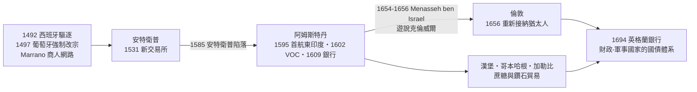

# 第三章第二節 宮廷猶太人與現代財政國家的胚胎

## 一、Hofjude：戰爭與宮廷之間的金融奇才

三十年戰爭（1618–1648）是歐洲財政史的斷層線：戰費規模遠超封建稅收，各邦君主被迫向私營金融家緊急借貸。在這個斷層上，湧現了一個新角色——宮廷猶太人（德文 Hofjude，複數 Hofjuden）：以貸款、軍需供應、鑄幣承包換取王室特許保護信（Schutzbrief）與居住權的猶太金融家。他們是舊制度（Ancien Régime）的影子財政部。

最著名的是維也納的薩繆爾·奧本海默（Samuel Oppenheimer, 1630–1703）。他出身海德堡的奧本海默家族銀行世家，自 1680 年代起成為皇帝利奧波德一世的軍需與軍餉總供應商：1683 年維也納之圍期間，他籌措款項供應洛林的卡爾公爵（Charles of Lorraine）的解圍大軍；其後數十年，奧斯曼戰爭與西班牙王位繼承戰爭的軍費大量經他之手。他壟斷了神聖羅馬帝國軍隊的絕大部分軍需承包，麾下網絡延伸至法蘭克福、維也納與匈牙利。1703 年他猝逝，皇帝隨即賴帳並逮捕其家人，帝國財政幾近癱瘓——反證了宮廷猶太人已是國家機器的關鍵零件。

同一網絡中的薩姆森·韋特海默（Samson Wertheimer, 1658–1724），奧本海默的合夥人與侄婿，先後任維也納宮廷因素（Hoffaktor）、後為薩克森選帝侯與美因茲選帝侯服務，並長期擔任匈牙利猶太人的官方代表（Landesrabbiner）——金融與社群代表權集於一身，正是宮廷猶太人的典型雙重身分。在勃蘭登堡，腓特烈·威廉大選帝侯倚重的是伊斯特（Gompertz/Israel Aaron）等因素；到腓特烈大帝時代，宮廷因素韋特爾·埃弗萊姆（Veitel Heine Ephraim, 1703–1775）與丹尼爾·伊茨希（Daniel Itzig）承包了七年戰爭（1756–1763）的鑄幣與軍需——尤其是著名的「劣質鑄幣」（Ephraimiten，摻假錢幣）承包案，為普魯士戰時財政輸血，也讓 Ephraim 的姓氏成為柏林俗語中的貶詞。薩克森選帝侯國則有 Chaikin 家族世代經營宮廷因素與軍需承包，見證了這一職位的家族傳承性。

## 二、Jud Süß：宮廷猶太人的結構性脆弱

宮廷猶太人的權力與危險是一體兩面：他們替君主做的每一件事——徵稅、鑄幣、壟斷、發債——都由民眾承擔成本，而民眾看不到君主，只看得到猶太人。最悲劇性的標本是約瑟夫·祖斯·奧本海默（Joseph Süss Oppenheimer, 1698–1738）。他出身海德堡金融世家，1720 年代成為符騰堡公爵卡爾·亞歷山大（Karl Alexander）的財政顧問，替公爵重建邦國財政：發行債券、整頓鑄幣、經營彩票與郵政專營權，權傾一時，也招致等級議會（Landstände）與民間的深刻怨恨。1737 年公爵猝逝，祖斯立即被捕，1738 年 2 月在斯圖加特以「性接觸基督徒女性」等罪名被判絞刑，行刑時被吊在鐵籠中示眾六年。審判的司法瑕疵昭然——真正的罪名是替一位不得人心的君主執行財政政策。納粹 1940 年的反猶電影《猶太人祖斯》（Jud Süß）正是挪用了這樁三百年前的案子。

結構性脆弱可以概括為一個死結：

$$
\text{執行君主意志} \;\Longleftrightarrow\; \text{承接民怨} \;+\; \text{君主更替即清算} \quad\Rightarrow\quad \text{高報酬} \times \text{高死亡風險}
$$

宮廷猶太人是「現代國家財政的助產士」：他們示範了長期公債、軍需總承包、專營權融資與鑄幣政策的技術，等這些技術被官僚化、轉移到英國財政-軍事國家（fiscal-military state）的國債體系（1694 年英格蘭銀行成立）之後，他們個人的功能便逐漸被取代——歷史再次重演了「先驅者被體制吸收後拋棄」的劇本。

## 三、塞法迪網路：從安特衛普到阿姆斯特丹

與德意志阿什肯納茲宮廷猶太人平行，另一條金融血脈來自伊比利半島的葡萄牙裔「新基督徒」（Marranos，強迫改宗的猶太人）。1492 年西班牙驅逐猶太人、1497 年葡萄牙強制改宗之後，這批表面信天主教、暗地保持猶太信仰的商人，發展成橫跨里斯本—安特衛普—阿姆斯特丹—倫敦的貿易與金融網絡。他們的優勢是三重的：跨國親族信任網絡（降低匯兌與訊息成本）、多語言與多重身分（可在禁運體系間穿梭）、以及對信貸與匯票技術的世代掌握。

1531 年安特衛普新交易所（Nieuwe Bourse）落成，成為北歐第一個國際證券與商品交易中心，葡萄牙裔商人（如 Mendes、Ximénez 家族）是其中的要角。1585 年安特衛普陷落於西班牙，商人與資本大舉北遷；1590 年代阿姆斯特丹崛起，1595 年荷蘭船隊首航東印度群島成功後，1602 年荷蘭東印度公司（VOC）成立、1609 年阿姆斯特丹銀行（Wisselbank）創立，葡裔猶太社群（Talmud Torah 會堂，1675 年落成至今）也隨之在阿姆斯特丹獲得前所未有的宗教與商業自由——哲學家斯賓諾莎（Spinoza, 1632–1677）正是這個社群的兒子。

## 四、1656 年的倫敦：Menasseh ben Israel 與克倫威爾

英格蘭自 1290 年驅逐以來無猶太社群，但克倫威爾時期出現轉機。阿姆斯特丹的拉比與出版家瑪納塞·本·以色列（Menasseh ben Israel, 1604–1657）於 1655 年親赴倫敦，向護國公克倫威爾請願，理由混合了商業利益與彌賽亞神學（他相信猶太人散居到世界角落是救世主降臨的前提）。1655 年 12 月的 Whitehall 會議未做出正式決議，但法官們認定 1290 年驅逐令是王室特權行為、不阻礙個人和平居住；1656 年，克倫威爾默許猶太人秘密公開禮拜與取得墓地，英格蘭重新接納猶太人由此成為既成事實。此舉的動機一目了然：與西班牙的戰爭進行中，倫敦需要阿姆斯特丹的資本與訊息網絡——葡裔商人如 Carvajal 家族已在為克倫威爾提供敵情與匯兌。政治、軍事與金融的需求，再一次為一個被排斥的群體打開了制度之門。

## 五、結語：兩條血脈，一個方向

阿什肯納茲的宮廷猶太人提供了「向國家放貸」的技術與示範；塞法迪的 Marrano 網絡提供了「跨國資本流動」的組織形態。兩者在 1650–1750 年間於倫敦、阿姆斯特丹、維也納交會，共同參與了現代財政國家的誕生：國債、央行、軍需承包、專營權融資——這些今日被視為「現代性」的制度，其胚胎期都曾以猶太金融家為中介與試驗場。他們的代價是結構性的：霍夫猶太人（Hofjuden）的地位依附於君主的私人意志，Jud Süß 的絞架與奧本海默死後的清算提醒我們，這個位置本身就是一張不定期到期的債券。而當民族國家與國債市場在十八世紀末成熟、金融業官僚化之後，宮廷猶太人的時代便落幕了——他們留下的，是一個已經學會自己借錢的國家。
