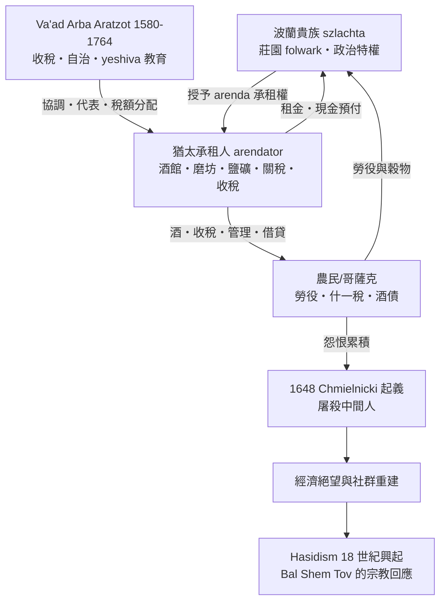

# 第三章第三節 波蘭—立陶宛：隔都之外的另一個世界

## 一、從 Kalisz 特許狀到「猶太人的天堂」

當西歐在十二至十三世紀以禁息令、行會排斥與驅逐令把猶太人逼進縫隙市場時，東歐卻展開了方向相反的運動。1264 年，大波蘭公爵波列斯瓦夫·虔誠者（Bolesław the Pious）頒布《卡利什特許狀》（Statute of Kalisz），以三十五條條款保護猶太人的人身、貿易與信仰自由，其藍本是奧地利的弗雷德里希二世（Friedrich II of Austria, 1244 年）的猶太特許狀。這份文件成為波蘭猶太法的基石：猶太人不受城市法庭管轄而由王庭官員（wojewoda）審理猶太人案件、會堂與墓地受保護、禁止血誣指控。

到了卡齊米日三世「大王」（Casimir III the Great, 1333–1370 在位）時代，特許狀於 1334、1364、1367 年多次擴張與確認，並隨波蘭向東擴張（尤其是 1385 年克列沃聯盟與 1569 年盧布林聯合成立波蘭—立陶宛聯邦，Commonwealth）而覆盖廣袤新領土。從黑海到波羅的海的廣大土地、稀疏的人口、貴族急需開發經濟，使猶太移民獲得西歐罕見的機會。16 至 17 世紀中葉，波蘭—立陶宛因此被後世史家稱為 Paradisus Iudaeorum——「猶太人的天堂」：猶太人口從 1500 年的約 2 至 3 萬，增長到 1648 年前的約 40 萬，佔當時世界猶太人口的一半以上。經濟結構也不同於西歐：這裡的猶太人不只是典當商，而是莊園管理者、木材與穀物貿易商、稅收承租人、酒館經營者與手工業者。

## 二、馬德堡法與排除的悖論

波蘭的城鎮在十三世紀起普遍採用馬德堡法（Magdeburg Law / Magdeburger Recht）作為自治憲章——從 1257 年的克拉科夫到後來數以百計的城鎮。這套德國來的城市法保障市民自治與商業秩序，但同時以德裔市民為主體，行會與市議會往往將猶太人排除在「市民」之外：猶太人常被限制住在指定街區（雖非西歐式封閉隔都，克拉科夫的猶太區 1495 年才被「建議」遷往卡齊米日 Kazimierz）、繳納特別稅、不得進入部分行會。於是出現一個悖論：城市自治越發達，猶太人越被推向城市之間的鄉野與莊園——正好是貴族最需要他們的地方。

## 三、Arendator：莊園經濟的中樞神經

波蘭—立陶宛聯邦的經濟基礎是所謂「二次農奴制」：貴族（szlachta）莊園（folwark）以強制勞役生產穀物，經維斯瓦河出口到但澤（Gdańsk）供應西歐。掌握土地的貴族缺的是管理者與市場中介，而猶太人供給了這一切——透過 arenda（波蘭文 arenda，源自烏克蘭文 оренда，意為「承租」）制度。Arendator（承租人）向貴族預付一筆租金，取得經營權：管理莊園的酒館（propinacja，壟斷性蒸餾酒銷售）、磨坊、鹽礦（如維利奇卡 Wieliczka 鹽礦的部分稅收與經營）、關稅所、橋樑通行費、乃至整片莊園的徵稅權。到十七世紀，大型承租契約動輒數千至數萬茲羅提，需由猶太財團（如克拉科夫、盧布林的銀行家集團）合資組成 arenda 集團（kupa）承接。

這使猶太人成為聯邦經濟的中樞神經：貴族得到現金與專業管理，農民則在酒館與稅所遇到猶太承租人——所有的制度性壓力（酒壟斷、教會什一稅、勞役）都以猶太人為面孔呈現。用結構語言說，猶太人是典型且放大版的 middleman minority：經濟上不可或缺，社會上極端暴露。

## 四、Va'ad Arba Aratzot：世界史上最大的猶太自治

猶太人在波蘭的自治規模是空前絕後的。1580/1581 年，波蘭王室把向猶太社群徵收總額稅（統一稅）的任務「外包」給猶太人自己，於是成立了四國議會（希伯來文 Va'ad Arba Aratzot，意第緒文 Der Veer Lender，指大波蘭、小波蘭、波多利亞—沃里尼亞、立陶宛——立陶宛 1623 年另設 Va'ad Medinat Lita）：由各地區（kahal）選出的代表組成，每年在盧布林（後輪流於盧布林、雅羅斯瓦夫、皮尼喬夫）召開大集市期間的會議。其職能涵蓋：與王室談判並分配稅額、設立與管理 the Three Lands Yeshiva（1595 年起由 Mordechai Jaffe 創立的中央高等律法學院）、監管宗教法庭與出版審查、協調對外防護（如反血誣）、管理 arenda 特許與社群賑濟。這實質上是一個平行國家的立法與財政機構——運作到 1764 年被最後一位聯邦國王斯坦尼斯瓦夫·奧古斯特（Stanisław August Poniatowski）解散（部分因為該機構在戰亂中已財政破產），共存續約一百八十年。教育上，四國議會支持遍佈城鎮的 cheder 與 yeshiva 體系，使波蘭—立陶宛成為此後三百年全世界猶太律法學術（如 1550 年代克拉科夫的 Moses Isserles「Rema」的宗教法權威）的中心。

## 五、1648：中間人結構的總爆發

「天堂」的代價在 1648 年總爆發。赫梅利尼茨基起義（Chmielnicki Uprising, 1648–1657）：扎波羅熱哥薩克首領博格丹·赫梅利尼茨基（Bohdan Khmelnytsky, 約 1595–1657）聯合克里米亞韃靼人反抗波蘭貴族統治。哥薩克與農民的怨憤同時指向貴族與其猶太承租人——正因猶太人是收稅、賣酒、管理莊園的日常面孔，屠殺便以猶太人為首要目標。1648–1649 年間，涅米羅夫（Nemyriv）、圖利欽（Tulczyn）等數十個城鎮的猶太社群被殲滅；史學界對死亡數字的估計從數萬到十萬以上不等（傳統數字十萬以上，近年 Shaul Stampfer 2013 年研究下修至約一萬八千至二萬，但逃亡與毀滅的社群難以計數）。起義之後是 1654–1667 年的俄波戰爭（「大洪水」）與 1655 年瑞典入侵，聯邦人口銳減，猶太社群更是首當其衝。

## 六、Hasidism：從經濟絕望中誕生的宗教

大毀滅之後的百年間，波蘭—立陶宛的猶太社會在廢墟上重建，卻再也回不到從前的繁榮：聯邦在十八世紀衰落、arenda 體系萎縮、1740 年代又有赫梅利「後裔」烏馬尼（Uman）一帶的 Haidamak 屠殺（1768 年）。就在這經濟與政治的長夜中，18 世紀 30–40 年代，波多利亞出現了以色列·本·以利以謝——巴爾·謝姆·托夫（Israel ben Eliezer, the Baal Shem Tov, 約 1698–1760）。他本人曾做過承租助理、泥土搬運工與「善名者」（民間醫者），其教導——上帝遍在、喜樂事奉（simcha）、誠懇禱告勝過學問、每個平凡人都能親近神——像野火一樣在烏克蘭與加利西亞的貧苦猶太人中傳開，到 18 世紀末已席捲波蘭猶太人口的一半以上。傳統猶太學術（rabbinic elite，如维尔纽斯的「Gaon」Elijah ben Shlomo Zalman, 1720–1797，曾於 1772 年頒布禁令）視其為異端，但無法阻止它。從社會史看，Hasidism 是底層猶太人對「中間人地位崩潰」的宗教回應：當 arenda 的經濟階梯塌了，它提供了一條不依賴財富與學問的靈性階梯。

## 七、結語：天堂的辯證

波蘭—立陶宛的故事與西歐構成完美鏡像：西歐以排斥造就縫隙市場（放貸），東歐以特許造就整合市場（承租與管理）。兩者殊途同歸之處在於：猶太人都被放在「經濟必需、社會暴露」的中間人位置——一邊對著權力，一邊對著怨恨。Paradisus Iudaeorum 與 1648 年的大屠殺是同一結構的兩面；而 Va'ad Arba Aratzot 證明了猶太社群具備近乎國家級的自我治理能力，Hasidism 則證明了這個社群在經濟基礎崩潰時，能以宗教創新完成文化重建。當 1772、1793、1795 年俄普奧三次瓜分波蘭、把數百萬猶太人併入俄羅斯帝國的「栅欄區」（Pale of Settlement）時，這個在隔都之外長成的世界，即將迎來它的下一場大變局。
