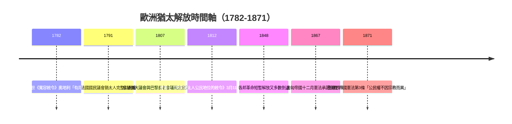
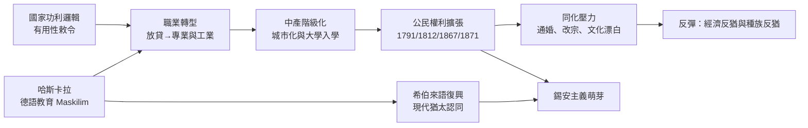

# 4.1 哈斯卡拉與解放：門德爾松、拿破崙與公民身份

## 一、柏林啟蒙的起點：門德爾松與《耶路撒冷》

1779年，摩西・門德爾松（Moses Mendelssohn, 1729-1786）出版《耶路撒冷，或論宗教權力與猶太教》（*Jerusalem, oder über religiöse Macht und Judentum*），這部著作被後世視為猶太思想進入現代的宣言之書。門德爾松出身德紹（Dessau）貧困的托拉學生家庭，1743年隨其師弗蘭克爾（David Fränkel）進入柏林，靠絲綢貿易與數學著述崛起，1763年以《證明靈魂不朽》獲普魯士科學院獎，被康德稱許，並成為萊辛《智者拿坦》（*Nathan der Weise*, 1779）中拿坦的原型。他以德語寫作、參與德國啟蒙運動（Aufklärung），向歐洲讀書界證明：一個猶太人可以同時是理性哲學家與虔誠教徒。

門德爾松的核心論證是「思想自由」與「政教分離」：國家無權強制信仰，宗教社團亦無權施行異端懲罰；猶太教作為一種「啟示立法」，其誡命僅約束猶太社群內部，與公民義務並不衝突。這為猶太人「以猶太身份取得公民權」提供了哲學基礎——但門德爾松本人畢生未獲正式公民權，普魯士只頒給他「受保護猶太人」（Schutzjude）身分，說明啟蒙的論述遠走在制度之前。

門德爾松的更大影響在於教育與語言。1783年，他與友人完成《摩西五經》德語譯本（以希伯來字母排印的德文，即所謂 Bi'ur），並由其學生納夫塔利・赫茨・魏邁澤（Naftali Herz Wessely）撰寫序言《和平與真理的話語》（*Divrei Shalom ve-Emet*），主張猶太兒童應學習世俗知識。同年「猶太自由學校」（Jüdische Freischule, 1778年創立）的師生創辦德語期刊《搜集者》（*Ha-Me'assef*），標誌著哈斯卡拉（Haskalah，希伯來語「啟蒙」）運動的正式展開。

## 二、哈斯卡拉：Maskilim 的文化工程

哈斯卡拉的支持者自稱「馬斯基勒」（Maskilim，啟蒙者），他們的綱領可概括為四項：

1. **語言轉向**：學習德語與歐洲語文，將希伯來語從祈禱與註經語言改造成世俗文學與科學語言；
2. **教育改革**：設立兼授數學、地理、歷史與手工技藝的現代學校，如柏林猶太自由學校（1778）、布累斯勞的威爾海姆學校（Wilhelmsschule, 1791）；
3. **職業重構**：批評猶太人過度集中於放貸、舊衣買賣與流動商販，主張轉向農藝、手工業與「有用」的職業；
4. **出版與公共領域**：透過《搜集者》、《猶太人備忘錄》（1840年代路德維希・菲利普森創刊）等刊物，建立德語猶太公共輿論。

這場文化工程與國家的功利邏輯一拍即合。普魯士官員克里斯蒂安・威廉・馮・多姆（Christian Wilhelm von Dohm）1781年受門德爾松之託撰寫《關於猶太人公民改善》（*Über die bürgerliche Verbesserung der Juden*），提出著名論點：猶太人的「缺陷」是政策造成的，不是天性；給予權利，他們自然成為有用公民。哈斯卡拉因此具有內在的張力——它既是猶太人的自我革新，也部分內化了國家「改造以換取接納」的語法。

## 三、約瑟夫二世與「有用性」的邏輯

1781年10月至1782年1月，神聖羅馬皇帝約瑟夫二世（Joseph II, 1741-1790）頒布《寬容敕令》（Toleranzpatent，奧地利本部1782年1月2日，匈牙利稍後），允許猶太人進入大學、開設工廠、從事自由職業、購置土地（有條件），並取消「人頭稅」（Leibmaut）。但同時代的《系統性規制》（Systematicalches Hauptreglement, 1782）與後續敕令卻附帶嚴格義務：1787年命令猶太人採用德語姓名、1788年強制猶太青年兵役、學校必須以德語授課、拉比須具大學學歷。

這套政策的哲學是啟蒙專制主義的「有用性」（Nützlichkeit）邏輯：國家解放猶太人，不是承認天賦權利，而是要將猶太人從「無用」的寄生性貿易改造為「有用」的生產性人口。哈斯卡拉的精英與國家的官僚在「改革猶太人」這一點上同床異夢：前者視世俗教育為自我實現，後者視之為歸化的手段。這種「以教育換權利、以同化換接納」的契約結構，成為此後近百年歐洲猶太政策的基本模型——從加利西亞的德語學校到俄國亞歷山大一世的「基督教化農業殖民地」計畫，皆是同一邏輯的變奏。

## 四、法國大革命與拿破崙的「審判」

真正的制度突破發生在法國。1789年9月28日，南錫（Nancy）猶太社團向制憲國民議會請願；1791年9月27日，議會通過決議：「凡具備公民誓言者，猶太人亦得享有完整的公民權利」——猶太人首次在歐洲大國成為法律上的公民。阿爾薩斯的猶太人（約三萬人，多為小商販與放貸者）隨即捲入廢除封建債務的風暴，1790年代的反猶騷動已預告了解放的社會摩擦。

拿破崙對此做了一次史無前例的「制度審查」。1806年，阿爾薩斯頻傳債務糾紛，內政部長夏普塔爾建議召集猶太顯貴；同年7月29日至8月7日，一百一十一位代表出席「猶太長老會議」（Assemblée des Notables），法國政府提出十二個問題，核心是：猶太人是否視法國人為同胞？是否允許異族通婚？拉比婚姻裁決是否服從民法？

1807年2月9日至3月9日，由大議會（Grand Sanhedrin）——刻意借用法利賽時代最高宗教議會之名——在巴黎召開，作出十二項裁定：法國是猶太人的祖國；民法高於宗教法（拉比婚姻判決服從民事登記）；允許與基督徒通婚；放貸須遵守國家利率與法律。同年12月，巴黎正式議會（Grand Sanhedrin）以宗教會議形式確認之。這是歐洲國家第一次以「調查—裁定—認可」的程序，將猶太法置於民族國家主權之下審查，堪稱「解放的凱恩斯式談判」：以集體承諾換取個體權利。

但拿破崙同時頒布針對性極強的「侮辱性敕令」（Décret infâme, 1808年3月17日），在阿爾薩斯等地限制猶太人遷徙、禁止寄居、凍結放貸業務十年，並強迫採用固定姓氏（此即今日歐洲猶太姓氏如「門德爾松」「羅森塔爾」大量定型的時代）。解放與歧視並行，成為整個19世紀的常態。

## 五、解放的辯證：權利與同化的鐘擺

解放並非一次性事件，而是跨越近百年的漸進過程，且常因政治需要而逆轉：1815年維也納會議後，法蘭克福、漢堡、利貝克等自由市曾撤回法國時期的權利（法蘭克福1815年「取消解放」案引發羅斯柴爾德家族與丹麥首相馮・貝恩斯托夫的干預）。

以普魯士為例：1812年3月11日，哈登貝格（Karl vom Stein zum Altenstein 體系下的改革首相卡爾・馮・哈登貝格）頒布《關於猶太人公民地位的敕令》，授予猶太人國家公民身分與自由擇業權，但仍排除其擔任公職與軍官——「國家中的國家」疑慮從未消散。1869年北德意志邦聯《平權法》與1871年帝國憲法才完成形式平等；奧匈帝國則以1867年十二月憲法確立「公民權利不因宗教而異」。俄國則直到1917年二月革命才廢除柵權區（Pale of Settlement, 1791-1917）。

## 六、教育與職業轉型：從放貸者到專業者

解放的物質基礎是猶太社群在教育與職業上的重塑。以柏林為例：1800年前後，猶太人仍在放貸、珠寶與紡織貿易中高度集中；到1850年代，柏林猶太人口中醫生、律師、記者、教師比例已遠高於非猶太市民——因為猶太社群對教育的投資遠超平均。統計顯示，19世紀末柏林大學學生中猶太裔比例一度達兩成以上，而柏林猶太人口僅占全市約5%。這正是桑巴特在《猶太人與經濟生活》（1911）所分析的「精神氣質」的轉型：從流動資本與信用的傳統優勢，轉向人力資本與知識密集產業。

這一「教育—職業—權利—認同」的驅動迴路，是第四章的樞紐：啟蒙打開了公民社會的門，也製造了「作為猶太人的德國人」的身份撕裂——這正是下一節反猶主義現代轉型與錫安主義誕生的深層前因。

## 七、結語

從門德爾松的《耶路撒冷》到拿破崙的長老會議，猶太解放是一場跨越三代的談判：哲學家提供論述，國家提供契約，社群付出同化代價。它證明了制度變遷可以由思想先行，但也預示了「以有用性換權利」模式的脆弱——一旦經濟危機或民族主義興起，這份契約便可能被單方面撕毀。本章後兩節將分別處理這份契約的「經濟紅利面」（羅斯柴爾德時代）與「政治反噬面」（現代反猶主義）。
