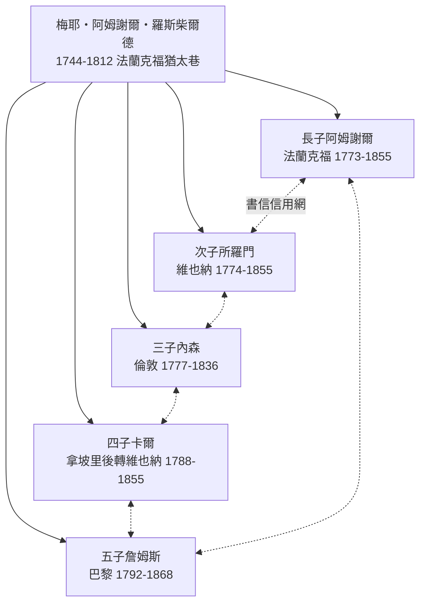
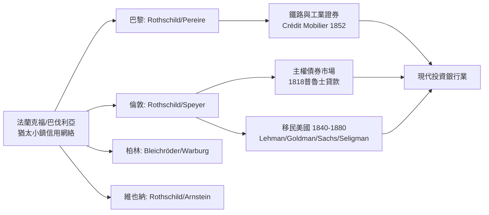

# 4.2 羅斯柴爾德時代：猶太人與19世紀全球金融

## 一、法蘭克福猶太巷的起點

1744年，梅耶・阿姆謝爾・羅斯柴爾德（Mayer Amschel Rothschild, 1744-1812）出生於法蘭克福猶太巷（Judengasse）——一條長約三百公尺、由鐵鏈鎖閘管控的封閉街區，直至1796年才因法軍砲擊而部分拆毀。他的父親經營布匹與貨幣兌換，梅耶年輕時在漢諾瓦的奧本海默銀行做學徒，返鄉後以古錢幣與徽章買賣起家，1769年取得黑森宮廷「宮廷代理人」（Hoffaktor）資格，1770年與施佩耶爾（Schneeberger/Schnapper）家族聯姻鞏固商業網絡，最終成為黑森-卡塞爾選侯威廉九世的金融代理人之一。

1806年，威廉九世在耶拿戰敗後流亡，將鉅額財富託付梅耶保管；這筆資金成為羅斯柴爾德帝國的第一桶金。梅耶與妻子居特爾（Gutle, 1753-1849）育有十九個子女（存活十人），五個兒子——阿姆謝爾（Amschel, 1773-1855）、所羅門（Salomon, 1774-1855）、內森（Nathan, 1777-1836）、卡爾（Karl, 1788-1855）、詹姆斯（James, 1792-1868）——分駐五都：

這一「五子分駐」的制度設計，本質上是把家族信用轉化為跨國清算網絡：在電報問世前，訊息即資本，而五兄弟之間的私營書信網（每週多次、以密碼與猶太-德語混合體書寫）比任何官方管道都快。內森1798年赴曼徹斯特做紡織出口，1805年移居倫敦轉型票據貼現，1811年成立 N M Rothschild & Sons，由此把歐陸信用接入倫敦資本市場。

## 二、威靈頓戰爭融資與滑鐵盧傳說

1813至1815年，內森承辦了英國對威靈頓半島戰役與百日王朝時期的大陸補給融資。工程浩大：他必須將倫敦的英鎊兌換為法蘭德斯與西班牙戰場所需的金幣。內森的辦法是套利式購金——以低價收購東印度公司剛在市場拋售的黃金，再透過其弟詹姆斯在巴黎的網絡，把部分黃金轉運至荷蘭與西班牙前線，甚至出現「透過巴黎向威靈頓供金」的戲劇性逆向操作。1815年滑鐵盧戰役前後，羅斯柴爾德兄弟累計為英國政府輸送約一百萬英鎊資金與數十萬盎司黃金，戰後內森被追授奧地利男爵爵位（1822年五兄弟共同獲封，紋章為「五箭束」——典出《塔木德》「一箭易折、五箭難斷」）。

關於「內森因先獲知滑鐵盧戰報、在倫敦證券交易所壓低價格後狂買英國公債而一夜暴富」的傳說，必須嚴謹辨析：此說最早見於1830年代薩克雷引述的倫敦街談，後被1913年 John Reeves 的家族史誇大。史實層面：內森確實擁有當時最快的訊息通道（其代理人羅沃斯 Rowworth 於6月20日以鴿、快船與驛馬接力將戰報先於官方送抵倫敦），他確實在戰前、戰中大量買入英國統一公債（Consols）——但動機是賭英國勝利而非「先賣空製造恐慌後撿便宜」；戰後英國公債並未如傳說般暴漲數倍，內森的獲利來自長期持有與戰後承銷，而非單日操縱。尼爾・弗格森在《羅斯柴爾德家族》（1998）以家族檔案核實：傳說是「訊息優勢被妖魔化」的產物——訊息租（information rent）是真實的，操縱恐慌則是神話。

## 三、國際債券市場與公共債務的證券化

羅斯柴爾德兄弟的真正歷史貢獻，是將公共債務變成可跨國流通、可持續定價的證券。18世紀的公債多靠個別包稅人與少數銀行承銷；1818年內森為普魯士承銷五百萬英鎊羅森貼現貸款（Rothschild loan），首次讓外國主權債在倫敦交易所掛牌並建立償債基金；此後1820至1840年代，法國、奧地利、俄國、巴西、西班牙的貸款皆循此模式。這一變遷的政治意義深遠：當國債由成千上萬的中產階級持有、由跨國銀行定價，政府的違約成本便由「對付幾個債主」變成「對付整個資本市場」——債券市場成為比軍隊更便宜的紀律工具。

以最簡化的定價模型看，羅斯柴爾德的利潤核心有三：承銷價差、匯兌與黃金套利，以及訊息租：

$$P_{bond}=\sum_{t=1}^{T}\frac{C}{(1+i+\lambda)^{t}}+\frac{F}{(1+i+\lambda)^{T}}$$

其中 $i$ 為無風險利率， $\lambda$ 為主權風險溢酬。羅斯柴爾德的訊息優勢使他對 $\lambda$ 的估計早於市場數日乃至數週：

$$\pi_{info}\approx (\lambda_{mkt}-\lambda_{R})\times \text{持倉規模}$$

當家族書信網先於官方得知戰局、內閣更迭或財政赤字，他們便能在 $\lambda_{mkt}$ 尚未調整時完成建倉。這是「知識即資本主義的關鍵生產要素」的最純粹案例，也是桑巴特式「猶太人的抽象計算能力」論題最可檢驗的場域——但必須補充：這種優勢來自制度化的家族治理與書信紀律，而非任何「種族天賦」。

## 四、鐵路、電報與佩雷爾兄弟的挑戰

1830至1860年代，羅斯柴爾德家族的第二戰場是鐵路。詹姆斯主持巴黎至魯昂、勒阿弗爾的北方鐵路（1843年通車）、奧地利的北鐵路（Nordbahn，1836年特許），使家族收入結構從債券利息轉向實業股息。但挑戰者出現了：聖西門主義（Saint-Simonianism）的信徒、塞法迪猶太裔的埃米爾・佩雷爾（Émile Pereire, 1800-1875）與伊薩克・佩雷爾（Isaac Pereire, 1806-1880）兄弟，於1852年創立動產信貸銀行（Crédit Mobilier），以「零售存款集資—認股鐵路與重工業—證券上市流通」的新模式，繞開羅斯柴爾德依賴的私人大客戶網絡，直接把儲蓄大眾變成投資人。

1850年代的「佩雷爾—羅斯柴爾德戰爭」是現代投資銀行業的第一次模式競爭：佩雷爾兄弟拿下東鐵路等特許權、推動西班牙鐵路；詹姆斯則以聯合貸款與政府關係反制，並在1857年金融恐慌中目睹動產信貸銀行受重創、1867年終至清算。這場競爭預示了後來德國環球銀行（ universal bank）與英美證券市場兩種金融路徑的分岔。同時代，電報（1840年代歐陸電報網建成）逐步侵蝕了羅斯柴爾德的訊息租——1851年後，家族書信中已自承「訊息不再值錢，信用與規模才是」。

## 五、猶太金融家族的星座

羅斯柴爾德不是孤例，而是一個星座中最亮的一顆：

- **格森・布萊希羅德（Gerson von Bleichröder, 1822-1893）**：柏林私人銀行家，1860年代起成為俾斯麥的私人財務代理，承辦普法戰爭賠款（1871年五十億法郎）的匯兌操作與羅馬尼亞、俄國貸款，是「金融外交」的典型——弗里茨・斯特恩的《金與鐵》（Gold and Iron, 1977）以他為軸心剖析德意志帝國的政商結構，也剖析了這位帝國首富如何因猶太出身而終身不得進入宮廷核心。
- **斯佩耶爾家族（Speyer）**：法蘭克福起家，轉戰倫敦與紐約，承辦美國鐵路與墨西哥、中國公債。
- **塞利格曼家族（Seligman）**：巴伐利亞猶太移民至美國，由馬鞍與布匹生意轉型投資銀行，1870年代承銷美國政府貸款。
- **瓦爾堡家族（Warburg）**：漢堡的古老猶太銀行世家（可追溯至1559年之前的威尼斯 Warburg 家族譜系），1898年馬克斯・瓦爾堡（Max Warburg, 1867-1946）主持 M. M. Warburg & Co，後任德國帝國銀行董事；1938年因其猶太身份被迫出售銀行流亡美國——本節故事的悲劇註腳。
- **美國路徑**：1840至1880年間，約十萬德意志猶太人（多為巴伐利亞、普法爾茨小鎮居民）移民美國，由行商（peddler）起家轉型百貨與金融：萊曼兄弟（Lehman Brothers, 1850年於阿拉巴馬由亨利・萊曼三兄弟創立，以棉花貿易起家）、高盛（Goldman Sachs, 1869年馬庫斯・高曼於紐約創立，1882年女婿薩克斯入夥）、庫恩-羅布（Kuhn, Loeb & Co，雅各布・希夫 Jacob Schiff 於1875年入主，後承銷日本日俄戰爭公債）。這批「德國猶太裔投資銀行家」將法蘭克福式的信用網絡移植到紐約，成為20世紀美國金融資本主義的種子。

## 六、結語：紅利與怨恨的共生

1848年，梅泰尼赫在法蘭克福議會中的名言——「羅斯柴爾德一家是歐洲的第六強權」——道出了猶太金融家的歷史高度；但同一批年代，法蘭克福街頭也爆發了針對猶太人的騷動（1848年8月的「Hepp-Hepp」暴動餘波）。金融資本主義的紅利與對「猶太高利貸者」的怨恨，是同一枚硬幣的兩面：債券持有人的收益是納稅人的成本，鐵路大亨的財富是農民的票價。當1873年大蕭條降臨，這種結構性怨恨便被政治企業家收購、改寫——下一節將處理它的意識形態轉型。
