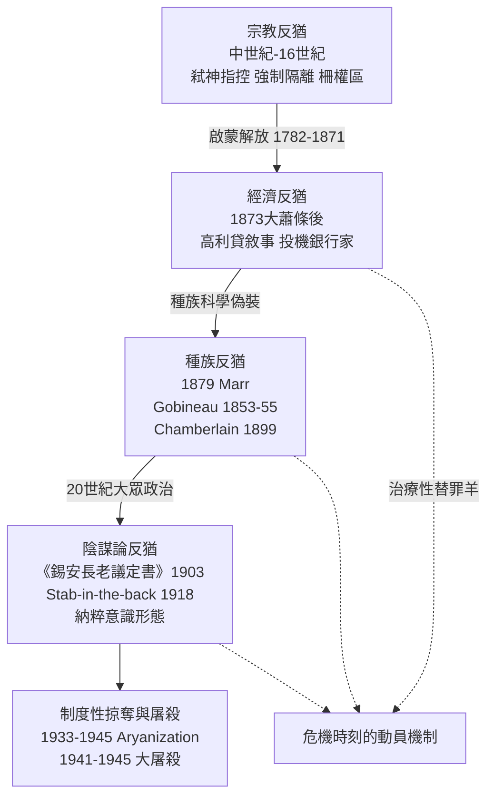

# 4.3 反猶主義的現代轉型：從宗教偏見到種族意識形態

## 一、一個新詞的誕生：Wilhelm Marr, 1879

1879年，漢堡記者威廉・馬爾（Wilhelm Marr, 1818-1904）出版小冊子《猶太教對德意志的勝利：論非宗教立場》（*Der Sieg des Judenthums über das Germanenthum*），並創立「反猶聯盟」（Antisemitenliga）。這是「Antisemitismus」一詞首次作為政治標語使用——馬爾刻意造新詞，是為了宣告：這不是舊式的宗教仇恨（Judenhaß），而是基於「種族」與經濟競爭的世俗立場。他自陳不信基督教神學，故「反猶」與改宗無關；猶太人即使受洗也無法「變成」德國人。這一修辭策略極其成功：它把偏見從懺悔室搬到議會與報紙，從神學問題變成「民族健康」問題。

幾乎同時，柏林宮廷布道家阿道夫・施特克爾（Adolf Stoecker, 1835-1909）於1878年成立基督教社會黨（Christlichsoziale Partei），以「基督教-日耳曼」語言動員小市民與手工業者，將反猶與社會福利訴求捆綁——他是第一位把反猶主義系統運用於大眾選舉政治的德國政治家。在法國，愛德華・德呂蒙（Édouard Drumont, 1844-1917）於1886年出版《法國猶太人》（*La France juive*），兩年內賣出十萬冊以上，1892年創辦《自由言論報》（*La Libre Parole*），把猶太人與1789年大革命、「法蘭西的猶太化」連結，為日後的反德雷福斯陣營提供了意識形態軍火庫。

## 二、1873年大蕭條與替罪羊機制

轉型的物質觸媒是1873年5月的維也納股市崩盤——由1870至1873年的「建國繁榮」（Gründerzeit）泡沫破裂引發，隨後蔓延德、美，開啟長達二十年的「大蕭條」（Great Depression, 1873-1896，農產品價格崩跌與長期通縮）。在經濟民族主義者眼中，繁榮期的投機銀行家與蕭條期的失業手工業者之間的鴻溝，需要一個敘事來解釋——猶太金融家成為現成的能指。維也納的格奧爾格・馮・舍納雷爾（Georg von Schönerer, 1842-1921）於1880年代把種族反猶與泛日耳曼主義結合；卡爾・呂埃格爾（Karl Lueger, 1844-1910）1897年當選維也納市長，其基督教社會黨以「市營反猶」（把煤氣、電、電車國有化與反猶口號同售）贏得小市民選票——青年希特勒在維也納（1908-1913）親眼目睹的，正是這套「民主反猶主義」的教科書。

替罪羊機制（scapegoat mechanism）在結構層面的解釋力來自猶太人的「中間人」位置。齊格蒙特・鮑曼之前，社會學家格奧爾格・齊美爾（Georg Simmel）在1908年《陌生人》（*Der Fremde*）一文中指出：陌生人「今天來、明天留下」，他既在群體之內又天然脫離派系鬥爭，因而常被委以客觀交易的中介角色——商人、裁判、放貸者。猶太人是歐洲「陌生人」的原型：他們因被排除在行會與土地之外（前現代制度的結果），只能進入貿易與金融這類「空間上流動、風險上中性」的行業；一旦危機來臨，中介位置便從功能優勢變成攻擊標靶。亨利・皮朗（Henri Pirenne）的中世紀城市研究與桑巴特《猶太人與經濟生活》（1911）皆揭示：猶太人的「經濟特殊性」是被歐洲制度的排斥所塑造，再被反猶話語反過來指控為「本性」。

## 三、德雷福斯事件與錫安主義：解放的失敗診斷

1894年10月，法國砲兵猶太裔上尉阿爾弗雷德・德雷福斯（Alfred Dreyfus, 1859-1935）被誣控向德國出賣軍事情報，同年12月被判終身流放魔鬼島；1896年皮卡爾上校查明真兇為埃斯特拉齊少校，軍方卻掩蓋；1898年左拉發表《我控訴》（*J'accuse…!*，1月13日刊於克雷孟梭的《震旦報》）；經兩度重審與再定罪後，德雷福斯於1899年9月獲總統特赦，1906年7月12日最高上訴法院平反、復職並授榮譽勳章。長達十二年的事件撕裂法國：反德雷福斯陣營中，「猶太人不能是真正的法國人」成為軍隊、教會與民族主義報刊的共同語法。

在巴黎旁聽審判的維也納記者特奧多爾・赫茨爾（Theodor Herzl, 1860-1904）得出結論：**解放已經失敗**。他在1896年出版《猶太國》（*Der Judenstaat*），論證反猶主義不是可被同化消除的偏見，而是歐洲民族國家結構的常數；猶太問題的解方不是融入，而是建國。1897年8月，第一屆錫安主義大會在巴塞爾召開，通過《巴塞爾綱領》：「錫安主義旨在為猶太民族在巴勒斯坦建立一個受公法保障的家園。」與哈斯卡拉的路線分裂就此公開：門德爾松的後裔們相信「教育與公民德行終將贏得接納」，赫茨爾則斷言「只要主權缺席，任何德行都不兌現」。

值得強調的辯證是：錫安主義不是反猶主義的簡單鏡像，而是對「解放契約脆弱性」的理性回應。它吸收了反猶主義的兩個前提——猶太人被視為一個「民族」（而非僅是宗教群體）、歐洲民族國家不會真正容納他——卻把結論從「清除」倒轉為「自決」。這是思想史上的弔詭：種族反猶主義在邏輯上竟為錫安主義鋪了路。

## 四、從《議定書》到 Aryanization：20世紀的悲劇

1903年，俄國秘密警察在聖彼得堡刊印偽書《錫安長老議定書》（*Протоколы сионских мудрецов*），聲稱揭發猶太人操縱世界金融、媒體與革命的陰謀；1920年英、美譯本問世，福特在《迪爾本獨立報》連載之（後於1927年公開道歉）。一戰後，「背後一刀」（Dolchstoßlegende）神話把德國戰敗歸咎於「猶太布爾什維克與猶太資本家」——兩個互相矛盾的指控竟能並存，恰好證明陰謀論的語法無須經驗內容，只需一個可以承載怨恨的符號。

1933年1月30日希特勒上台後，迫害迅速制度化：4月1日全國抵制猶太商店、4月7日《重設專業公職法》清洗猶太公務員、1935年9月紐倫堡法剝奪公民權並禁止通婚。經濟上的核心機制是「雅利安化」（Aryanization, 1933-1945）——強迫猶太人賤賣企業與房產予「雅利安」買家：1938年德奧合併後維也納的「強制出售」在數月內完成數千家；1938年11月9至10日的水晶之夜（Kristallnacht）摧毀約一千四百座會堂與七千餘家商店，此後猶太企業近乎歸零。據估計，納粹德國透過強徵稅、凍結帳戶與賤價收購掠奪猶太財產以十億帝國馬克計，戰後西德至1965年為止對以色列與倖存者的賠償（盧森堡條約, 1952）則以百億馬克計——掠奪與賠償之間的巨大差額，正是大屠殺不可逆性的經濟注腳。

1941至1945年，最終解決方案（Endlösung）在萬湖會議（1942年1月20日，海德里希主持）完成科層化分工，約六百萬猶太人被屠殺。戰後的反思漫長而遲緩：1950至60年代西德學界以桑巴特遺產為焦點展開「猶太資本主義」論戰的清理；1979年美國電視劇《大屠殺》與1985年西德總統魏茨澤克的「5月8日是解放日」演說、柏林「絆腳石」（Stolpersteine, 1992年起 Gunter Demnig 發起）計畫，代表記憶政治的世代更替。學術上，漢娜・阿倫特《平庸之惡》（1963）與戈爾德哈根爭論（1996）皆圍繞同一問題：大屠殺是現代性科層制的產物，還是德國特殊文化的產物？——無論何者，它都是第四章前兩節故事的終點：啟蒙許諾的解放契約，在極端危機中可以崩解為滅絕行政。

## 五、結語：意識形態的演化樹

反猶主義的現代轉型，本質上是一套古老偏見對現代性危機的四次「適應性突變」：宗教時代以神學定罪；經濟時代以市場怨恨定罪；種族時代以偽科學定罪——使偏見不可退出（改宗無效）、可遺傳、可統計（人口學家計算「血統比例」）；陰謀論時代則以全球操縱敘事定罪——使偏見擁有解釋一切危機的全能框架。每一階段都嫁接了當時最先進的媒介（報紙、大眾選舉、偽科學、廣播），這提醒我們：技術與制度從不自行選擇善惡，它們放大既有社會怨恨的訊號。理解這棵演化樹，是理解20世紀、乃至防範下一次危機動員的最低成本保險。
