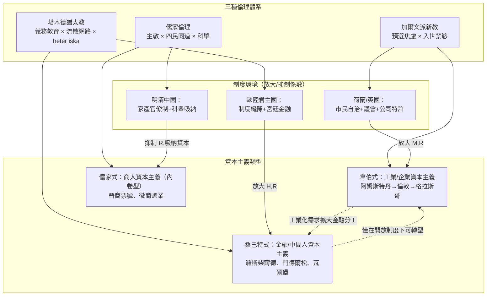

# 第五章第一節 比較視野：新教倫理、塔木德倫理與儒家倫理

## 一、問題的提出：為何要「比較」？

本書前四章已分別檢視了猶太人與資本主義精神的關係：從中世紀的放貸者與宮廷猶太人（Hofjuden），到近代解放浪潮中的羅斯柴爾德家族（Rothschild，邁耶·阿姆謝爾·羅斯柴爾德，1744–1812，於1790年代在法蘭克福建立金融王朝），再到「制度縫隙說」與「網路資本說」。本章第一節的任務，是把猶太經驗放進一個更寬廣的比較框架：如果「倫理—經濟」的親和性（elective affinity）真實存在，那麼新教倫理、塔木德倫理與儒家倫理，作為三種都曾與商業文明發生深刻互動的倫理體系，各自的結構性差異為何？它們分別「選中」了何種資本主義類型？

馬克思·韋伯（Max Weber，1864–1920）在《新教倫理與資本主義精神》（1904–1905）中提出著名命題：加爾文派的預選說（predestination）與入世禁慾（inner-worldly asceticism），使信徒透過世俗職業的成功來確認恩典狀態，從而催生了系統性的理性化經濟行為。韋伯本人對猶太教的判斷則相當消極——他在《古猶太教》（Das antike Judentum，1917–1920）中認為猶太教是「賤民民族」（pariah people）的宗教，其倫理是「順應的政治倫理」而非「信念的政治倫理」，並認為猶太人只是「政治投機資本主義」與「高利貸」的承載者，而非「現代理性資本主義」的推動者。然而，這個判斷在韋伯生前就受到挑戰，死後更被大量史學與計量研究修正。與此同時， Werner Sombart（桑巴特，1863–1941）在《猶太人與現代資本主義》（Die Juden und das Wirtschaftsleben，1911）中提出與韋伯針鋒相對的命題：現代資本主義的「精神」——抽象思維、計算癖、流動性、法條主義——恰恰是猶太性的產物。本節將以比較表與因果模型，對這三種倫理與資本主義的親和性做系統性整理。

## 二、三種「資本主義相容倫理」的比較

以下比較表綜合了宗教社會學與經濟史的研究成果，從六個維度比較三種倫理體系：

| 維度 | 新教（加爾文派） | 猶太教（塔木德傳統） | 儒家（近世商人倫理） |
|------|------------------|----------------------|----------------------|
| **天職觀** | Beruf（天職）概念：世俗職業是榮耀上帝的手段，勞動本身即禁慾修行 | 無「天職」概念但有持守妥拉的世俗勞動義務；工作以維持學習與家庭為目的 | 「敬業」觀念：朱熹（1130–1200）「主敬」傳統下，士商界限可通；職業是修身與盡倫的場域 |
| **時間觀** | 時間即上帝的財產，虛擲光陰是重罪；鐘錶式作息、系統化日程 | 安息日制度化休息與其餘六日的高強度利用；塔木德「Shenayim mikra」定時功課培養紀律 | 「惜時」為美德（《顏氏家訓》）；但缺乏末世緊迫感，時間觀是循環的而非線性焦慮的 |
| **財富觀** | 財富是上帝賜福的記號，但獲取財富須以系統性勞動為之，消費享樂受譴責 | 財富本身中性；「以牙還牙」式的商業正義；heter iska（heter iska，投資合夥豁免條款）使放貸合乎利息禁令 | 「君子愛財，取之有道」；義利之辨下商人須以「良賈不負閨閫」自我正當化 |
| **教育觀** | 為了自行閱讀聖經而普及識字（宗教驅動的全民教育，路德1530年代倡議識字運動） | 極端重視：公元64年大祭司約書亞·本·加姆拉（Yehoshua ben Gamla）設立義務初等教育制度 | 科舉驅動的識字教育；「士農工商」階序中教育是流動的階梯，商人家庭「賈而好儒」 |
| **契約觀** | 信守契約是榮神益人的見證；日內瓦商業實踐與誠信倫理結合 | 契約法高度發達：《塔木德》數百頁討論契約、擔保、遺產；「dina de-malkhuta dina」（國法即法律）原則調和異族統治 | 人情網路優先於形式契約；晉商、徽商以會館、宗族、連保制維繫信用 |
| **救贖機制** | 預選說下的「救贖焦慮」：以職業成功與禁慾生活自我確認恩典 | 無原罪—救贖結構；遵守誡命（mitzvot）即是義；學習妥拉本身有宗教功值 | 無末世救贖概念；以修身、齊家、慎終追遠追求道德完滿與祖先認可 |

從表中可以看出三個關鍵的結構性差異：

**第一，救贖機制不同，產生的心理動力不同。** 加爾文派的核心是「預選焦慮」——無人能確知自己是否得救，只能透過持續不斷、體系化的世俗成就來尋求（但永遠無法確證）恩典的記號。這是一種「焦慮驅動」的倫理。猶太教則完全沒有這種焦慮結構：救贖不在於個人靈魂的揀選，而在於群體遵守誡命與學習妥拉。塔木德理性主義的特徵是：宗教價值內嵌於「學習」這個活動本身，這使得猶太人對教育有一種近乎「內生偏好」的投入——這正是本章第二節（Botticini & Eckstein 的人力資本假說）的伏筆。儒家則以「道德完滿」與「家聲」為終極關懷，其動力是榮譽驅動而非焦慮驅動。

**第二，對利息與商業的制度性處理不同。** 天主教會依據《路加福音》6:35「借給人而不指望償還」發展出系统的利息禁令（第三次拉特朗大公會議1179年、第二次里昂會議1274年明確譴責高利貸），猶太教內部則有《申命記》23:19-20的規定：「借給外邦人可以取利，借給弟兄不可取利。」這條「雙重道德」條款在中世紀被詮釋為：猶太人可以向非猶太人收利息。更關鍵的是塔木德學者發展出的 **heter iska**（投資豁免結構）：透過將貸款重新定性為合夥投資（貸款人承擔部分風險、分享利潤），使有息借貸在律法上成立。這個制度創新最早可見於十二世紀法國萊茵地區的托薩福學者（Tosafists），並在十六世紀由薩法迪學者約瑟夫·卡羅（Joseph Caro，1488–1575，《Shulchan Aruch》作者）等人系統化，至今仍是以色列宗教金融的基礎。相比之下，新教是在宗教改革後（尤其加爾文於日內瓦，1540年代起）逐步鬆弛利息禁令——加爾文在《論高利貸》（De usuris，1545）中主張利息在特定條件下合法。可以說，猶太教比新教早了三百年在律法體系內「馴化」了資本利息。

**第三，「雙重道德」與「普遍倫理」的張力。** 韋伯批評猶太倫理是「雙重道德」（doppelte Moral）：對內（猶太同胞）奉行兄弟之誼，對外則容許商業上較不拘泥的手段。桑巴特反過來把這種「客觀化、去人格化」的商業態度視為現代資本主義精神的搖籃。當代學者（如經濟史家 Avner Greif 對馬格里布商人網路的研究，1989–1993）則指出：這種內外有別的倫理，配合高信任的族裔網路，正好構成前現代商業世界中最稀缺的資源——**契約執行機制**。在沒有現代法院與商法的環境裡，「對自己人絕對誠信、對外人有議價空間」的倫理，是集體行動的理性解。

## 三、與余英時的對話：儒家倫理與中國商人精神

儒家這一欄需要特別說明。韋伯在《儒教與道教》（1915）中斷言：儒家倫理「適應世界」而非「改造世界」，缺乏對傳統的緊張關係，因此無法產生資本主義的理性化動力。這個判斷在一九七〇至八〇年代隨著東亞經濟起飛而受到全面挑戰，余英時的《中國近世宗教倫理與商人精神》（1987）正是這場「韋伯式追問」在漢學界的代表作。

余英時的核心論證是：十六至十八世紀（明嘉靖至清乾嘉），中國出現了一場「士商互動」的思想運動。王陽明（1472–1529）首倡「四民異業而同道」，《節庵方公墓表》（1525年）明文肯定商人的職業尊嚴；泰州學派把聖學下移到工商階層；明清之際的沈垚（1798–1840）更直言「古者四民分，後世四民不分」，並指出「天下之士多出於商」。商人階層由此發展出自己的倫理話語：徽商「賈而好儒」、以《朱子家訓》式的紀律管理店鋪、以「賈服儒行」自我正當化。余英時稱之為「中國宗教倫理的入世轉向」——禪宗的「擔水砍柴無非妙道」與新儒家「主敬」的結合，與新教「天職」觀有結構性的類似。

然而余英時也坦承其限制：中國的「商人精神」始終未能突破兩個制度天花板。其一是**家產官僚制的吸納**：科舉把商業利潤的終點導向購買功名與土地，「以末致富，以本守之」（司馬遷《史記·貨殖列傳》語），資本無法持續沉澱在生產性部門。其二是**缺乏形式法律**：契約依賴人情與宗族，公司法、破產法、專利制度付之闕如。因此儒家式商人資本主義停留在「內卷的繁榮」——徽商、晉商的財富規模驚人，卻始終未能轉化為工業資本主義的起飛。

## 四、比較的因果模型

我們可以用一個簡化的因果模型來形式化三種倫理與資本主義類型的關係。設倫理體系供給三種關鍵「心理—制度投入」：動機強度 $M$ （行為的系統性與紀律）、人力資本投入 $H$ （對教育的內生偏好）、信任半徑 $R$ （契約得以執行的網路範圍），則資本主義的「精神密度」可寫成：

$$
C = f(M, H, R) = \alpha M^{\beta_1} H^{\beta_2} R^{\beta_3}, \quad \alpha, \beta_i > 0
$$

三種倫理的差異，在於三個參數的相對強度與**制度環境對它們的放大或抑制係數**。加爾文派： $M$ 極高（預選焦慮）， $H$ 中高（全民識字）， $R$ 依賴新興城市市民社會；且 1500–1700 年的西歐制度環境（荷蘭共和國、英國光榮革命後的議會金融）給予其最高的放大係數——韋伯式資本主義於焉出現。猶太教： $H$ 極高（一千八百年的義務教育傳統）、 $R$ 極高（跨國流散網路與 heter iska 等法律工具），但 $M$ 是「適應性」而非「改造性」，且多數時期身處制度縫隙——故猶太經驗呈現為「桑巴特式」的中間人與金融資本主義，而非組織工廠生產的工業資本主義。儒家： $M$ 與 $H$ （就科舉教育而言）皆高，但 $R$ 被宗族邊界切割、且制度放大係數近於零（家產官僚制），故只能產生「內卷式」商人繁榮。這個模型說明：**倫理本身不充分，倫理 × 制度環境 × 網路結構的乘積，才是資本主義精神出現的充分條件。**

## 五、三條路徑：三種資本主義類型

下圖綜合前述分析，描繪三種倫理各自通往不同「資本主義類型」的路徑：

路徑圖揭示了一個常被忽略的動態：三種資本主義類型並非平行孤立的島嶼，而存在**分工與互相轉化的關係**。韋伯式的工業資本主義需要大規模長期融資，於是桑巴特式的猶太金融家應運而生——十八世紀末，布萊希羅德（Gerson von Bleichröder，1822–1893）成為俾斯麥（Otto von Bismarck，1815–1898）的私人銀行家；羅斯柴爾德家族在1815年滑鐵盧戰役後的公債操作，使其成為歐洲「第六強權」。反過來，猶太資本的充分施展，只有在解放後的開放制度中才可能——這正是1848年後猶太人進入德國、奧匈學術界與企業界並大量轉向工業與科學職業的歷史背景（如西門子公司早期的重要猶太工程師群體）。

## 六、小結

本節的比較分析得出三點結論。第一，韋伯與桑巴特各執一半真理：新教倫理提供了「動機的系統化」，猶太教提供了「人力資本與信任網路」，二者在近代早期的歐洲是互補而非互斥的資本主義供給源。第二，儒家倫理證明了「倫理相容」不等於「倫理致動」——沒有制度放大係數，最敬業的商人也只能繁榮而不起飛。第三，heter iska 這類律法創新提醒我們：宗教傳統並非資本主義的靜態障礙或助力，而是能在內部演化出金融工程的「活的法律體系」。下一節將以計量證據檢驗本節的核心懸念：猶太人對教育的內生偏好，如何轉化為職業轉型與經濟位置的長期優勢。
