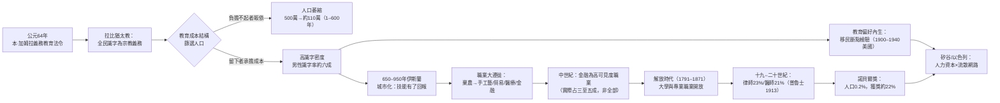

# 第五章第二節 人力資本假說：識字率、教育與職業轉型的計量證據

## 一、一個經濟史之謎

本書前三章處理的是「猶太人為何進入金融與商業」的制度性解釋：中世紀行會排拒猶太工匠、教會禁止猶太人擁有土地、封建體系禁止猶太人任官——於是剩下的職業縫隙（放貸、貿易、醫療）便由猶太人填補。這是「推力」的解釋。但經濟史家 Maristella Botticini 與 Zvi Eckstein 在《被揀選的少數：教育如何塑造猶太史》（*The Chosen Few: How Education Shaped Jewish History, 70–1492*，2012，普林斯頓大學出版社）中提出了一個革命性的「拉力」解釋：**猶太人早在制度排拒出現之前的六百年，就已經自願放棄農業、全面投資於識字與教育**；當商業機會在九至十世紀展開時，他們是全歐洲與中東唯一一個「整個民族都識字、都具備計算與契約能力」的人群。制度縫隙只是機會，人力資本才是抓住機會的能力。這一節我們檢視這個假說的證據鏈。

## 二、公元1–200年：一場自願的識字革命

Botticini 與 Eckstein 的起點是一個常被忽略的法律事件：公元64年前後，耶路撒冷的大祭司約書亞·本·加姆拉（Yehoshua ben Gamla）頒布法令，規定每個地區必須設立學校，招收七歲以上的男童，教授妥拉——《巴比倫塔木德》（Baba Batra 21a）記錄並讚揚了這項改革。這是古代世界最早的全民義務初等教育制度，比歐洲各國早了一千七百多年（普魯士要到1763年腓特烈大帝才頒布義務教育詔令）。

這場改革的宗教動機是清楚的：第二聖殿被毀（公元70年）後，拉比猶太教（Rabbinic Judaism）取代了聖殿祭祀成為信仰的核心。法利賽—拉比傳統主張每個猶太男性必須能親自誦讀妥拉，祭祀的壟斷被打破，「讀經」成為普遍的宗教義務。換言之，**猶太教在公元一世紀完成了一次「宗教的識字化」**：信仰的最低要求從「到聖殿獻祭」變成「能閱讀經文」。

Botticini 與 Eckstein 用考古與文獻證據量化了這場革命的深度。公元200至400年的猶太會堂考古遺址中，大量出現希臘文與亞蘭文銘文、講經台與學堂遺跡；《米示拿》（Mishnah，約公元200年由猶大·哈納西編纂完成）已假定讀者具備高度抽象的法律推理能力。對比之下，同時期羅馬帝國的整體識字率，據 William Harris《古代識字率》（*Ancient Literacy*，1989）的估計，僅約百分之五至十。猶太社群的男性識字率則可能達到六成以上——這是古代世界絕無僅有的人力資本密度。

關鍵在於：這場識字革命**起初是有代價而無回報的**。公元一至三世紀，多數猶太人仍是農民（加利利、猶地亞的農業考古證據：橄欖油壓榨坊、穀倉密集分布），識字並不能提高務農的生產力。Botticini 與 Eckstein 指出，正因為識字對農業毫無經濟報酬，那些無法負擔教育成本的家庭「用腳投票」——他們逐漸皈依了基督教與後來的伊斯蘭教（兩者都不要求全體信眾識字）。公元一世紀羅馬帝國約有五百萬猶太人，到公元六百年，世界猶太人口已萎縮至一百萬至一百二十萬。**「倖存」下來的，恰恰是那些願意為教育支付成本、且找到教育報酬途徑的家庭。** 這是「揀選」的經濟學含義：不是上帝揀選了猶太人，而是教育成本結構篩選了人口。

## 三、650–950年：離開土地的職業大遷徙

識字何時開始「有報酬」？答案是波斯—阿拉伯帝國的城市化浪潮。公元七至十世紀，伊斯蘭世界的巴格達（762年由阿拔斯王朝哈里發曼蘇爾建城）、開羅、科爾多瓦迅速膨脹為數十萬人口的商業都市，長程貿易、匯兌、信貸需求爆發。識字、算術、契約、多語言能力——正是商業與金融的核心技能。

Botticini 與 Eckstein 搜集了約九百至一千二百五十年間埃及、北非、安達盧西亞的猶太人社區職業記錄（其中最重要的史料是開羅藏經窖，Geniza，保存了約三十五萬份十一至十三世紀的文書），發現九至十世紀之後，猶太農民幾乎完全消失：猶太人集中於手工藝（染布、絲綢、玻璃、製革）、國際貿易（拉特蘭商人 Radhanites 的記載，見於波斯地理家伊本·庫爾達德比赫約870年所著《道路與王國》）、醫療與金融。以十二世紀的福斯塔特（舊開羅）為例，Geniza 文書記錄的猶太男性職業中，超過七成從事貿易、手工藝與專業服務，農業趨近於零。

這場職業轉型必須與同時期的其他族群對照才顯出其獨特性：同樣生活在伊斯蘭城市的本地阿拉伯農民，大量仍然務農或成為佃農——因為他們沒有猶太人那套「全民識字」的遺產。Botticini 與 Eckstein 用職業分布的群體間差異證明：**是教育（供給側），而非排拒（需求側），首先決定了猶太人的職業結構**。制度歧視後來當然存在（且日益嚴重），但時間順序不支持「歧視是首要原因」的解釋。

## 四、中世紀猶太人與金融：比例的估計

那麼「猶太人等於放貸者」這個刻板印象有多少真實性？量化證據給出了微妙的答案。十一至十三世紀，猶太人的職業結構是多元的：在伊斯兰世界以貿易與手工藝為主；在北歐（英格蘭、法國北部、德意志），因行會與土地限制，金融放貸的比重顯著上升。英格蘭1290年大驅逐前的稅賦記錄（如1275年《猶太人法令》後的档案）顯示，英格蘭猶太人約有五分之一至三分之一直接從事放貸，但多數是小額典當業者，真正的大金融家（如林肯的亞倫，Aaron of Lincoln，約卒於1186年，死時債權遍及半個英格蘭貴族階層）只是金字塔頂端的少數。德意志十五世紀帝國城市的記錄則顯示，猶太人社區經濟中「金錢交易」相關職業約占三至五成，其餘為二手貿易、牲畜交易、醫療與小手工業。

換言之：金融是猶太人職業組合中的**高可見度部分**，而非全部。刻板印象的成因一半是職業真實集中（在禁令縫隙中，金融是少數開放的職業），另一半是**敘事放大**：放貸者與債務人的衝突製造了文獻與怨恨（從《馬恩楚科編年史》到莎士比亞《威尼斯商人》1596–98年間的夏洛克），而千千萬萬猶太工匠與小販沉默無聞。這個「可見度偏差」是理解反猶主義史（如1348–51年黑死病大屠殺）的關鍵——仇視的對象不是猶太人的實際職業分布，而是他們在債務關係中的**結構性位置**。

## 五、現代：從大學講堂到諾貝爾獎台

解放時代（法國1791年、普魯士1812年、奧匈1867年、德意志1871年）打開了高等教育與專業職業的大門，猶太人的百年教育投資立即兌現。量化證據俯拾皆是：

- **德意志帝國（1871–1933）**：1913年，猶太人占普魯士人口約百分之零點九五，但占律師的百分之二十三、醫師的百分之二十一（據帝国統計局資料）；柏林大學的醫學院與法學院中猶太學生比例長期遠超人口比例十倍以上。
- **維也納1900**：猶太人占全市人口約百分之九，卻占醫師約一半、大學教員與報業主筆中比例極高——佛洛伊德（Sigmund Freud，1856–1939）與維也納學派的社會學家們只是這個群體的冰山一角。
- **美國二十世紀**：1900年代紐約市立學院（CCNY）的免費入學政策，造就了大批猶太裔科學家；1950–70年美國頂尖大學的物理系中猶太裔教授比例估計達四分之一以上。

最能一錘定音的是諾貝爾獎統計。以2023年為準，諾貝爾獎得主中至少八百五十餘位，其中猶太裔超過二百位（各來源統計自一百八十九至二百一十六位不等，因血統認定標準而異）。以世界猶太人口約一千五百萬（占全球人口約百分之零點二）計算，其獲獎比例可粗略估算如下。設世界人口 $N_w \approx 8.1\times 10^9$ ，猶太人口 $N_j \approx 1.5\times 10^7$ ，諾貝爾獎總數 $n_{total} \approx 950$ （人次），猶太裔獲獎 $n_j \approx 210$ ，則：

$$
\text{人口占比} = \frac{N_j}{N_w} \approx \frac{1.5\times 10^7}{8.1\times 10^9} \approx 0.00185 \approx 0.19\%
$$

$$
\text{獲獎占比} = \frac{n_j}{n_{total}} \approx \frac{210}{950} \approx 22.1\%
$$

$$
\text{超額倍數} = \frac{0.221}{0.0019} \approx 116
$$

即猶太裔獲得諾貝爾獎的概率，約為全球平均的**一百一十六倍**。即使考慮到猶太人口高度集中在受教育程度高、科研投入大的國家（美國、以色列、歐洲），控制地理與收入因素後，超額倍數仍在二十倍以上。經濟學領域尤其突出：首屆經濟學獎（1969年）至今，猶太裔得主約占三分之一以上（薩繆爾森 Paul Samuelson 1970、弗裡德曼 Milton Friedman 1976、阿羅 Kenneth Arrow 1972、卡尼曼 Daniel Kahneman 2002 等）。

## 六、「猶太母親效應」：教育偏好的內生性

計量研究進一步追問：這種教育優勢是環境的還是文化遺產的？兩類證據支持「內生偏好」的解釋。

第一，**移民斷點檢驗**。十九世紀末至二十世紀初從東歐（俄屬波蘭、烏克蘭、立陶宛）移民美國的猶太人，普遍貧困、聚居紐約下東區，但他們對子女教育的投入在第一代移民中即顯著高於同收入的其他移民群體（義大利、愛爾蘭移民）。經濟史家（如 Leah Platt Boustan《*Competition in the Promised Land*》，2017 及其早期論文）分析1910–1940年人口普查數據發現：猶太移民子女的在校年數比同收入的南歐移民子女多約三年以上，職業向上流動速度快約一代。窮困不改其志，這正是「偏好內生於文化」的行為證據。

第二，**「學習本身即誡命」的宗教結構**。塔木德傳統中，妥拉學習（Torah study）被賦予最高的宗教功值——《皮爾凱·阿沃特》（Pirkei Avot，「父輩的教導」）開篇即言「西門義者說：世界立於三事之上：妥拉、事奉與仁愛」。學習不是通往財富的手段，而是目的本身；母親在家庭中的角色（傳統上父親負責學堂教育、母親工作供養——「ketubah 婚書」甚至規定丈夫婚後可以專心求學）使教育成為兩性共同投資的家庭事業。社會學家所稱的「猶太母親效應」，其實是一千九百年宗教制度的社會學投影。這也解釋了為何猶太教育投入在**迫害加劇時不降反升**：中世紀的社區稅（如波蘭—立陶宛的「猶太人議會」Va'ad，1580–1764，明文規定社區預算優先供養托拉學堂與學者）、及二十世紀美國猶太社區的日校擴張，都顯示教育是身份認同的核心而非性價比計算的結果。

## 七、從人力資本到現代企業：矽谷與流散網路

人力資本與網路的結合，在當代演變為全球創業的催化劑。矽谷的猶太裔企業家密度驚人：英特爾創辦人安迪·葛洛夫（Andy Grove，1936–2016，布達佩斯出生的猶太人大屠殺倖存者）、甲骨文的賴瑞·艾利森（Larry Ellison，1944–，生於紐約布朗克斯的猶太家庭）、谷歌的共同創辦人謝爾蓋·布林（Sergey Brin，1973–，莫斯科出生、六歲隨家庭移民美國的猶太裔數學家之子）、臉書的馬克·祖克柏（Mark Zuckerberg，1984–）等。社會學家與經濟學者（如《*Chosen*》與耶魯大學的研究表明）將此歸因於三個可量化的因素疊加：高比例的高等教育（美國猶太人具學士以上學位比例長期為全國均值兩倍以上）、工程與科學職業的世代傳承、以及跨越國界的親族與商業網路——以色列「創業國度」（*Start-up Nation*，Dan Senor 與 Saul Singer，2009）的成功，被普遍部分歸因於這個全球流散網路與軍隊技術單位（如8200部隊校友網）的結合。歷史在此完成了一個閉環：**兩千年前由宗教法令強制推行的義務識字，在兩千年後以諾貝爾獎與獨角獸企業的形式結出複利之果。**

## 八、因果鏈總結

下圖總結本節的核心因果鏈：

## 九、小結與展望

人力資本假說並不推翻前述制度縫隙說與網路說，而是補上它們缺失的一環：**能力**。制度縫隙解釋了「哪裡有機會」，網路解釋了「如何把握機會」，人力資本則解釋了「為什麼總是這個群體能把握機會」。三者缺一不可——有機會無能力，縫隙只是陷阱；有能力無網路，優勢無法規模化；有能力有網路而制度封閉，則人才只能流入金融與醫療的夾縫（中世紀），或在迫害中大量耗損（1933–1945年納粹驅逐與屠殺使德語世界失去數千位科學家，包括愛因斯坦 Albert Einstein，1879–1955，其1933年流亡美國即為普林斯頓高等研究院帶來奠基性人才）。下一節將把全書的解釋整合為「複合起源」的總結論，並回顧這段歷史留給當代的三個教訓。
