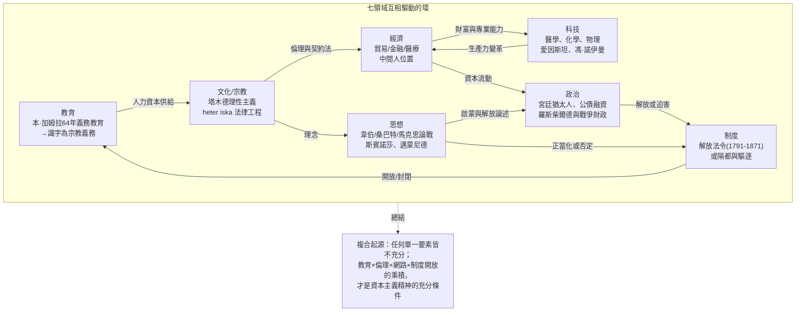

# 第五章第三節 結論：資本主義精神的複合起源與歷史的教訓

## 一、三個假說的合流：複合起源論

本書用了前四章與本章前兩節，分別檢驗了解釋「猶太人與資本主義精神」的三組假說。現在可以給出最終的裁決。這三組假說並非互相排斥的競爭者，而是分別解釋了因果鏈的不同環節：

| 假說 | 核心命題 | 解釋的環節 | 代表人物與文獻 |
|------|----------|------------|----------------|
| 制度縫隙說 | 中世紀的職業禁令（土地、行會、官職）把猶太人「推」入金融與商業 | **機會的空間在哪裡** | Werner Sombart（1911）；Wilhelm Roscher（1881）；Salo Baron 對「憐憫說」的修正（1928起） |
| 宗教倫理說 | 塔木德理性主義、heter iska、雙重道德構成資本主義的倫理—法律基礎設施 | **為何有能力與正當性** | Sombart（1911）；Botticini & Eckstein（2012）；對韋伯《古猶太教》（1917–20）的修正 |
| 網路資本說 | 流散網路、族裔信任、婚姻聯盟構成前現代最稀缺的契約執行機制 | **如何規模化** | Avner Greif 對馬格里布商人（1989–93）；Francesca Trivellato《*The Familiarity of Strangers*》（2009）；羅斯柴爾德家族史（Niall Ferguson，1998） |

裁決如下：**資本主義精神是複合起源的，猶太經驗是「供給側條件」之一，而非唯一原因。** 用一個化學比喻：制度縫隙是反應容器，宗教倫理是催化劑，網路是反應物的輸送管道，而新教倫理與國家建構則提供了另一支反應物。任何單一要素的缺席都會使反應遲滯——這正是為什麼儒家倫理（有倫理無制度放大）與明清中國（有市場無形式法律）未能獨立孕育工業資本主義，而中世紀的猶太人（有能力有網路而制度封閉）也只能在金融夾縫中繁榮而不起飛。起飛需要所有要素同時就位：這發生在十六至十九世紀的西北歐，而不在任何其他時間地點。

## 二、韋伯—桑巴特論戰的終審

現在我們可以對那場持續超過一個世紀的論戰做出裁決。

**韋伯錯了什麼。** 韋伯在《古猶太教》中把猶太教定義為「賤民民族」的宗教，認為其「順應性」倫理與「投機資本主義」無法孕育現代企業精神。這個判斷有三重錯誤。第一，經驗錯誤：Botticini 與 Eckstein 的計量證據顯示，猶太人早在近代之前一千八百年就完成了由宗教驅動的人力資本革命，其理性化程度（全民義務教育、發達的契約法學）遠超韋伯的想像。第二，概念錯誤：韋伯把「入世禁慾」作為理性資本主義的必要條件，但 heter iska 的法律工程與拉比的商業倫理顯示，**理性化的經濟倫理可以不經由禁慾主義而達成**——透過律法的內部演化。第三，方法錯誤：韋伯的比較單位是「宗教理念型」，忽略了猶太教作為「族裔—宗教複合體」的網路與制度維度。

**韋伯對了什麼。** 韋伯對新教倫理的洞察仍然有效：預選焦慮與天職觀確實提供了一種獨特的、改造世界的心理動力，而這是猶太教的「適應性」倫理所缺乏的。工業資本主義（而非金融資本主義）的組織革命——把紀律、時間與資本系統性地投入生產而非交換——確實更多由新教社會（荷蘭、英格蘭、普魯士、新英格蘭）承載。韋伯的錯誤在於把這個真實的貢獻**排他化**，彷彿新教倫理是唯一原因。

**桑巴特對了什麼。** 桑巴特《猶太人與現代資本主義》（1911）的核心直覺——現代經濟的「抽象化、可計算性、去人格化」與猶太法律的思維方式有親和性——在當代獲得了意外的支持：塔木德的論證形式（從案例歸納規則、對文字的精確解讀、把道德衝突轉化為可裁決的法律問題）確實與現代商法的思維同構。桑巴特列舉的「猶太貢獻清單」（現代信貸、支票、公債、證券交易、殖民貿易的先驅角色）大體經得起史學檢驗：阿姆斯特丹證券交易所（1602年成立，與荷蘭東印度公司同年）早期就有塞法迪猶太商人的深度參與；英格蘭銀行（1694年）的籌資網路中有桑巴特所稱的「新基督徒」與猶太金融家的蹤跡。

**桑巴特錯了什麼。** 桑巴特犯了與韋伯對稱的錯誤：把猶太貢獻**排他化**，宣稱「現代資本主義就是猶太精神的產物」。更嚴重的是，此書在方法上混雜了誇大的統計（他估計十八世紀某些地區猶太人「壟斷」金融的數字遠超後世研究）與潛在的種族化語彙（他把「猶太性」描述為可遺傳的族裔特質），使其論證後來被納粹意識形態挪用——諷刺的是，納粹同時也焚燒韋伯的著作。歷史對兩位學者開了同樣的玩笑：**把文化貢獻本質化為血統，必然滑向種族主義。**

**馬克思的批判視角。** 卡爾·馬克思（Karl Marx，1818–1883，本身出身改宗猶太家庭）在《論猶太人問題》（1843）中寫下了論戰史上最糾結的段落：他把「猶太精神」（Judentum）等同於「實踐的猶太教」即金錢崇拜，並宣稱「金錢是以色列人的嫉妒之神」，資本主義社會的「猶太性」只有在其消解之後才能解放。這段文字被後世廣泛批評為自我憎恨與反猶刻板印象的合流，但它提出了一個嚴肅的問題：**如果猶太人是資本主義的承載者，那麼他們究竟是資本主義的主體，還是被資本邏輯異化的客體？** 本書的答案是：兩者皆是——正如所有人群一樣。猶太人既發明了金融工具（供給側的創造者），也被金融職業的位置所困（中間人的結構性弱勢）。馬克思的失誤在於把「猶太精神」實體化，其洞見在於看穿了金錢關係對一切傳統共同體（包括猶太共同體）的腐蝕。

## 三、歷史的教訓

從整體敘事中，我們提煉四條教訓。

### 教訓一：邊緣性是創新的溫床——但僅在門半開時

猶太人兩千年的創造力爆發，幾乎都發生在「邊緣但半開放」的位置：完全封閉（隔都）時只有生存無有創造，完全同化（十九世紀末德國的期待）時反而遭遇反彈。黃金時代出現在縫隙中：八至十二世紀的伊斯蘭西班牙（撒母耳·哈納吉德 Samuel ha-Nagid，993–1056，貴族、將軍與詩人）、十七世紀的阿姆斯特丹（斯賓諾莎 Baruch Spinoza，1632–1677，被逐出教門的鏡頭與荷蘭黃金時代同步）、十九世紀末的維也納與柏林。社會學的解釋（Georg Simmel《陌生人》，1908）：邊緣人同時置身局內與局外，能看見局內人視而不見的結構。對當代的啟示：移民、僑民與跨界者是最稀缺的創新資源，社會應當降低他們的進入門檻而非築牆。

### 教訓二：解放與反猶的鐘擺

歷史顯示，猶太人的成功與迫害之間存在可怕的相關性。每一次解放都伴隨下一次反彈：法國1791年解放後，1848年革命與德雷福事件（Dreyfus Affair，1894–1906，迫使赫茨爾 Theodor Herzl，1860–1904，於1896年寫下《猶太國》）；德國1871年解放、猶太人在學術與金融界大放異彩之後，迎來了1933–1945年的滅絕。中間人少數群體的困境在於：他們在經濟上不可或缺，在政治上卻無權無勢——繁榮沒有轉化為安全。經濟學家 稱之為「中間人少數群體」的政治風險（見 Amy Chua《*World on Fire*》，2003，對全球族裔市場主導少數群體的比較）：當經濟不平等與族裔界線重合時，怨恨會被政治動員導向少數群體，而制度性弱點（無軍隊、無領土、跨國分布）使其成為完美的替罪羊。鐘擺的教訓是：**多元社會的穩定，取決於經濟成功與政治權利、社會認同能否脫鉤；否則市場上的每一分成功，都在為下一場迫害累積利息。**

### 教訓三：人力資本是最持久的資本

本書的核心計量證據指向一個簡單而深刻的結論：土地可以被沒收（1492年西班牙、1290年英格蘭驅逐時的財產充公），可以被焚毀（1938年「水晶之夜」的商店與會堂），可以一夜歸零（1945年歐洲猶太人的財富損失估計超過當時全部財富的三分之二），但**內嵌於人腦中的識字、計算、法律與科學能力，是唯一無法被剝奪、且隨迫害移動的資本**。1933年後納粹驅逐的科學家（愛因斯坦、馮·諾伊曼 John von Neumann，1903–1957、費米之外的流亡者群體，其中相當比例是猶太裔）使美國在曼哈頓計畫與戰後科技霸權中獲益，而德國物理學界倒退一代——這是人力資本跨國轉移最昂貴的自然實驗。對任何社會的啟示：投資於人的教育的回報週期，比任何基礎設施都長；而摧毀一個群體的教育的社會，最終懲罰的是自己。

### 教訓四：制度開放是複利的起點

最後，回到本書的起點——韋伯與桑巴特的問題「誰創造了資本主義精神」。答案不是某個宗教或某個民族，而是**一種制度情境：當權利開放、教育普及、法律形式化時，任何擁有人力資本的群體都能創造經濟奇蹟**；反之，一切「精神」都會枯萎於封閉的制度中。諾貝爾經濟學獎得主 Acemoglu 與 Robinson《國家為什麼會失敗》（*Why Nations Fail*，2012）的包容性制度論，與本書的猶太史敘事在同一點上會合：猶太人兩千年的起伏，本質上是一部「制度開放度的晴雨表史」——開放時他們繁榮並回饋文明（從邁蒙尼德 Maimonides，1138–1204，到愛因斯坦），封閉時他們流亡而文明失血。

## 四、全書總結：驅動關係圖

最後用一張環狀圖總結全書的核心命題：科技、經濟、制度、文化、政治、思想、教育七個領域構成一個互相驅動的反饋環，猶太經驗是這個環上的一個樞紐節點——它不單獨決定任何一環，卻放大了整個環的運轉速度。

## 五、延伸閱讀書單

**核心文獻（本書直接對話的對象）**

1. Max Weber，《新教倫理與資本主義精神》（1904–05）及《古猶太教》（1917–20）——論戰的起點。
2. Werner Sombart，《猶太人與現代資本主義》（1911）——對立面，貢獻與危險並存。
3. Maristella Botticini & Zvi Eckstein，*The Chosen Few: How Education Shaped Jewish History, 70–1492*（Princeton, 2012）——人力資本假說的計量奠基之作。
4. 余英時，《中國近世宗教倫理與商人精神》（1987）——儒家倫理與「韋伯式追問」的漢學回應。
5. Karl Marx，〈論猶太人問題〉（1843）——批判視角與意識形態史。

**網路與制度研究**

6. Avner Greif，"Reputation and Coalitions in Medieval Trade"（*Journal of Economic History*, 1989）——馬格里布商人的契約執行機制。
7. Francesca Trivellato，*The Familiarity of Strangers*（Yale, 2009）——十八世紀裡窩那猶太商人與跨文化貿易。
8. Niall Ferguson，*The House of Rothschild*（1998）——羅斯柴爾德家族的兩卷本權威史。
9. Daron Acemoglu & James Robinson，*Why Nations Fail*（2012）——包容性制度與經濟發展。
10. Yuri Slezkine，*The Jewish Century*（Princeton, 2004）——「巨人時代的默米爾人」：二十世紀猶太人與現代性的總體史。

**文化、社會與記憶**

11. Salo Baron，"Ghetto and Emancipation"（1928）——對「哭訴與憐憫史觀」的經典修正。
12. Georg Simmel，〈陌生人〉（1908）——邊緣性社會學的起點。
13. Amy Chua，*World on Fire*（2003）——市場主導少數群體的政治風險比較研究。
14. David B. Ruderman，*Early Modern Jewry*（Princeton, 2010）——早期近代猶太文化史。
15. Dan Senor & Saul Singer，*Start-up Nation*（2009）——當代以色列與流散網路的創業史。

這份書單也是本書方法論的自我告白：單一學科（神學的、經濟學的、社會學的）都只能照亮這段歷史的一角。資本主義精神的故事，是一個關於人的故事——他們如何在縫隙中求生、在迫害中投資未來、在解放後回饋文明，以及文明如何一次又一次辜負了他們的忠誠。記住這個故事的所有面向，包括光榮的與恥辱的，才是歷史探案最終的判決書。
