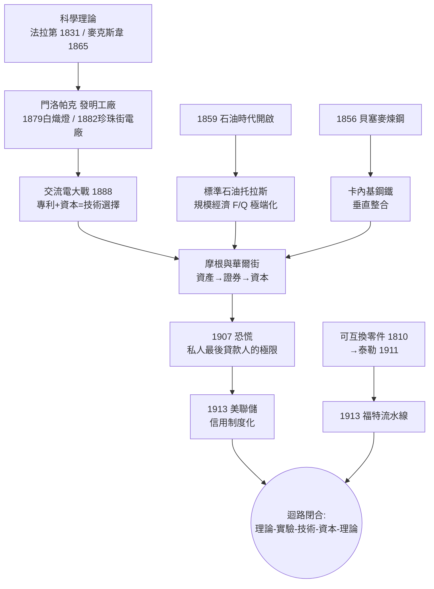

# 第四章　迴路轉接：愛迪生、石油、電氣與華爾街

> 探案的現場是一間吵雜的實驗室：1876年，新澤西門洛帕克，愛迪生掛出招牌「發明工廠」。此後十年，白熾燈、電廠、電話、石油托拉斯、鋼鐵帝國、投資銀行，像齒輪一樣一個咬住一個。本章要還原的，是「理論—實驗—技術」迴路如何從英國的個人手工業，轉接成美國的系統性產業。

## 一、門洛帕克：發明的系統化

英國的迴路是這樣運轉的：法拉第在皇家研究院做實驗（見 [1831-法拉第電磁感應](../../科技史/科技發展史/1831-法拉第電磁感應.md)），麥克斯韋寫下方程組（見 [1865-麥克斯韋方程組](../../科技史/科技發展史/1865-麥克斯韋方程組.md)），然後——技術落地要等幾十年，等某個工匠恰好對上某個機會。發明是機遇，不是流程。

愛迪生把機遇變成了流程。門洛帕克實驗室（見 [1879-愛迪生白熾燈](../../科技史/科技發展史/1879-愛迪生白熾燈.md)）首次以工業化方式組織發明：分組攻關、系統試錯（據稱試過六千種燈絲材料）、專利矩陣布局、以「系統」而非「單品」為目標——愛迪生賣的不是燈泡，而是「發電機＋電纜＋電錶＋燈座」的整套系統。1882年珍珠街電廠在曼哈頓點亮（見 [1882-珍珠街電廠](../../科技史/科技發展史/1882-珍珠街電廠.md)），證明電力可以像煤氣一樣按表收費賣給公眾。

用探案的語言說：愛迪生完成了發明的「福特化」——把天才的靈感拆解成可分工、可複製的工序。這是管理革命的第一幕：迴路中「實驗→技術」這一段，第一次有了組織形態。1888年前後的交流電大戰（見 [1888-交流電大戰](../../世界史/工業革命史/1888-交流電大戰.md)）則顯示，此時技術選擇已經是資本規模的較量——威斯汀豪斯買下特斯拉的專利、以變壓器與交流輸電取勝，證明「發明—專利—融資—系統鋪設」已成為標準產業流程。

## 二、1859石油時代：德拉克井與垂直整合的原型

1859年8月，賓州泰特斯維爾的德拉克井打出石油（見 [1859-石油時代開啟](../../世界史/工業革命史/1859-石油時代開啟.md)），煤油照明工業誕生。但真正讓「石油時代」成立的，不是鑽井，而是組織。

約翰·洛克菲勒的標準石油示範了新迴路企業的完整形態：控制煉油（規模經濟環節）、整合輸油管與鐵路回扣（網路環節）、以托拉斯架構統一指揮數十家公司（治理環節）。到1880年代，標準石油控制全美約九成煉油能力。這是第一次，一家企業以大陸市場為單位做總體規劃—— $F/Q$ 曲線被刻意推到極端：固定成本越高、越要壟斷規模。

壟斷與效率在此糾纏不清：托拉斯壓低了煤油價格、統一了品質，也扼殺了競爭。這條矛盾最終在1890年《謝爾曼反托拉斯法》（見 [1890-謝爾曼反托拉斯法](../../世界史/世界發展史/1890-謝爾曼反托拉斯法.md)、[1890-謝爾曼反托拉斯法](../../世界史/工業革命史/1890-謝爾曼反托拉斯法.md)）中引爆，成為美國特色的答案：**不以拆解市場規模為代價，而以法律馴化企業規模**。

## 三、卡內基鋼鐵與摩根：發明如何變成產業

鋼鐵是第二個現場。貝塞麥轉爐讓鋼的成本曲線陡降（見 [1856-貝塞麥煉鋼法](../../世界史/工業革命史/1856-貝塞麥煉鋼法.md)、[1856-貝塞麥轉爐](../../科技史/科技發展史/1856-貝塞麥轉爐.md)），鐵路、橋樑、摩天樓立刻形成大陸尺度的需求。安德魯·卡內基的做法與洛克菲勒互為鏡像：他不做發明，只做**成本控制與垂直整合**——擁有礦山、船隊、軋鋼廠，把每一道工序的單位成本記在黑板上壓著打。鐵路軌道的反覆更新需求，使鋼鐵廠可以開到理論最大規模。

而把這些資產「定價」的，是摩根。1901年摩根買下卡內基鋼鐵，合併成美國鋼鐵——史上第一家十億美元公司。華爾街在此扮演了迴路的「變壓器」：把分散的實體資產，轉換成可交易的證券，再轉換成更大規模的資本。投資銀行承銷鐵路債券時發展出的盡職調查、財務重整與董事會控制，成為美國公司治理的起點。1907年尼克博克恐慌（見 [1907-尼克博克恐慌](../../世界史/金融經濟史/1907-尼克博克恐慌.md)）中，摩根以私人身份召集銀行家救市——這既證明了華爾街的能量，也暴露了體制的風險：最後貸款人竟是個人的名字。

## 四、貝爾與電話：訊息網路的第二層

1876年貝爾取得電話專利（見 [1876-電話](../../世界史/工業革命史/1876-電話.md)），訊息網路從「廣播式」（電報）進化到「會話式」。電話的意義在組織而非生活：它讓大企業的總部第一次能即時指揮分散各地的工廠與分支，是管理革命的神經系統。AT&T依託專利壟斷與系統思維（一家公司、一套網路、一個標準），與鐵路、電力一起構成「網路型大企業」的三原色——這些企業的共同點，正是以大陸市場為規模單位、以 $F/Q$ 的極端化為競爭策略。

## 五、美國製造體系：可互換零件與泰勒

回到更早的線索。1810年代以降，斯普林菲爾德兵工廠與機床工業發展出可互換零件體系（見 [1810-機床與可互換零件](../../世界史/工業革命史/1810-機床與可互換零件.md)）：零件按公差生產，任何一件都能裝上任何一支槍。這是「知識寫進機器」的關鍵一步——工藝從工匠的手移轉到夾具與量規，技能變成標準。1911年泰勒的科學管理（見 [1911-泰勒科學管理](../../世界史/工業革命史/1911-泰勒科學管理.md)、[1911-科學管理](../../世界史/金融經濟史/1911-科學管理.md)）把同樣邏輯應用到人的動作上：時間動作研究、標準作業程序。機器與人都被「公差化」之後，1913年福特流水線（見 [1913-福特流水線](../../世界史/工業革命史/1913-福特流水線.md)、[1913-福特T型車與大量生產](../../世界史/美洲史/1903-福特T型車與大量生產.md)）不過是水到渠成的合攏：T型車價格從850美元跌到260美元，產量卻倍增——這就是 $AC(Q)=F/Q+c$ 在流動線上的具象。

## 六、1913：美聯儲——迴路的貨幣地基

迴路還缺最後一塊：穩定的貨幣與信用。美國長期沒有中央銀行，金融恐慌呈週期性爆發（1873、1893、1907），每次都掐斷產業的資金鏈。1907年恐慌的教訓直接催生了1913年《聯邦準備法案》：美聯儲成立（見 [1913-美聯儲](../../世界史/美洲史/1913-美聯儲.md)、[1913-聯準會成立](../../世界史/金融經濟史/1913-聯準會成立.md)、[1913-福特流水線與美聯儲](../../世界史/世界發展史/1913-福特流水線與美聯儲.md)），設計上揉合了兩種傳統——華盛頓的聯邦治理（理事會）與華爾街的市場治理（十二家地區儲備銀行），最後貸款人從「摩根個人」變成「制度」。

同一年，福特流水線開動。這個巧合值得寫進案卷：**大規模生產（供給端）與最後貸款人（金融端）在同一年制度化**。大量生產需要大量信用支撐庫存與分期付款，中央銀行提供的彈性貨幣供給，正是規模經濟能夠持續運轉而不被金融恐慌中斷的前提。迴路的四段——發明系統化、產業托拉斯化、資本證券化、貨幣制度化——至此全部接通。

## 七、迴路轉接的總帳

把本章線索合攏。英國的迴路是「理論→實驗→技術」的單線慢速傳遞；美國的迴路是一個閉合的高速迴環：

$$\text{理論} \xrightarrow{\text{大學/實驗室}} \text{實驗} \xrightarrow{\text{發明工廠/專利}} \text{技術} \xrightarrow{\text{托拉斯/規模}} \text{產業} \xrightarrow{\text{華爾街/美聯儲}} \text{資本} \xrightarrow{\text{再投資}} \text{更大的理論投入}$$

每一個箭頭都對應一種制度發明：門洛帕克（發明的分工）、專利與托拉斯（產權的規模化）、投資銀行（資產的證券化）、美聯儲（信用的制度化）。金觀濤所言「理論—實驗—技術」循環，在美國被加上第四段——「資本」，並以大陸市場為反應爐，使迴路第一次能自我加速。到1913年，美國工業產值已超過英德之和的量級；迴路轉接完成，剩下的是國家層次的動員與秩序供給——那是後面章節的案情。

## 小結

本章還原的案情是「迴路轉接」：愛迪生把發明變成工廠的流程，洛克菲勒與卡內基把技術變成托拉斯的規模，摩根把產業變成證券的資本，美聯儲把信用變成制度的地基。四段接力各自補上了「理論—實驗—技術」循環缺的一環，而貫穿四段的共同變數，是上一章建成的大陸統一市場——它使每一個 $F/Q$ 曲線都有無限延伸的 $Q$ 可滑。發明系統化＋產業規模化＋資本證券化＋貨幣制度化，這就是美國接替英國時，迴路組織的代際躍升。下一案將追查：這台加速的迴路機器，如何被國家動員，並開始向世界輸出秩序。
