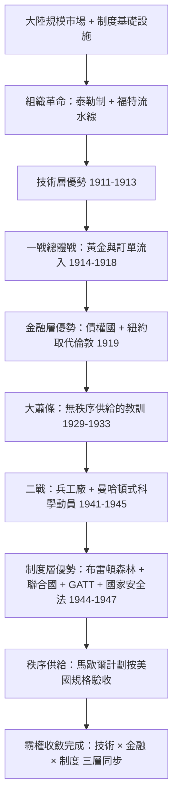

# 第六章 兩次大戰：從債務國到秩序設計者

## 一、案情提要：霸權為何「自願」移交

1913年，美國在組織革命完成之際（見第五章），在世界舞台上的身分仍是**債務國**——紐約資本市場靠倫敦融資，海軍不及皇家海軍的三成，外交上奉行門羅主義自掃門前雪。三十四年後的1947年，美國為西歐開支票、為世界定匯率、為聯盟寫章程。

霸權移交史上從未如此「順滑」：沒有美英之間的決戰，沒有占領與割地。本案要偵查的是：**歐洲霸權是如何一步一步、幾乎是自願地交出黃金、訂單與秩序設計權的？** 證據鏈有四枚指紋：1914年總體戰、1919年債權國身分、1941年珍珠港的參戰時機、1944—1947年的制度密集期。

## 二、第一枚指紋：總體戰把黃金與訂單推向美國

1914年7月底，歐洲的全球化在一週之內自毀——黃金停付、交易所關閉、金本位熄火（見[../../世界史/商業貿易史/1914-全球化中斷.md]）。一次大戰不是傳統的會戰，而是**總體戰**：國家動員全部工業、財政與人力，把戰爭變成一場消耗性的生產競賽（見[../../世界史/世界發展史/1914-一次大戰與總體戰.md]）。而消耗戰比拚的正是產量 $Q$ ——恰恰是流水線的主場。

美國先是坐收訂單。協約國的彈藥、鋼鐵、食品、卡車訂單湧向大西洋對岸，福特、杜邦、伯利恆鋼鐵的流水線日夜運轉；1917年德國無限制潛艇戰切斷大西洋生命線，反而把美國拖入戰局（見[../../世界史/世界發展史/1917-潛艇戰與大西洋生命線.md]）。戰爭結束時的資產負債表一目了然：

$$
\Delta W_{US} \approx +\,\text{黃金流入} + \text{協約國債權} + \text{滿負荷產能} - \text{本土戰損}=0
$$

歐洲的分子是鉅額戰損，美國的分母是零。英國賣掉海外資產付帳，黃金源源流入聯邦儲備；1919年，美國對外債權躍居世界第一，紐約取代倫敦成為全球金融中心——**技術層的優勢（第五章），至此兌現為金融層的優勢**。

## 三、岔路與整流：大蕭條為何沒有終結美國霸權

按「霸權必遭反噬」的劇本，此處應有意外。的確有：1930年斯姆特—霍利關稅把全球貿易腰斬（見[../../世界史/商業貿易史/1930-斯姆特霍利關稅.md]），1931年英國被迫脫離金本位（見[../../世界史/金融經濟史/1931-英國脫離金本位.md]），世界分裂成貨幣集團與帝國特惠圈。這是大英帝國的殘局，卻也是美國秩序的預演教訓：**沒有制度供給的金融霸權，比沒有霸權更危險**。

1933年羅斯福新政在國內完成整流（見[../../世界史/美洲史/1933-羅斯福新政.md]）：證券監管、存款保險、公共工程，把組織革命的機器從崩潰邊緣修復。與此同時，管理知識持續積澱為制度資產——這段「沉潛期」解釋了為何1940年代的美國能一次性端出整套戰後秩序：設計圖早已畫好，只等戰場清場。

## 四、1941：珍珠港與參戰時機的經濟學

1941年12月7日，日本偷襲珍珠港，航艦時代取代戰艦時代（見[../../世界史/世界發展史/1941-珍珠港與航艦時代.md]）。軍事史關注的是奇襲與航艦；經濟史關注的是時機：**美國在「民主國家兵工廠」的角色上早已入場，只差名分**。租借法案自1941年3月起輸血英國與蘇聯，訂單再次推動流水線全速運轉。

戰時動員把管理科學推向頂點：曼哈頓計劃以矩陣式管理協調數十萬人與十三億美元，是泰勒制的國家級放大（見[../../世界史/美洲史/1945-曼哈頓計劃與科學動員.md]）——**國家科學動員**與**迴路組織**在戰爭中合流，成為霸權的第四根支柱。廣島的蘑菇雲則宣布：秩序設計權的物理基礎已經壟斷（見[../../世界史/世界發展史/1945-核武與嚇阻.md]）。

## 五、1944—1947：制度密集期的三層交接

1944年7月，四十四國代表齊聚新罕布夏州布雷頓森林，設計戰後貨幣秩序：美元釘住黃金（35美元一盎司）、各國貨幣釘住美元，IMF與世界銀行為國際收支失衡提供紓解（見[../../世界史/工業革命史/1944-布雷頓森林體系.md]、[../../世界史/世界發展史/1944-布列頓森林.md]、[../../世界史/金融經濟史/1944-布雷頓森林.md]）。凱恩斯代表英國出席，提出的「班科」國際清算貨幣方案被否——英國拿到了會議桌上的禮遇，美國拿到了匯率體系本身。

1945年聯合國成立，安理會否決權把政治秩序制度化（見[../../世界史/世界發展史/1945-聯合國與戰後秩序.md]）。1947年兩份文件補完最後一層：GATT 以多邊最惠國與關稅減讓取代帝國特惠制（見[../../世界史/工業革命史/1947-GATT.md]、[../../世界史/商業貿易史/1947-GATT.md]）；《國家安全法》則把戰時動員固化为常備的國防部、國安會與中情局——**冷戰國家**誕生，科學動員成為永久制度（見[../../世界史/美洲史/1947-國家安全法與冷戰國家.md]）。而馬歇爾計劃用一百三十餘億美元為歐洲重建輸血，同時強制要求受援國拆除貿易壁壘——秩序供給是有償的，且按美國的規格驗收（見[../../世界史/世界簡史/1947-馬歇爾計畫與歐洲麵包.md]）。

三層交接至此完成：

| 層級 | 移交內容 | 關鍵節點 |
|---|---|---|
| 技術層 | 大規模生產取代工匠與實驗室 | 1911—1913（第五章） |
| 金融層 | 美元取代英鎊、紐約取代倫敦 | 1919 → 1944 |
| 制度層 | 聯合國＋布雷頓森林＋GATT＋冷戰國家 | 1945—1947 |

## 六、復盤：霸權移轉的因果鏈

值得強調的是箭頭方向：**不是戰爭造就霸權，而是組織優勢在戰爭中兌現**。若美國仍是工匠經濟，1914年的訂單只會餵飽英國的軍火商；若沒有1944—1947年的制度密集期，1919年的債權國地位會像西班牙的白銀一樣耗散。兩次大戰只是讓必然發生的移交，發生得比正常情況快了二十年。

## 七、反證檢驗：為何說移交「不可逆」？

控方會問：英國在1919年仍是頭號殖民帝國，何以此後再無翻身？證據在迴路的不可複製性。英國可以抄泰勒的教科書、可以蓋流水線，卻抄不了三樣東西：**大陸規模的統一市場**（帝國特惠圈是封鎖而非市場）、**證券市場＋職業經理人的資本組織**（倫敦的商人銀行只做承兌不做量產融資）、**永久化的國家科學動員體制**（1947年國家安全法之後，美國研發支出占西方世界一半以上）。組織知識可以印成書，組織知識賴以運轉的生態不能裝箱運輸——這正是「一連串特殊事件與體制的串聯」比任何單一事件更接近真相的原因。

## 小結

從債務國到秩序設計者，美國走完的不是一場戰爭的僥倖，而是三層交接的複合收斂：1911—1913年的組織革命給出技術層優勢，1914—1919年的總體戰把它兌現為金融層優勢，1944—1947年的制度密集期再把它固化为秩序供給權。歐洲兩度自毀全球化，美國兩度承接訂單與黃金；但承接之後能否重訂規則，取決於它是否擁有可輸出的制度設計能力——這恰是大英帝國所無、而美國在管理革命中練就的本領。

至此，全書的偵查線索閉合：大陸規模市場 × 制度基礎設施 × 迴路組織代際躍升 × 國家科學動員 × 秩序供給——五項條件缺一不可，而美國是史上第一個集齊五枚拼圖的國家。霸權移轉的密碼，不在戰場上的某個瞬間，而在組織知識與資本方式的代際差：**英國用工匠組織蒸汽機，德國用實驗室組織化學，美國用管理組織整個世界**。

## 延伸閱讀

- [../../世界史/世界發展史/1914-一次大戰與總體戰.md]：總體戰的動員結構
- [../../世界史/商業貿易史/1914-全球化中斷.md]：第一次全球化的自毀
- [../../世界史/世界發展史/1941-珍珠港與航艦時代.md]：參戰時機的軍事面
- [../../世界史/工業革命史/1944-布雷頓森林體系.md]：美元本位的制度設計
- [../../世界史/世界簡史/1947-馬歇爾計畫與歐洲麵包.md]：秩序供給的有償性
- [../../世界史/美洲史/1947-國家安全法與冷戰國家.md]：冷戰國家的誕生
