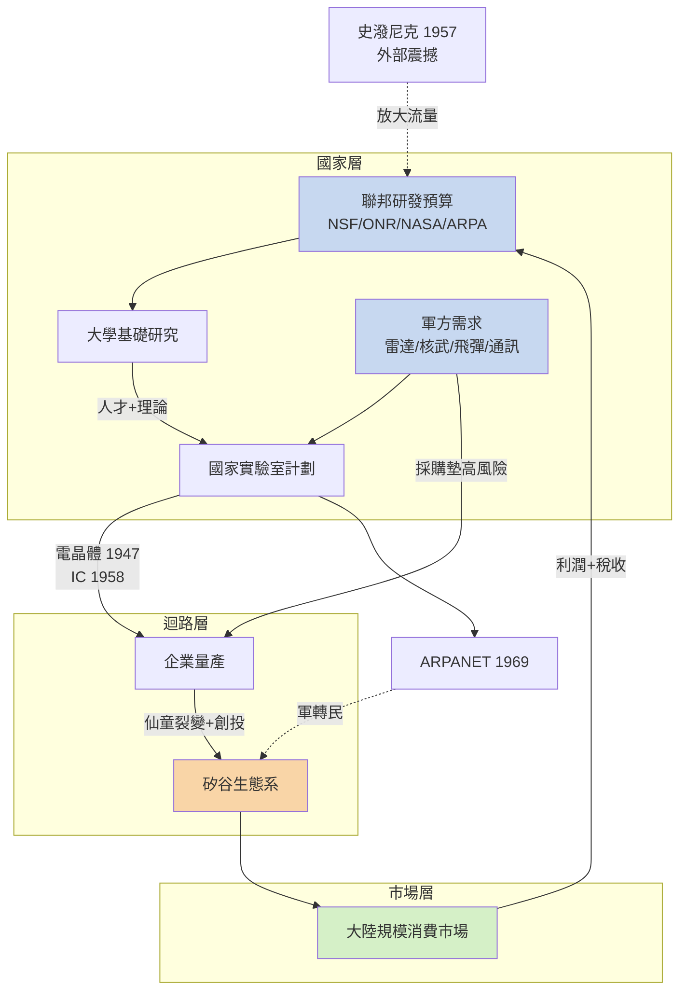

# 第七章 科學動員：曼哈頓計劃、矽谷與登月

## 摘要：當國家把整個迴路搬進戰爭部

金觀濤的「理論—實驗—技術」循環結構，原本是一台自組織的知識機器：科學家出於好奇提出理論，實驗家受控檢驗，工匠與企業家把成果變成技術，技術反過來提供新儀器與新問題。這台機器在英國以皇家學會與專利制度閉合，在德國以工業實驗室升級，在美國以管理與規模擴張。但本章要講的是一個全新的變異：**國家親自下場，把整個迴路編入戰爭動員體系**。二戰期間，美國政府以史上未見的規模，把大學、企業、軍方與資本熔鑄成一個「國家⇒迴路」的新通道——這條通道在戰後沒有拆除，反而被制度化了。它產出了原子彈、雷達、電腦、電晶體、登月與網際網路，也產出了矽谷。美國崛起的最後一塊拼圖，不是市場也不是工廠，而是：**國家學會了組織科學**。

## 一、戰前的美國科學：有錢、有市場、缺一個總調度

1940年之前，美國的科學實力常被歐洲人輕視。諾貝爾獎多數落在歐洲；美國的優勢是工程與量產——愛迪生式的發明工廠、福特式的流水線。美國大學已有世界一流的實驗物理，但理論—實驗—技術三環之間的調度是分散的：企業研發（貝爾實驗室、GE）、大學實驗室、私人基金會（洛克菲勒、卡內基）各自為政。

歐洲的戰火改變了這個結構。1933年之後，愛因斯坦、費米、馮·諾伊曼、泰勒、西拉德——整整一代歐洲最強的物理頭腦，因納粹迫害而橫渡大西洋。美國做了一件歷史上少有的事：**把敵洲的大腦整批接收**。這批移民科學家後來成為曼哈頓計劃的理論骨幹。用迴路語言說：美國的「理論⇒實驗」通道原本輸入不足，移民潮一次性補足了最稀缺的要素。

## 二、雷達與原子彈：兩座「國家實驗室」的示範

第一個大型實驗是雷達。1940年，英國把空腔磁控管——雷達的心臟——送到華盛頓的「英國使團」，這是史上最有價值的技術轉移之一（見 [../../科技史/科技發展史/1940-雷達.md]）。麻省理工隨即成立輻射實驗室，高峰期僱用近四千人，把微波雷達從實驗室原理推到量產裝備。這是「理論⇒技術」通道第一次由國家出資、以戰爭時程表催逼著跑完全程。

第二個實驗規模更驚人。1942年12月2日，費米在芝加哥大學體育場下的壁球場，建成人類第一座自持核反應堆，實現受控鏈式反應（見 [../../科技史/科技發展史/1942-費米核反應堆.md]）。此後曼哈頓計劃以二十億美元、十三萬人、數十處秘密基地的規模，在三年內把核物理理論變成武器（見 [../../世界史/美洲史/1945-曼哈頓計劃與科學動員.md]、[../../科技史/科技發展史/1945-原子彈.md]）。1945年7月16日，三位一體試爆成功；8月，兩枚原子彈結束了戰爭，也開啟了核威懾時代（見 [../../世界史/世界發展史/1945-核武與嚇阻.md]）。

曼哈頓計劃的真正遺產不是炸彈，而是**範式**：政府出錢、大學出腦、企業出產能、軍方出需求，四者在一份合約下協同。戰前沒有任何國家用這種方式組織過科學。

## 三、布希的藍圖：《科學：無盡的前沿》與國家研發體制

工程師出身的科學家范納瓦·布希是這一切的總建築師。他主持的國防研究委員會（NDRC）與科學研究發展局（OSRD），正是輻射實驗室與曼哈頓計劃的母體。1945年戰爭將勝，布希向杜魯門提交報告《科學：無盡的前沿》（Science: The Endless Frontier），提出一個影響至今的主張：

1. 聯邦政府應**長期、穩定地資助基礎研究**——不是因為戰爭，而是因為基礎研究是「技術進步的水泵」；
2. 資助應以**撥款給大學**而非官辦研究所為主，保住學術自由與人才培育；
3. 設立一個專責機構統籌——這份藍圖在1950年兌現為國家科學基金會（NSF），加上早已成立的國家衛生研究院（NIH）、戰後海軍研究署（ONR）與1958年的國防先進研究計劃局（ARPA）。

用金觀濤的九通道語言說，布希制度化的正是國家版的迴路補貼：政府資金填平「理論⇒實驗」的市場失靈（基礎研究無法直接變現），而軍方採購填平「技術⇒規模化」的高風險段。這台「國家⇒迴路」的補貼機器，把美國研發支出推到GNP的百分之三以上，長期超過蘇聯之外任何國家。

## 四、1946—1947：矽谷與電晶體的雙重誕生

戰爭結束的方式，決定了戰後經濟的形態。美國做了一件與歷代戰勝國不同的事：**不是把軍工成果收進皇家庫房，而是把它撒回民間**。1945—1947年間，戰時技術解密、剩餘物資賤賣、GI法案把千萬退伍軍人送進大學——戰爭動員的產出被整體轉換為和平時期的生產力。

兩個事件最能說明這個轉換。其一是1946年：一方面ENIAC在賓州大學揭幕，人類第一台通用電子計算機，本身就是戰時彈道計算需求的產物（見 [../../科技史/科技發展史/1946-ENIAC.md]）；另一方面，斯坦福大學的特曼教授推動學生在帕羅奧圖創業，同年舊金山灣區形成了創投制度的雛形，把軍方資金、大學人才與私人資本接成一條新通路（見 [../../世界史/世界發展史/1946-矽谷創投制度.md]）。這就是日後矽谷的起點。

其二是1947年：貝爾實驗室的蕭克利、巴丁與布拉頓發明電晶體——用固態半導體取代真空管（見 [../../世界史/世界發展史/1947-電晶體的發明.md]、[../../科技史/科技發展史/1947-電晶體.md]）。電晶體的誕生本身就是迴路的產物：戰時雷達的矽與鍺檢波器研究（實驗）＋戰後量子力學固態物理（理論）＋貝爾系統對小型化交換機的需求（技術）三者匯流。而它的擴散更關鍵：貝爾實驗室受反壟斷壓力，**授權費用低廉地把電晶體技術公開給包括新創公司在內的任何申請者**——一家企業的壟斷性發明，被制度性地變成了公共知識。

## 五、仙童、史潑尼克與登月：迴路的代際躍升

1955年，蕭克利回鄉創業，八名年輕工程師投奔其門下；1957年，這「八叛徒」集體出走，在創投家洛克的撮合下成立仙童半導體（見 [../../世界史/美洲史/1957-仙童半導體與矽谷起源.md]）。仙童做對了三件事：用平面製程把電晶體量產、1958—1959年由諾伊斯與基爾比分別發明積體電路（見 [../../科技史/科技發展史/1958-積體電路.md]）、並像蒲公英一樣散播出英特爾、超微等數十家衍生公司。「八叛徒⇒新創⇒再新創」的裂變模式，加上創投資本，構成了矽谷的複製機制——**知識與資本可以自由流動的迴路，首次在產業層面閉合**。

同年，另一個事件替這台機器裝上了引擎。1957年10月4日，蘇聯史潑尼克衛星升空，美國舉國震撼（見 [../../科技史/科技發展史/1957-史潑尼克.md]）。恐慌轉化為制度：1958年成立NASA與ARPA，通過《國防教育法》向理工教育注入巨資。太空競賽把「國家⇒迴路」通道的流量放大了整整一個量級——而且NASA刻意把合約撒向全國的大學與企業，讓整個民間研發體系跟著太空計劃一起升級。1969年7月20日，阿波羅11號登月，這項計劃動員四十萬人、兩萬家廠商，是和平時期最大規模的科學動員（見 [../../科技史/科技發展史/1969-阿波羅登月.md]）。

登月的直接報酬或許是象徵性的，但它沿路撒下的技術種子——積體電路的大規模採購（阿波羅導航電腦消耗了當時全球IC產量的相當比例，把IC價格從每顆數十美元壓到個位數）、軟體工程、材料與控制技術——餵養了整個半導體產業。同年，ARPA建立的封包交換網路ARPANET首次連線，史潑尼克恐慌的另一個孩子，成為網際網路的祖先（見 [../../世界史/世界發展史/1969-阿帕網與網際網路誕生.md]、[../../科技史/科技發展史/1969-ARPANET.md]）。

## 六、軍民兩用迴路：美國的最終形態

把這一章的證據排成一條時間軸，可以看到「國家⇒迴路」通道的完整結構：

$$
\text{國家研發投入 } G \;\Rightarrow\; \underbrace{\text{技術突破}}_{\text{電晶體/IC/網路}} \;\Rightarrow\; \underbrace{\text{軍方採購（初期市場）}}_{\text{風險墊高}} \;\Rightarrow\; \underbrace{\text{民間量產＋創投擴散}}_{\text{成本下降}} \;\Rightarrow\; \text{大陸規模市場消化} \;\Rightarrow\; \text{利潤反哺研發}
$$

這個循環的美妙之處在於**軍民兩用**：軍方當「第一個笨客戶」，為昂貴的新技術支付溢價、承擔失敗風險；一旦技術過了嬰兒期，民間市場接手把成本曲線壓平（IC的學習曲線即典型的 $AC \propto Q^{-n}$ ），軍方再以越來越低的價格回購。政府的錢只補貼「從零到一」，市場的錢負責「從一到無限」——這正是蘇聯式純軍工動員做不到的（第8章將詳論）。

## 七、小結

二戰科學動員給了美國一條所有對手都沒有的通道：**國家⇒迴路**。德國曾以工業實驗室組織科學，但那是企業層級的組織；蘇聯以國家計劃組織科學，卻缺少讓成果進入市場的下半段。只有美國把四個環節——國家資金、大學研究、企業量產、創投擴散——接成一個可以自我強化的閉環，並用軍民兩用的制度設計，讓戰爭機器與消費市場互為對方的槓桿。曼哈頓計劃造出了炸彈，但《科學：無盡的前沿》、1946年的帕羅奧圖與1947年的貝爾實驗室，造出了矽谷；史潑尼克造出了恐慌，但NASA與ARPANET造出了登月與網際網路。當這台三層迴路機器全速運轉時，美國不只是在追趕英國——它已經在生產未來。

那麼，既然配方如此清晰，為什麼德國、蘇聯與日本都沒能複製它？下一章，我們逐一驗屍。

---

## 延伸閱讀（探案庫連結）

- [../../世界史/美洲史/1945-曼哈頓計劃與科學動員.md](../../世界史/美洲史/1945-曼哈頓計劃與科學動員.md)
- [../../世界史/世界發展史/1945-核武與嚇阻.md](../../世界史/世界發展史/1945-核武與嚇阻.md)
- [../../科技史/科技發展史/1942-費米核反應堆.md](../../科技史/科技發展史/1942-費米核反應堆.md)
- [../../科技史/科技發展史/1945-原子彈.md](../../科技史/科技發展史/1945-原子彈.md)
- [../../科技史/科技發展史/1940-雷達.md](../../科技史/科技發展史/1940-雷達.md)
- [../../科技史/科技發展史/1946-ENIAC.md](../../科技史/科技發展史/1946-ENIAC.md)
- [../../世界史/世界發展史/1946-矽谷創投制度.md](../../世界史/世界發展史/1946-矽谷創投制度.md)
- [../../世界史/世界發展史/1947-電晶體的發明.md](../../世界史/世界發展史/1947-電晶體的發明.md)
- [../../科技史/科技發展史/1947-電晶體.md](../../科技史/科技發展史/1947-電晶體.md)
- [../../世界史/美洲史/1957-仙童半導體與矽谷起源.md](../../世界史/美洲史/1957-仙童半導體與矽谷起源.md)
- [../../科技史/科技發展史/1957-史潑尼克.md](../../科技史/科技發展史/1957-史潑尼克.md)
- [../../科技史/科技發展史/1958-積體電路.md](../../科技史/科技發展史/1958-積體電路.md)
- [../../科技史/科技發展史/1969-阿波羅登月.md](../../科技史/科技發展史/1969-阿波羅登月.md)
- [../../世界史/世界發展史/1969-阿帕網與網際網路誕生.md](../../世界史/世界發展史/1969-阿帕網與網際網路誕生.md)
- [../../科技史/科技發展史/1969-ARPANET.md](../../科技史/科技發展史/1969-ARPANET.md)
