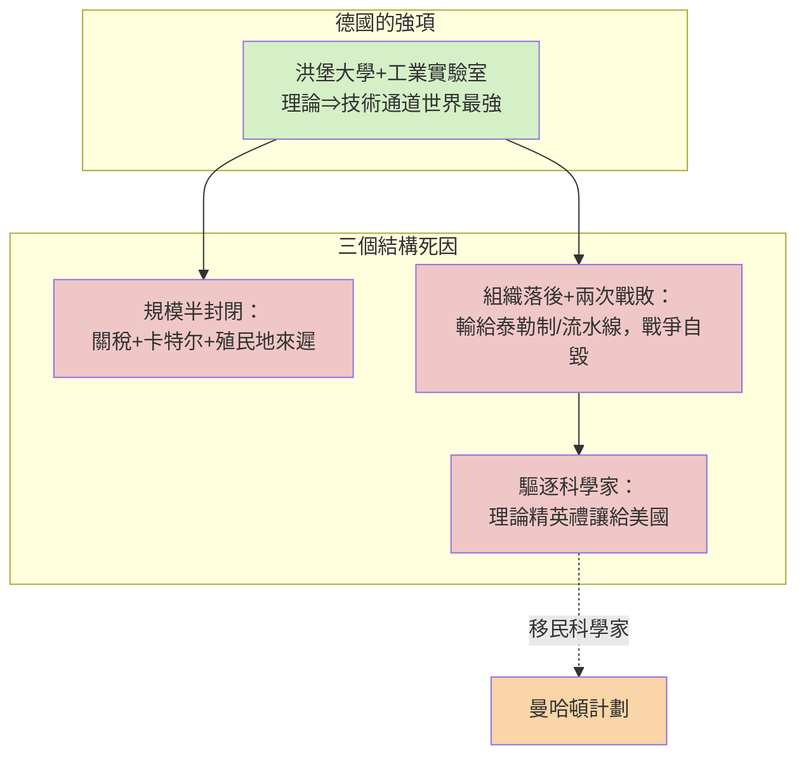
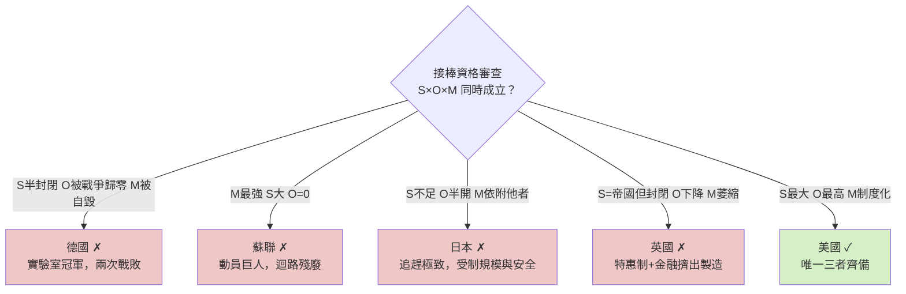

# 第八章 反事實檢驗：為何不是德國、蘇聯或日本

## 摘要：接棒者的資格審查

本書至此給出美國崛起的公式：**大陸規模市場 × 制度基礎設施 × 迴路組織代際躍升 × 國家科學動員 × 秩序供給**。但一個嚴肅的論證必須通過反事實檢驗：二十世紀上半葉，有資格接替英國的絕不只美國一家。德國在科學與工程上曾是世界第一；蘇聯以國家動員創造過驚人的增長；日本是唯一完成工業化的非西方國家；英國自己也遠未放棄王座。本章逐一驗屍，模仿偵探的排除法——每個候選人都死於一種結構性的死因，而倖存者的名單上只有一個名字。結論可以預告：接棒需要「**規模 × 開放 × 動員**」三者同時成立，缺一即出局；二十世紀中葉唯有一國三者齊備。

$$
\text{接棒條件} \;=\; \underbrace{S}_{\text{規模}} \times \underbrace{O}_{\text{開放}} \times \underbrace{M}_{\text{動員}}
$$

注意是乘法不是加法：任何一項為零，乘積為零。這正是本章每一節的死因。

## 一、德國：實驗室冠軍的兩次敗局

德國是十九世紀末科學迴路的最強者。洪堡大學改革讓研究與教學合一，工業實驗室（拜耳、巴斯夫、西門子）把有機化學與電氣工程變成國家產業，1901年首屆諾貝爾獎至一戰前，德國科學獎項多於美英之和。以「理論⇒實驗⇒技術」三環的密度論，柏林與海德堡勝過匹茲堡與芝加哥。

那麼德國輸在哪裡？三個結構性缺陷，而且每個缺陷都被兩次世界大戰放大為致命傷。

**第一，規模的詛咒。** 1871年統一後的德國擁有歐洲最強的工業，但它的市場是半封閉的：對外有關稅聯盟與俾斯麥的保護主義，對內有卡特尔（Kartell）的價格壟斷，對殖民地的爭奪又來得太遲——世界已經被英法瓜分完畢。德國化學品可以征服世界市場，但德國的「大陸規模消費市場」從未成形；它的規模擴張只能靠戰爭，而戰爭正是下述第二缺陷的引爆器。

**第二，管理的失敗與戰爭的自毀。** 第六章已述：美國以泰勒制與流水線在組織層級上代際躍升，德國精工細作的實驗室模式在成本曲線上被福特式量產碾過。更要命的是，德國兩次以戰爭解決「規模不足」的問題——1914年與1939年——兩次皆敗。第一次大戰耗盡黃金儲備與一代人才；納粹時期更直接執行了本世紀最愚蠢的腦力政策：驅逐猶太與異議科學家，等於把愛因斯坦、費米、玻恩整批禮讓給對手。曼哈頓計劃的理論核心，相當程度上是柏林與哥丁根的移民組成的——德國不是被原子彈打敗的，是先把自己變成了原子彈的原料供應商。

**第三，迴路的單向化。** 德國的「理論⇒技術」通道極強，但「技術⇒大市場⇒利潤⇒再投資」的下半段始終受限於內需與殖民地的雙重狹窄。迴路前半段是世界冠軍，後半段受制於地緣——乘法裡的 $S$ 打了折扣， $O$ （開放）又被戰爭歸零。

## 二、蘇聯：動員的巨人，迴路的殘廢

蘇聯的反事實最有分量，因為它是唯一在「國家⇒迴路」通道上與美國對位的選手。1928年起的三個五年計劃，以行政命令強制積累，把一個農業帝國在十二年內變成世界第二工業國；二戰後更造出原子彈（1949，只比美國晚四年）、氫彈、人造衛星。1957年史潑尼克升空（見 [../../科技史/科技發展史/1957-史潑尼克.md]）的那一夜，美國的恐慌是真實的：蘇聯的火箭、數學與動員能力似乎都在贏。

那麼，為什麼輸的是蘇聯？答案是：蘇聯的迴路只有上半身。

**動員有餘，開放歸零。** 蘇聯的研發體系規模巨大——科學家人數長期世界第一，軍事研發吞掉GDP的兩成——但它的迴路在關鍵處被行政切斷：

1. **理論⇒實驗**通暢（國家全額資助），**實驗⇒技術**在軍工領域通暢（命令驅動），但**技術⇒民間量產**幾乎不通：蘇聯沒有消費市場作為選擇壓力，軍工成果轉民用（如仿製矽谷的Shura微電子）永遠慢兩代，因為沒有利潤訊號告訴計劃委員會哪個技術值得放大。
2. **資訊迴路封閉。** 科學是國家機密，期刊與國際會議受限，電腦與影印機因維穩而被管制——連「知識複製成本」都被人為抬高。迴路的本質是資訊與資本的自由流動，蘇聯的制度設計恰恰以流動為敵。
3. **單一買家病。** 唯一客戶是國家，唯一的績效指標是完成計劃指標。沒有市場競爭，就沒有淘汰，也沒有仙童式的裂變——蘇聯科學城（如新西伯利亞）不會裂變出新公司，只會老化成官僚單位。

史潑尼克之後的歷史是這個病理的最佳註腳：1957—1965年蘇聯航天 still 領先，但半導體、計算機、化工——所有需要**民用市場反哺**的領域——差距逐年被拉開。到1980年代，蘇聯最好的晶片落後矽谷約十年，而它無法縮小差距，因為縮小差距的工具（市場、創投、人才流動、開放貿易）正是它制度上禁止的東西。蘇聯證明了：**動員 $M$ 可以用命令造出來，但 $O$ 不能；沒有開放，迴路就只是一條單行道，走到技術封頂為止。**

## 三、日本：追趕的極致與兩根天花板

日本是四個候選者中最接近成功的一個。1868年明治維新（見 [../../世界史/世界發展史/1868-明治維新.md]）以「迴路＋資本＋制度三件套」完成非西方世界唯一的工業化；戰後更以通產省（MITI）的產業政策、主銀行體制與終身僱用制，在鋼鐵、造船、汽車、半導體記憶體上把美國打得節節敗退，1980年代甚至有「日本第一」之說。豐田生產方式在組織層級上完成了對福特制的反超。

但日本死於兩根天花板，而這兩根都不是它自己能拆的。

**第一根：規模。** 日本一億人口的國內市場無法支撐美國式的大陸規模經濟，它的應對是出口導向——把歐美市場當作自己的市場。這個策略在追趕期完美，卻有一個致命的依賴：出口的通路與安全由美國的海軍與GATT體系保護。1985年廣場協議，美國一紙協議就能強迫日元升值、壓縮日本出口引擎；1990年代半導體戰，華盛頓用貿易制裁逼迫日本簽訂市場份額協定。**日本從未擁有自己的秩序供給**——它的繁榮運行在別人的系統上，系統的主人隨時可以調整參數。

**第二根：迴路的封閉面。** 戰後日本的政商體制（主銀行、系列企業、護送船團監管）在追趕既有技術時是利器——因為路標清晰、只需執行——但在開創新技術時是枷鎖：破產與退出機制不良，創投幾乎不存在，勞動力與資本不能流動到新部門。日本的半導體與電子業擅長把已知產品做到極致，卻幾乎沒有產出「從零到一」的範式（電晶體、IC、個人電腦、網路、手機作業系統皆非日本發明，儘管日本一度量產領先）。追趕靠的是 $S$ 與 $M$ ，開創靠的是 $O$ ——而日本的 $O$ 是半開：對內封閉的財閥網絡，對外依附的安全框架。

## 四、英國：為何無法續霸——在位者的三個病

最後審問在位者。英國並非天然退位：它仍是世界最大殖民帝國、最大海外投資國、英鎊仍是主要儲備貨幣，1945年的英美債務對比也遠非一邊倒。英國輸在自己的結構病上。

**病一：帝國特惠制 vs 開放體系。** 1932年渥太華會議建立的帝國特惠制，把英帝國變成一個封閉的關稅圈——這是對美國大陸自由市場的模仿，卻是劣質版：帝國市場的購買力遠小於美國本土市場，而封閉本身削弱了英國作為「世界市場中心」的立場。美國戰後用GATT強推多邊開放，正是看準了這一點：**開放體系對小市場的在位霸權是減分項，對大市場的挑戰者是加分項**。英國簽下自己霸權的死亡證明。

**病二：金融擠出製造。** 這是最深層的一根。倫敦城作為全球金融中心，其匯率與利率政策服務於金融收益（維持英鎊區、保護債權），代價是本土製造業長期投資不足、英鎊高估。二戰後此病加劇：1947年印度獨立與帝國解體（見 [../../世界史/英國史/1947-印度獨立與帝國解體.md]）抽走帝國市場，1956年蘇伊士危機（見 [../../世界史/英國史/1956-蘇伊士運河危機.md]）宣告帝國武力不再能支撐貨幣霸權，1976年IMF紓困（見 [../../世界史/英國史/1976-IMF紓困與滯脹終局.md]）為這場漫長的退位蓋章。英國的路徑是：帝國⇒金融⇒製造萎縮⇒更加依賴金融——一個自我強化的下行迴路，與美國「製造⇒科技⇒金融⇒再投資科技」的上行迴路恰成鏡像。

**病三：科學強、動員弱。** 英國科學（雷達、核裂變理論、電腦——曼徹斯特與劍橋都有原創貢獻，巨像電腦甚至早於ENIAC）毫不遜色，但戰後財政無力維持曼哈頓級的動員，研發體系規模被大陸國家碾壓。天才依舊，引擎縮水。

## 五、驗屍報告總表

| 候選者 | 規模 $S$ | 開放 $O$ | 動員 $M$ | 死因 |
|---|---|---|---|---|
| 德國 | 半封閉市場，靠戰爭擴張 | 卡特尔＋保護主義，戰爭歸零 | 實驗室最強，被戰敗與人才驅逐自毀 | 兩次挑戰皆敗 |
| 蘇聯 | 領土最大，經濟規模第二 | 資訊與資本迴路封閉 | 國家動員世界最強 | 迴路單行道，無市場反哺 |
| 日本 | 一億人口內需有限 | 出口依賴美國體系，對內財閥封閉 | 政產學動員有效，安全依附美國 | 規模與主權雙天花板 |
| 英國 | 帝國雖大，購買力分散 | 帝國特惠制自我封閉 | 科學強，戰後財政無力動員 | 金融擠出製造，帝國解體 |
| 美國 | 大陸規模自由市場 | 關稅最低＋GATT推廣開放 | 國家⇒迴路制度化（NSF/NASA/ARPA） | **三者齊備，乘積最大** |

## 六、乘法法則的一般意義

這份驗屍報告可以總結成一條比歷史細節更耐久的規律。霸權交替不是單項比賽，而是乘法比賽：

$$
P_{\text{接棒}} \propto S \times O \times M
$$

- 德國證明： $S$ 、 $M$ 可以很高，但一場輸掉的總體戰能把 $O$ 與 $M$ 同時歸零；
- 蘇聯證明： $S$ 、 $M$ 可以無限大， $O=0$ 時迴路退化為單行道，增長有硬上限；
- 日本證明：追趕只需 $S \times M$ ，開創必須 $O>0$ ；且 $S$ 不足者必須借用他者的秩序，於是主權上被動；
- 英國證明：在位者的 $O$ 下降（封閉化）與 $M$ 萎縮（金融擠出）會同時發作——封閉保護既得利益，金融虹吸實業，兩者互為因果。

唯獨美國：大陸規模自由市場（ $S$ 最大）、最低關稅＋戰後以GATT把開放推向全球（ $O$ 最高且是它自己定義的）、以及制度化了的科學動員（ $M$ 由國家⇒迴路通道保證）。第7章展示的三層迴路機器，正是 $S \times O \times M$ 三個變數的物理載體。

## 七、小結

反事實檢驗通過了：接棒的不是科學最強的（德國）、動員最狠的（蘇聯）、追趕最努力的（日本），也不是在位最久的（英國），而是唯一讓「規模×開放×動員」三個變數同時取最大值的美國。每一個落選者不是不優秀，而是死於乘法法則——一項為零，全盤為零。這個法則還有一個延伸含義：**只要美國自己不讓任何一個變數塌陷，霸權就不會被單一挑戰者奪走**。那麼，半個世紀過去，這三個變數還安好嗎？美元、資訊與一個新的挑戰者，把這個問題留給尾聲。

---

## 延伸閱讀（探案庫連結）

- [../../科技史/科技發展史/1957-史潑尼克.md](../../科技史/科技發展史/1957-史潑尼克.md)
- [../../世界史/世界發展史/1868-明治維新.md](../../世界史/世界發展史/1868-明治維新.md)
- [../../世界史/英國史/1947-印度獨立與帝國解體.md](../../世界史/英國史/1947-印度獨立與帝國解體.md)
- [../../世界史/英國史/1956-蘇伊士運河危機.md](../../世界史/英國史/1956-蘇伊士運河危機.md)
- [../../世界史/英國史/1976-IMF紓困與滯脹終局.md](../../世界史/英國史/1976-IMF紓困與滯脹終局.md)
