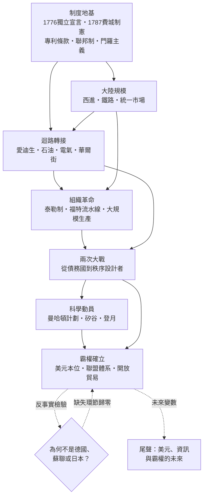

# 美國為何崛起——探討美國為何接續英國，成為世界強國

## 總序：一樁歷史懸案的偵查

1890 年前後，世界最強的工業國換了人。這件事本身不稀奇——工業化的火種本來就可能四處蔓延。真正令史家著迷的是案發現場的幾個反常細節：

第一，被超越的英國，擁有當時最深的資本市場、最廣的殖民帝國、最先發的工業基礎。挑戰者德國，擁有當時最強的科學實驗室、最好的大學化學與光學工業、最快的參謀本部動員體制。然而最終接棒的，卻是那個直到 1860 年還在靠出口棉花與小麥、被歐洲人視為「暴發戶與鄉巴佬之國」的美國。

第二，德國兩度以戰爭挑戰英國主導的秩序，兩度失敗；美國幾乎不曾主動出拳，霸權卻像是自己走進了它手中。

第三，把鏡頭拉近看，美國的每個「優勢」單獨拆開來，都不是美國的發明：專利制度威尼斯 1474 年就有，蒸汽機是英國人的，實驗室研究是德國人的，流水線的前身可追溯到兵工廠的可互換零件傳統。美國像是把別人的零件重新組裝，卻組出了一台別人都開不動的機器。

本書的偵查立場由此確立：**我們不問「美國為何會強」（那是人人都會強的問題），而問「為何偏偏是美國接棒」**。這是一個問題的反轉。反轉之後，答案不再是列舉優點，而是尋找「一連串特殊事件與體制的串聯」——找出那些缺一不可、且恰好只在此地齊備的環節。

### 分析框架：九通道迴路＋一連串串聯

本書借用了金觀濤對工業革命的「理論—實驗—技術」三元迴路結構：科學理論指導實驗，實驗催生技術，技術的成功反哺理論與實驗投入，形成自我加速的循環。工業革命的爆發，正是這個迴路在英國率先閉合的結果；而迴路一旦閉合，就會沿著九條通道（科學、技術、經濟、政治、法律、教育、傳播、金融、組織）向四方擴散。

但僅有迴路，解釋不了美國。因為迴路會擴散，德國和法國也接上了線。美國的新變數在於它做了兩件前人沒做的事：

- **把「組織」本身變成技術**。英國的迴路靠工匠（瓦特是儀器工匠，蒸汽機的改良靠車間手藝），德國的迴路靠實驗室（合成染料工業把大學化學直接接上工廠），而美國把第三條路走了出來：泰勒的科學管理、杜邦的事業部制、福特的流水線——用管理知識把資金、機器與人重新編排，讓同樣的零件產出十倍的產能。
- **把「國家」變成迴路的超級催化劑**。二戰前後，美國以曼哈頓計劃的規格動員科學，以戰後的研發體制（聯邦經費、拜杜法、創投、國防先進研究計畫署）讓「理論—實驗—技術」迴路第一次獲得國家規模的燃料，再以美元本位、聯盟體系與開放貿易，把這套迴路外包給全世界使用——並從中收租。

於是本書的核心論旨可以寫成一條因果鏈：

$$
\text{美國崛起}=\underbrace{\text{大陸規模市場}}_{\text{規模經濟的溫床}}\times\underbrace{\text{制度基礎設施}}_{\text{憲法}\cdot\text{專利}\cdot\text{聯邦制}\cdot\text{美聯儲}}\times\underbrace{\text{管理代際躍升}}_{\text{泰勒}\cdot\text{福特}\cdot\text{事業部制}}\times\underbrace{\text{國家科學動員}}_{\text{曼哈頓}\cdot\text{戰後研發體制}}\times\underbrace{\text{秩序供給}}_{\text{美元}\cdot\text{聯盟}\cdot\text{開放貿易}}
$$

這是連乘，不是連加。任何一項為零，積便為零——這正是「缺一不可」的數學表述。霸權移轉不是戰爭紅利的僥倖，而是**組織知識與資本方式的代際優勢**：英國用工匠組織蒸汽，德國用實驗室組織化學，美國用管理與國家動員組織一切。

### 全書因果鏈總圖

## 目錄

| 章 | 檔案 | 探案主題 |
|---|------|---------|
| 1 | [01-導論：問題的反轉與霸權移轉之謎](01-導論：問題的反轉與霸權移轉之謎.md) | 為何偏偏是美國接棒？問題的反轉與偵查地圖 |
| 2 | [02-制度地基：獨立宣言、費城制憲與專利條款](02-制度地基：獨立宣言、費城制憲與專利條款.md) | 知識財產權入憲，聯邦制作為內部自由市場的保障 |
| 3 | [03-大陸規模：西進、鐵路與統一市場](03-大陸規模：西進、鐵路與統一市場.md) | 規模經濟的溫床：一個國家，一個市場 |
| 4 | [04-迴路轉接：愛迪生、石油、電氣與華爾街](04-迴路轉接：愛迪生、石油、電氣與華爾街.md) | 發明變成產業，產業接上資本 |
| 5 | [05-組織革命：泰勒制、福特流水線與大規模生產](05-組織革命：泰勒制、福特流水線與大規模生產.md) | 管理作為第三條迴路：英國工匠、德國實驗室、美國管理 |
| 6 | [06-兩次大戰：從債務國到秩序設計者](06-兩次大戰：從債務國到秩序設計者.md) | 戰爭如何清空對手、成就美元 |
| 7 | [07-科學動員：曼哈頓計劃、矽谷與登月](07-科學動員：曼哈頓計劃、矽谷與登月.md) | 國家作為迴路的超級催化劑 |
| 8 | [08-反事實檢驗：為何不是德國、蘇聯或日本](08-反事實檢驗：為何不是德國、蘇聯或日本.md) | 逐一驗證「缺一不可」：誰缺了哪個環節 |
| 9 | [09-尾聲：美元、資訊與霸權的未來](09-尾聲：美元、資訊與霸權的未來.md) | 迴路是否會移轉？下一次接棒者的清單 |

## 閱讀指引

- 各章以「一、」至「七、」小節推進，模擬偵查程序：現場 → 疑點 → 排除 → 串聯 → 定論。
- 行文中的相對連結指向本探案庫各冊（世界史、科技史），可循線深挖原始條目。
- 每章以「小結」收束，回到全書核心公式，檢驗該章貢獻了哪一個乘數。
