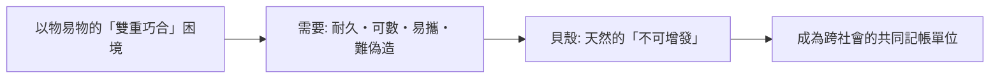

# 第一篇 第一章 第一節：貝幣與泥板借據——貨幣比鑄幣早了兩千年

> 約公元前 3000 年，兩河流域與印度河谷。**貝殼（Cowrie shell）**從馬爾地夫的潟湖一路被搬到黃河與尼羅河畔——**它不能吃、不能用，卻被數十個互不相識的社會同時選為「錢」**。同一時期，美索不達米亞的書吏把借貸刻上泥板：**本金、利率、期限、擔保人**。本節拆解一個反直覺的史實：**貨幣的第一形態不是「支付工具」，而是「記帳單位＋信用憑證」**——鑄幣要等到兩千多年後才登場（參見《會計的故事》1 章、《金融的故事》1.1）。

## 一、前因：為什麼是貝殼

1. **「雙重巧合」的經濟學**：農夫要用穀物換矛，必須恰好找到「要穀物的矛匠」——**交易成本高到抑制分工**；一個公認的「中間物」能把每次交換拆成兩半；
2. **貝殼的「貨幣性」優點**：**不可偽造**（深海採集成本高）、**可計數**（枚）、**不可腐壞**、**便攜**——同時它**沒有內在用途**，這反而免除了「當錢用還是當工具用」的衝突——這個邏輯在四千年後的比特幣身上重演（11.2）；
3. **貝幣的地理尺度**：從非洲西岸、印度洋沿岸到中國商代（甲骨文以「貝」為偏旁的字多與財富有關：**財、貨、貸、買、賣、賞**）——**漢字本身就是一部貝幣史**。

## 二、泥板上的信用：美索不達米亞的借貸

1. **烏爾與巴比倫的商業文書**：**本金（大麥或白銀）、利率（約 20%–33%）、期限、證人、滾筒印章**——一塊小泥板就是一份**可執行的契約**；
2. **「銀」是記帳單位而非實物**：大部分借貸以「銀的謝克爾」計價，**結算可以用大麥、奴隸或服務**——**「銀本位的記帳，非銀本位的支付」**——與今日的「美元計價、多幣種結算」同構；
3. **《漢摩拉比法典》的金融條款**（約前 1754 年）：**利率上限、債務奴役以三年為限、乾旱免息展期**——**人類第一次用立法管理信用週期**（詳《金融的故事》1.2）。

## 三、後果：三條制度長線

1. **「記帳先於貨幣」**：神廟的分配帳冊孕育了**利息、複式記帳（2.3 的威尼斯遠祖）與審計**——**金融的本體是共同承認的記錄**，這條線直通區塊鏈（11.2）；
2. **「不可增發」的貨幣哲學**：貝殼—黃金—比特幣，**「稀缺性靠自然或數學擔保」**與「統治者鑄幣權」（1.2 起）的對抗，是此後四千年的貨幣政治主軸；
3. **債務與社會的張力**：**「取消債務」成為古代近東的定期儀式**（如前 18 世紀的「自由法令」）——**債務豁免不是現代發明**，而是貨幣與社會永恆張力的最早出口（對照《國家破產的故事》全書主題）。

---

*下一節：呂底亞鑄幣——參見 [1.2 呂底亞鑄幣](01.2-呂底亞鑄幣.md)*