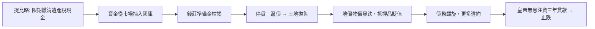

# 第一篇 第二章 第二節：羅馬錢莊與公元 33 年危機——史上第一次記錄在案的系統性緊縮

> 公元 33 年，羅馬。皇帝**提比略（Tiberius）**積極國庫（約 27 億塞斯特斯）卻遇上一場**通貨緊縮的信用危機**：元老院被發現**大量把土地抵押借款用於奢侈消費**，皇帝下令**限期以現金還清遺產稅欠款**——資金從市場被抽進國庫，**錢莊（argentarii）**現金枯竭、放貸停擺，**地價與物價暴跌**。提比略最後以**無息注資 1 億塞斯特斯、借給土地持有者三年**化解——**史上第一次記錄在案的「最後貸款人」操作**，比英格蘭銀行早了一千六百多年。

## 一、前因：羅馬的金融基礎設施

1. **錢莊（argentarii）**：設在羅馬廣場朱利亞柱廊的**銀行桌**——兌換、保管、放貸、**拍賣代辦**（破產清算也是他們的業務）——上層還有**「六人錢商行會」**的半官方結構；
2. **帝國的貨幣統一**：奧古斯都以來，**金奧里斯、銀第納爾、銅塞斯特斯**的比價體系支撐環地中海貿易——**貨幣是帝國的黏合劑**（也使「稀釋硬幣」成為帝國財政的毒癮，見《國家破產的故事》1.1）；
3. **信用的廣度**：元老階層以土地抵押大額借款、商人以船貨融資、行省城市互相貸款——**貴族消費信貸已經成為系統性的鏈條**。

## 二、危機的機制：一次「政策引發的信用緊縮」

1. **塔西佗的記載**（《編年史》6.16–17）：**「到處都在拋售、卻無人買入」**——**流動性陷阱**的古典描述；「公家財富被鎖進金庫，市面現金枯竭」——**財政盈餘與信用緊縮並存**的悖論；
2. **解藥的三大要素**：**無息**（打破債務螺旋）、**長期（三年）**（避免短期逼債）、**以土地為擔保**（救抵押品價格）——**現代危機處理的原則在公元 33 年已被全部寫出**；
3. **對照 2008 年**：抽走流動性的政策（歐債危機初期的緊縮、1937 年的美國二次緊縮）反覆重演同一劇本——**「政府從市場抽水」與「政府向市場放水」的差別，就是危機與復甦的差別**。

## 三、後果

- **「最後貸款人」的概念被驗證**：但**制度化**要等到 1694 年英格蘭銀行（6.1）與 1913 年聯準會（8.2）——**「知道解藥」與「擁有解藥的機構」之間隔了一千六百年**；
- **錢莊業的脆弱**：公元 33 年之後，羅馬的 argentarii 在帝國晚期的動盪中反覆破產——**「無存款保險的銀行業」在無監管環境下的宿命**；
- **思想的殘章**：塔西佗的記載成為**貨幣經濟學的古典文本**——孟德斯鳩、吉本到現代經濟史家（如費弗爾、洛貝爾）反覆重讀——**「信用是心理」的洞見已經在古典時代成形**。

---

*下一章：飛錢與交子——參見 [3.1 飛錢與唐宋匯兌](03.1-飛錢與唐宋匯兌.md)*