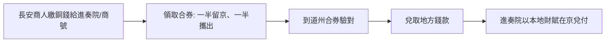

# 第一篇 第三章 第一節：飛錢與唐宋匯兌——銅錢太重，於是「紙」先當了匯款單

> 唐憲宗時代（806–820），長安的商人把銅錢交給**諸道進奏院**（地方藩鎮在京辦事處）或大商號，換取一紙憑券，**分成兩半、各持其一**；到地方後**合券驗對、如數領錢**——**「輕裝趨四方，合券乃取之，號飛錢」**（《新唐書》）。**飛錢不是貨幣，而是「匯款憑證」**——但它證明了一件事：**當金屬貨幣的運輸成本高過其面值，紙就必然登場**。

## 一、前因：銅錢經濟的物理極限

1. **銅錢的重量問題**：一貫（千文）銅錢約 **5–6 斤**；大額交易動輒百貫千貫——**跨區域商業被「運錢的物流成本」卡死**；
2. **唐代財政的輸入結構**：**東南的稅賦與鹽利要輸入長安**、軍費要輸往邊鎮——**政府本身就是最大的「匯款客戶」**；
3. **銅錢的「出境禁令」**：各道為留住貨幣屢頒**「錢禁」**（禁銅錢出境）——**管制的套利空間，正好由飛錢填補**。

## 二、機制：飛錢的「雙券制」

1. **「匯兌的清算本質」**：飛錢**不改變貨幣總量**，只是**把「運錢」改為「移帳」**——兩地互為清算——**這是 SWIFT 與現代支付的邏輯原型**（10.2）；
2. **「信用在哪裡」**：飛錢的信用來自**進奏院（準官方）與大商號的商譽**——**「機構信用」先於「法定信用」**——與義大利匯票（4.2）的私人信用路徑完全平行；
3. **政府的態度**：官方一度**禁止民間飛錢**（試圖把匯兌收歸戶部），失敗後轉為**放任並利用**——**「管制→失敗→收編」**成為中國貨幣治理的循環模式。

## 三、後果：通往交子的最後一級階梯

- **北宋的「便錢」與「見錢公據」**：宋初官方匯票制度化，天禧末年（1021）**便錢流通額已達三百餘萬貫**——**匯兌的規模化訓練了「紙可代錢」的社會習慣**；
- **四川的「鐵錢困境」**：四川禁用銅錢、通行**鐵錢**——**買一匹絹要兩萬錢、重達百斤**——**極端的支付成本，逼出了世界最早的紙幣**（3.2）——**飛錢的匯兌經驗＋鐵錢的痛苦成本＝交子**；
- **與伊斯蘭世界的平行**：同期阿拔斯帝國的**「蘇夫達傑（suftaja，信用函）」與「哈瓦拉（hawala，轉帳）」**體系承擔同樣功能——**「匯兌先於紙幣」在歐亞兩端同時發生**——**大眾對「紙代表錢」的信任，是所有紙幣的社會前提**。

---

*下一節：交子——參見 [3.2 交子與紙幣的誕生](03.2-交子與紙幣的誕生.md)*