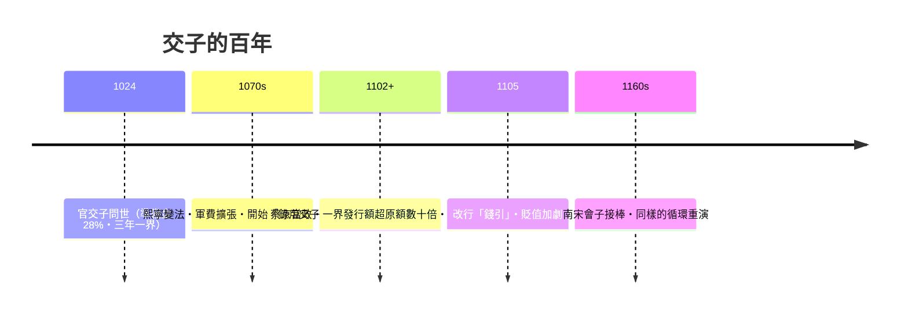

# 第一篇 第三章 第二節：交子與紙幣的誕生——世界第一張官方紙幣的百年興亡

> 1024 年，北宋益州（成都）。**四川十六家富商聯營的「交子鋪」**因兌付糾紛被官府取締後，**益州交子務**設立——**官方發行的紙幣「官交子」**自此問世，比歐洲第一張紙幣（1661 年瑞典）早了六百三十七年。它的配方：**鐵錢準備金＋分界發行（三年一界、回收舊鈔）＋限定額度**。它的死因：**財政需要時就多印**。本節是全書第一個完整案例：**紙幣的興盛與毀滅，取決於「發行者能否克制自己」**。

## 一、前因：從私營到官營

1. **鐵錢的痛苦**（3.1 末）：**小錢十枚抵銅錢一枚**，大宗交易以斤計——**成都商人先行創辦私營交子鋪**，以「存款憑證」代鐵錢流通；
2. **私營的危機**：個別鋪主**濫發、無力兌付**，爭訟四起——1023 年益州知州**張詠**奏請**官辦**：收私券、設**益州交子務**——**「私營失控→官營收編」**與飛錢的路徑一模一樣；
3. **制度設計（天聖元年，1024）**：**一界 125 萬餘貫，以 36 萬貫鐵錢為準備（約 28%）**；**分界發行、三年一換**；**界滿造新換舊**——**準備金＋期限＋額度**，十七世紀的英格蘭銀行也不過如此。

## 二、興亡的時間線

1. **「準備金的滑落」**：初期 28% 準備 → 慶曆年間**挪作軍費** → 崇寧年間**一界發行額膨脹至原額二十倍**——**「分界」的紀律被「財政需要」碾碎**——交子貶值至**面值的十分之一**；
2. **「為何仍算成功」**：即使貶值，**交子仍然流通了百年以上**——**「會貶值的紙幣仍優於鐵錢」**——貨幣的價值是**相對的、且由替代品定義**；
3. **「會子」的續集**：南宋會子（1160）同樣**始於兌換承諾、終於濫發**——**宋元明清的紙幣史，就是「準備金紀律」的失守史**——元朝的至元寶鈔通脹至廢紙（《國家破產的故事》2.2），明朝寶鈔崩潰後**中國退回白銀經濟**。

## 三、後果：紙幣的三條世界線

- **技術線**：**雕版印刷＋特殊紙張＋印花、暗記、兩色套印**——**防偽技術與貨幣同步誕生**——這條線通向今日的鈔票防偽與數位簽章（10.2、11.2）；
- **制度線**：**「以準備金支撐的兌換券」**——同一配方在 1661 年斯德哥爾摩、1694 年倫敦重現——**但中國始終沒有長出「維持準備金紀律的制度機構」**（獨立央行）——**技術相同、制度缺席，結局迥異**；
- **思想線**：**馬可波羅的驚嘆**（《行紀》：大汗「以樹皮製成之紙，通行全境，猶如黃金」）把紙幣的觀念帶回歐洲——**「紙可為錢」的知識，經過六百年才在西方落地生根**。

---

*下一章：聖殿騎士團與麥第奇——參見 [4.1 聖殿騎士團的跨國匯兌](04.1-聖殿騎士團的跨國匯兌.md)*