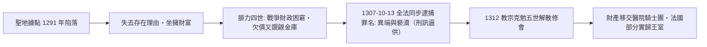

# 第二篇 第四章 第一節：聖殿騎士團的跨國匯兌——用「修會紀律」當信用等級

> 1119 年，九名法國騎士在耶路撒冷創立**「基督與所羅門聖殿貧苦騎士團」**——他們的最初任務是**保護朝聖者**；百年之內，這個武裝修會變成**橫跨巴黎、倫敦、黎凡特的跨國金融網**：朝聖者在巴黎把金銀存進聖殿團，領取書信，抵達聖地後憑信取款。**1139 年教宗英諾森二世授予「免於一切地方稅與關稅」的特權**——**「跨主權的特許機構」**就此誕生。1307 年 10 月 13 日星期五，法王腓力四世**同時逮捕全法聖殿騎士**——**歐洲第一個跨國金融體系，被一個債台高築的君主一舉消滅**。

## 一、前因：為什麼是修會

1. **朝聖的匯兌需求**：從歐洲到耶路撒冷**攜帶金銀穿越數千公里與數十個關卡**——搶劫與沒收的風險高得驚人——**「存錢在巴黎、取錢在雅法」**是剛需；
2. **「修會」的信用結構**：**貧窮誓願**（不可個人私產）＋**共同生活**＋**教宗直屬（不受任何王權管轄）**——**紀律替代了擔保品，主權豁免替代了法人制度**——中世紀沒有公司，**修會就是公司**；
3. **堡壘網路的「物理優勢」**：從倫敦聖殿區、巴黎聖殿塔到阿卡的基地——**儲備可以沿著自己的城堡鏈安全轉移**——**「物流即金融」**。

## 二、業務解剖：不止匯兌

| 業務 | 案例 |
|---|---|
| 朝聖匯兌 | 巴黎存、耶路撒冷取 |
| 保管 | 各國王室與貴族的珠寶、文件存於聖殿塔 |
| 轉帳支付 | 法王以「聖殿團帳戶」支付西班牙邊境開支 |
| 放款 | 借給君主：**腓力二世（奧古斯都）**、英王約翰、路易七世、愛德華一世 |
| 財政代理 | 法王的**王家金庫實際設在聖殿塔** |

1. **「君主是最大客戶也是最危險客戶」**：聖殿團**放款給幾乎所有西歐王室**——**借出的是金銀，抵押的是特許與友誼**——**沒有強制執行手段的債權人**，此後五百年裡所有「君主的銀行家」（4.2、6.1）都將重演這個困境；
2. **「聖殿塔之囚」**：1240 年代起，法國王室金庫存於聖殿塔——**「替國王管錢的機構」距離災難只有一步**——當國王需要錢而不想還債時，**監守者就是獵物**。

## 三、覆滅：1307 的黑色星期五

1. **「罪名是宗教、動機是財政」**：腓力四世**先後對倫巴第銀行家與猶太人徵收重稅、驅逐、沒收**——聖殿團只是這一**「掠奪序列」的最大獵物**——**「債務人的主權」第一次消滅了債權機構**（《國家破產的故事》全書主題的序曲）；
2. **制度遺產的正反兩面**：**負面**——「跨國金融機構」的形象蒙上陰影，此後歐洲金融網絡退回**城邦與家族尺度**（4.2）；**正面**——聖殿團的**帳簿組織、信函轉帳、堡壘倉儲**成為義大利銀行家的實務教科書；
3. **思想餘波**：**「星期五黑色」的現代迷信**部分溯源於 1307 年的大逮捕——**金融史上第一次「同日多點執法」**，也是今天全球金融制裁（如 SWIFT 切斷、9 章後的監管行動）的古老先例。

---

*下一節：麥第奇——參見 [4.2 麥第奇銀行](04.2-麥第奇銀行.md)*