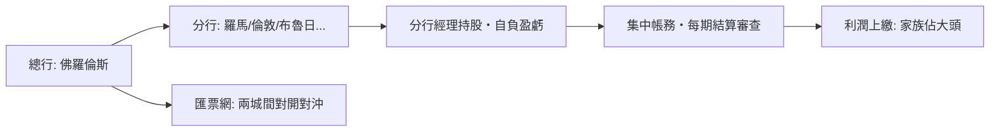

# 第二篇 第四章 第二節：麥第奇銀行——匯票、分行制與「文藝復興的資產負債表」

> 1397 年，**喬凡尼·迪比奇·德·麥第奇（Giovanni di Bicci de' Medici）**在佛羅倫斯設立總行——**麥第奇銀行（Medici Bank）**。到 15 世紀中葉，它在羅馬、威尼斯、倫敦、布魯日、日內瓦、里昂設分行，**為教宗管理稅款、為王公放貸**，並以財富資助了波提且利與米開朗基羅——**「銀行家資助文藝復興」**。本節拆解：**一個以「分行合夥制＋匯票」為核心的私人銀行帝國，如何繞開高利貸禁令、又如何在孫輩揮霍中衰亡**（結構詳《金融的故事》2.1、《會計的故事》2 章）。

## 一、前因：禁息的歐洲如何「銀行」

1. **教會的高利貸禁令**（第三次拉特朗公會議 1179、維埃納公會議 1311 定為異端）：**明收利息=死罪**——歐洲的資金供給被迫轉入**猶太貸款人、倫巴第錢商**的灰色地帶；
2. **匯票的法律幻術**：在佛羅倫斯以當地幣「支付」、在倫敦以英鎊「收款」——**匯率差內含了利息**——**「外匯損益」不是利息，故不犯禁**——**一套全球資金市場建立在會計分類之上**；
3. **商業環境**：**香檳集市衰落→義大利商業銀行的黃金時代**；佛羅倫斯的**毛紡行業與複式記帳文化**（2.3 帕喬利）提供了人才與工具。

## 二、機制的解剖：三項組織發明

| 發明 | 內容 | 意義 |
|---|---|---|
| 分行合夥制 | 分行是**獨立合夥**、經理持股 | 激勵在地化＋風險隔離——**現代商業銀行組織的原型** |
| 匯票對開 | 同城對開匯票鎖定價差 | **合規地收取利息**；兩城匯率成為最早的「市場利率」 |
| 雙重記帳 | 總行集中查帳（2.3） | **所有權與經營權分離的控制技術** |

1. **「教宗的銀行」**：羅馬分行承辦**教廷稅款的匯劃**——**宗教權威成為最大客戶**——同時**「麥第奇成為教宗的錢袋」**也埋下了政治反噬的種子（1513 年利奧十世即**喬凡尼·德·麥第奇**本人當選教宗）；
2. **「政治金融的雙刃」**：科西莫（老科西莫）以貸款操縱佛羅倫斯政治、**1466 年被放逐又靠軍隊回朝**——**銀行家的權力依賴放款網，也因放款政治化而失去客戶**；
3. **「衰亡的內部原因」**：羅倫佐（豪華者）時代**挪用公款資助政治與藝術、分行監管鬆弛**——倫敦與布魯日分行因對**英王愛德華四世與勃艮第公爵**的放款崩壞而巨虧——**1494 年美第奇被逐出佛羅倫斯、銀行清算**——**「給君主的貸款」再次成為銀行家的死因**（4.1 聖殿團的詛咒延續）。

## 三、後果

- **「商人銀行」模式的確立**：分行合夥＋集中審計＋匯票網——**此後羅斯柴爾德（19 世紀）、巴林、羅斯柴爾德家族的五兄弟分城體系**都是麥第奇的直系變種；
- **「藝術贊助=財富的社會兌換」**：麥第奇用金融利潤購買**政治合法性與文化永恆**——**「資本對文化的投資」自此成為歐洲精英的標準劇本**；
- **會計的勝利**：1494 年帕喬利《算術、幾何、比與比例概要》出版複式記帳法——**正是為麥第奇式銀行而生**——**沒有複式帳，就沒有跨國銀行**（《會計的故事》2 章專題）。

---

*下一章：阿姆斯特丹銀行——參見 [5.1 阿姆斯特丹銀行](05.1-阿姆斯特丹銀行.md)*