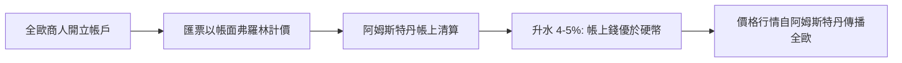

# 第二篇 第五章 第二節：阿姆斯特丹盾與國際貿易貨幣——「記帳貨幣」如何統治歐洲

> 17 世紀的歐洲商埠，商人結算時使用的不是任何一國硬幣，而是**阿姆斯特丹匯兌銀行的帳面弗羅林（bankflorijn / bankgulden）**——**一種只存在於銀行帳本上的貨幣**。波蘭的穀物、瑞典的銅鐵、葡萄牙的香料，**都以「阿姆斯特丹帳戶上的弗羅林」計價與結算**。本節拆解：**「國際貨幣」的第一形態不是強權的硬幣，而是一個中立城市的「帳本」**——這一原理在 1944 年以美元（9.1）、在今日以「清算系統＋帳戶網絡」（10.2）不斷重現。

## 一、前因：為什麼「帳上的錢」會贏

1. **硬幣的品質不可信**（5.1）：割竊、貶鑄、成色混亂——**「可驗證性」是稀缺品**；
2. **匯票網絡的密度效應**：全歐的匯票以阿姆斯特丹為樞紐對開——**「大家都用它計價」→「用它計價最省成本」**——**網絡外部性**的第一次貨幣實踐；
3. **荷蘭貿易的物質基礎**：**「歐洲的船運商隊」（moedernegotie，母貿易）**——波羅的海的糧食貿易使荷蘭掌握歐洲的**物價定價權**——**貿易份額先於貨幣霸權**。

## 二、機制：一個「非主權記帳單位」的運行

1. **「計價—結算—儲值」的三合一**：帳面弗羅林同時承擔**國際計價單位、結算媒介與儲備形式**（各國商人長期保有帳戶餘額）——**國際貨幣的三大職能，第一次被一個「帳本貨幣」完整履行**；
2. **「價格信息的壟斷」**：阿姆斯特丹交易所（1602）的**商品行情**與銀行的**匯率行情**同步傳播——**「定價權=信息權」**——四百年後的「美元計價＋倫敦/紐約行情」是同一結構；
3. **「中立性的紅利與極限」**：帳面弗羅林的信用**來自荷蘭的貿易霸權與市府紀律**，而非軍事霸權——**當英國以戰爭打垮荷蘭（三次英荷戰爭）並建立更強的金融機構（6.1），記帳貨幣的地位隨之轉移**——**「政治最終為貨幣背書」**。

## 三、後果

- **「國際貨幣是制度產品」**：阿姆斯特丹盾證明——**計價權可以屬於一個「清算系統」而非一個「帝國」**——此後 sterling（19 世紀）、美元（20 世紀）、乃至今日關於「數位貨幣與清算網絡」的討論（10.2、11.2），都在回答同一個問題：**誰的帳本，世界願意記帳？**
- **「升水=質量溢價」的恆定規律**：帳上錢優於硬幣的溢價，與今日**「在岸美元存款優於現鈔」、穩定幣對法幣的微幅溢價/折價**同構——**貨幣的價值差=制度信任差**；
- **荷蘭模式的全套輸出**：匯兌銀行＋交易所＋合夥資本市場＋信用保險——**英國在 1690 年代「全盤荷蘭化」**（荷蘭執政威廉入主英格蘭，6.1 的政治前提）——**一次完整的「金融制度移植」實驗**。

---

*下一章：英格蘭銀行——參見 [6.1 英格蘭銀行的誕生](06.1-英格蘭銀行的誕生.md)*