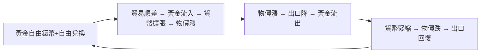

# 第三篇 第七章 第一節：牛頓與金本位——一次「銀幣定價失誤」鎖定了兩百年

> 1717 年，**艾薩克·牛頓（Isaac Newton）**——皇家學會會長、《自然哲學的數學原理》作者——身兼**皇家造幣局局長**。為解決**金幣（基尼）與銀幣（先令）比價失衡**造成的黃金湧入，他**把基尼金幣法定定為 21 先令**（此前市價波動於 21.5–22 先令）——**黃金因此被「定價過高」，白銀流出英國**——英國在無人決策的情況下**滑入金本位**。1816 年《鑄幣法》正式確認；**「一鎊＝113 格令標準金」**的比價運行到 1931 年。本節拆解：**史上影響最深遠的貨幣制度，竟然來自一次務實的比價校正**（牛頓的造幣生涯另見 4.2 末的南海虧損）。

## 一、前因：雙金屬的死結

1. **「劣幣驅逐良幣」的現場**：牛頓定價使**黃金對白銀高估**——**白銀被熔毀、出口**（流入法國——同時期法國的金銀比價對白銀更慷慨），**黃金佔據流通**——**格萊欣法則**從教科書走進現實；
2. **白銀的世紀性短缺**：1690 年代的**重鑄幣危機**（1696 大重鑄）已顯示**銀幣供給跟不上經濟**——英國**被迫接受黃金作為實際本位**；
3. **牛頓的雙重角色**：他先是**力圖拯救銀本位**（寫報告建議銀幣貶值重鑄，未獲採納），後**務實承認黃金的事實地位**——**「制度是撞出來的，不是設計出來的」**。

## 二、機制：金本位如何「自己運轉」

1. **「價格–金屬流動機制」**（Hume 的思想實驗＋其後的學理化）：**貿易失衡自動經由黃金流動修正**——**金本位=一個全球性的自動穩定器**——代價是**各國放棄貨幣自主權**；
2. **「金本位的政治經濟學」**：**債權人（銀行家、食利者）偏好金本位的「硬」**（防通脹稀釋），**債務人（農民、工業）偏好「軟」**——19 世紀英國的「金本位共識」實為**金融階層的政治勝利**——1890 年代美國「白銀自由鑄幣」運動（《綠野仙蹤》的著名隱喻）是同一鬥爭的美國版；
3. **「可信度的複利」**：英國在 1797、1847、1857、1866 年的**內部危機中屢次暫停兌現、又屢次恢復原比價**——**「暫停但不貶值」**使承諾愈發可信——**央行信譽是靠「事後回歸」積累的**。

## 三、後果

- **英鎊霸權的錨**（6.2）：金本位使英鎊成為**可自行兌換黃金的全球票據**——**倫敦成為世界的黃金與票據市場**；
- **全球金本位的擴散**：1870 年代德國（普法戰爭賠款）、斯堪的納維亞、美國（1873《鑄幣法》）相繼採行——**「世界黃金本位」（1870–1914）**是人類第一次全球貨幣一體化——**它的崩塌（1914–1931）也將是全球性的**（8.2）；
- **黃金供給的命門**：全球貨幣供給繫於**金礦產量**——1848 年加州（7.2）與 1890 年代南非蘭德的金潮**決定了全球物價的百年波動**——**「貨幣供給由地質學決定」**的時代，直到法幣（9.2）才終結。

---

*下一節：淘金熱——參見 [7.2 淘金熱與貨幣供應](07.2-淘金熱與貨幣供應.md)*