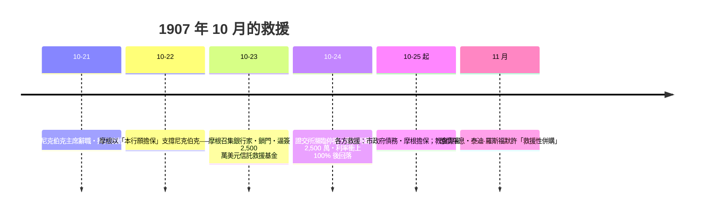

# 第四篇 第八章 第一節：1907 恐慌與摩根——「一個人的央行」

> 1907 年 10 月，紐約。尼克伯克信託（Knickerbocker Trust）因**銅礦股軋空失敗的關聯投機**遭擠兌，恐慌蔓延至整個信託與銀行體系——**存款人在街頭排隊、信託公司隔夜利率衝上 100%**。72 歲的**約翰·皮爾龐特·摩根（J.P. Morgan）**在自己的圖書館裡**召集銀行家、鎖門談判、強制同業出資**：**為信託公司提供流動性、為證券交易所籌錢、為市政府擔保**——**沒有央行，一個私人銀行家充當了最後貸款人**。這場「一個人的救援」直接催生了聯準會（8.2）。

## 一、前因：美國「無央行」的貨幣亂世

1. **1863–65 國民銀行體系的先天缺陷**（6.2 末的遠因）：**儲備層層上繳紐約**（鄉村銀行存於城市銀行）——**「金字塔式的準備結構」**——紐約一震，全國共振；且**鈔票發行綁死國債**——**貨幣供給缺乏彈性**，秋季農收提款季節性緊張；
2. **信託公司的監管真空**：信託公司**不受準備金要求約束**、以極低準備經營準銀行業務——**「影子銀行」的 1907 版**——**監管套利引發的脆弱性**與 2008 年同構；
3. **導火線**：**海因策兄弟**企圖軋空聯合銅礦股失敗，其關聯的**尼克伯克信託**主席引咎辭職——**恐慌以「關聯暴露」為傳染路徑**。

## 二、摩根的 72 小時

1. **「鎖門逼簽」的名場面**：摩根**把銀行家鎖在圖書館直到簽署出資承諾**——**私人協調替代公共機制**——**可一、可二，不可三**：1907 證明**金融穩定不能依賴一位巨富的心血來潮**；
2. **「最後貸款人的私營版」**：摩根的救援遵循**巴杰特原則**（「恐慌時以高利率自由放款」，《倫巴第街》1873）——**理論已有、機構缺席**；
3. **政治後果**：媒體與國會聚焦「**貨幣托拉斯**」——**1908 年奧爾德里奇–弗里蘭法**允許**緊急貨幣發行＋全國貨幣委員會調查**——**1912 年普喬聽證、1913 年《聯邦準備法》**——**摩根的救援成為央行立法的直接觸媒**。

## 三、後果

- **「最後貸款人」的制度化**（8.2）：**從私人英雄到法定機構**——1907 是美國央行誕生的「壓力測試」；
- **「影子銀行」的長影**：信託公司在 1907 年的角色，與 2008 年的**投資銀行＋貨幣市場基金＋回購市場**完全平行——《金融的故事》8、10 章的監管史由此展開；
- **思想遺產**：**「恐慌是心理事件，央行是心理制度」**——巴杰特到 2008 年伯南克的「**我們從 1907 與 1929 學到了什麼**」，同一條思想線索。

---

*下一節：聯準會的誕生與大蕭條——參見 [8.2 聯準會的誕生與大蕭條](08.2-聯準會的誕生與大蕭條.md)*