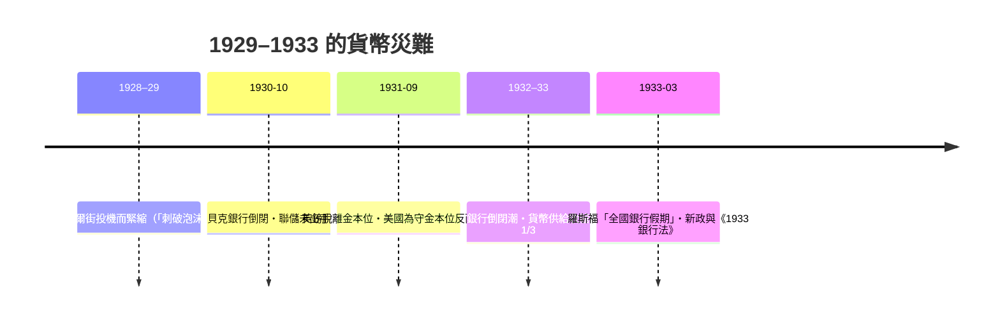

# 第四篇 第八章 第二節：聯準會的誕生與大蕭條——最後貸款人的「遲到」與「失職」

> 1913 年 12 月 23 日，威爾遜總統簽署**《聯邦準備法》**：**12 家地區聯邦準備銀行＋華盛頓聯邦準備理事會**——**「政府與私人、中央與地方」的妥協結構**。1930–33 年，這個新生機構在**大蕭條中坐視近萬家銀行倒閉、貨幣供給收縮三分之一**——**弗里德曼與施瓦茨的判詞：大蕭條不是市場的失敗，而是央行的失職**。本節拆解：**最後貸款人從「發明」到「制度化」到「第一次大考不及格」的完整弧線**。

## 一、前因：央行的「美國式妥協」

1. **歷史的兩次失敗**：**第一合眾國銀行（1791–1811）**與**第二合眾國銀行（1816–1836）**皆因**「中央集權」的政治恐懼**而未獲續期（傑克遜的「銀行戰爭」）——**美國反央行傳統**迫令 1913 年方案必須「去中心化」；
2. **1907 的教訓**（8.1）：**需要一個「彈性貨幣」供給者與恐慌救援者**——國民貨幣委員會（1908–12）考察歐洲央行，**借鑒英格蘭銀行的貼現機制與德國的分行結構**；
3. **政治的合成**：**民主黨的地區主義**（12 家地區行）＋**共和黨的集中訴求**（理事會）＋**銀行界的私人治理**（會員行持股）——**妥協產生了「設計上猶豫」的央行**。

## 二、大蕭條的三重失職

1. **「綁在金本位上的雙手」**：1931 年為保黃金平價**加息**——**「守金本位」壓倒「救銀行」**——跨國證據（伯南克與詹姆斯）：**越早脫離金本位的國家復甦越快**——**金本位成為蕭條的傳染與放大機制**（7.2 末的伏筆收束）；
2. **「最後貸款人的缺席」**：按巴杰特原則應「恐慌時自由放款」，聯儲卻**放任銀行倒閉**（部分因為「清算主義」思想——**讓壞銀行死掉**）——**思想錯誤比工具缺失更致命**；
3. **「貨幣供給的內生崩塌」**：銀行倒閉→存款消失＋現金囤積→**貨幣乘數塌縮**——**弗里德曼–施瓦茨《美國貨幣史（1867–1960）》（1963）的定量判決**——**「貨幣緊縮解釋蕭條深度」**成為宏觀經濟學的分水嶺。

## 三、後果：新制度的誕生

1. **《1933/1935 銀行法》**：**存款保險（FDIC）＋格拉斯–斯蒂格爾分業＋理事會權力集中（華盛頓馴服地區行）**——**現代美國金融監管的三腳架**；
2. **「美元本位的胎動」**：1934 年**黃金儲備法**把黃金收歸國庫、美元貶值——**美國開始以國家手段管理貨幣**，為布雷頓森林（9.1）鋪路；
3. **思想的長線**：**伯南克的名言「你們錯了，我們不會重演」**（2002 對弗里德曼九十壽宴）——**2008 年的 QE 與緊急貸款正是「1929 的贖罪」**（《金融的故事》8.3、10 章）——**央行的制度記憶，由兩場災難縫合而成**。

---

*下一章：布雷頓森林——參見 [9.1 布雷頓森林](09.1-布雷頓森林.md)*