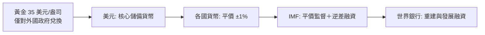

# 第四篇 第九章 第一節：布雷頓森林——「美元錨定黃金，世界錨定美元」

> 1944 年 7 月，44 國 730 名代表聚於新罕布夏州**布雷頓森林**的華盛頓山飯店——**戰火未熄，戰後貨幣秩序已在談判桌上成形**。**凱因斯（英國）與懷特（美國）**的方案交鋒：凱因斯提議**超主權貨幣「班科（Bancor）」**，懷特堅持**美元中心**。最終協定：**美元以 35 美元/盎司兌換黃金，各國貨幣對美元維持 ±1% 平價**——**「黃金–美元–各國貨幣」的三層錨定**。IMF 與世界銀行同時誕生。本節拆解：**一個以「美國黃金庫存」為信用基礎的全球貨幣體系**（詳《金融的故事》8.1–8.2）。

## 一、前因：兩次大戰的貨幣廢墟

1. **戰間期的「貨幣民族主義」**：1930 年代**競相貶值、以鄰為壑**（英國 1931、美國 1933、法國 1936）——納粹的**雙邊清算貿易**更把貨幣變成戰爭工具——**「貨幣秩序＝和平秩序」成為 1944 年的信仰**；
2. **兩份方案的思想對照**：**凱因斯《國際清算聯盟建議書》（1942–43）**——**債權國也要承擔調整責任**（順差國被迫擴張或轉移）；**懷特方案**——**以美元為軸、逆差國承擔調整**——**權力決定了設計**；
3. **美國的物質基礎**：戰後美國**持有全球黃金儲備約三分之二、工業產能約一半**——**「美元本位」不是談出來的，是儲備與產能的現實決定的**。

## 二、機制：三層錨定與兩個機構

1. **「金兌換本位」的精巧與死穴**：**只有美元對黃金負責、其他貨幣對美元負責**——**美國的貨幣政策＝世界貨幣政策**——**特里芬困境（Triffin Dilemma，1960）**：世界需要美元流動性 → 美國必須逆差 → 逆差侵蝕黃金兌換承諾——**體系的邏輯自毀裝置**；
2. **「資本管制的隱含前提」**：體系只在**限制跨國資本流動**下可運轉（懷特與凱因斯都主張管制投機資本）——**「固定匯率＋資本自由流動＋獨立貨幣政策」的不可能三角**當時尚未成為教條（《金融的故事》8.2）；
3. **「IMF 的藥方」**：逆差國以**國際收支貸款＋緊縮條件**換取時間——**「條件性（conditionality）」**成為此後七十年全球南方對 IMF 怨恨與依賴的雙重來源。

## 三、後果

- **「黃金–美元兌換」的倒數**：1958 年歐洲恢復貨幣兌換、美國逆差擴大 → **倫敦金庫市（1961–68）**與戴高樂的「**用美元換黃金**」攻勢 → **1971-08-15 尼克森關閉黃金窗口**（9.2）——**布雷頓森林活了 27 年**；
- **「IMF 與世銀」的制度遺產**：**全球金融治理的兩根柱**——治理結構（配額與投票權）鎖定 1944 年的權力版圖，**至今仍是新興國家改革訴求的核心**（《國家破產的故事》9 章的 IMF 紓困史）；
- **思想的遺產**：**「貨幣秩序需要設計與治理」**——從金本位的「自然秩序」到布雷頓森林的「協商秩序」——**全球化時代的貨幣從此成為政治選擇**，也為 2009 年後「人民幣國際化、數位貨幣、儲備多元化」的討論提供了框架（10.2、11 章）。

---

*下一節：尼克森衝擊——參見 [9.2 尼克森衝擊與法幣時代](09.2-尼克森衝擊與法幣時代.md)*